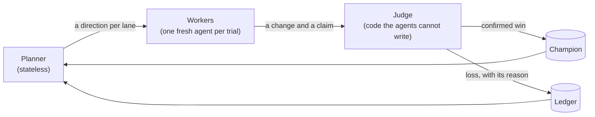
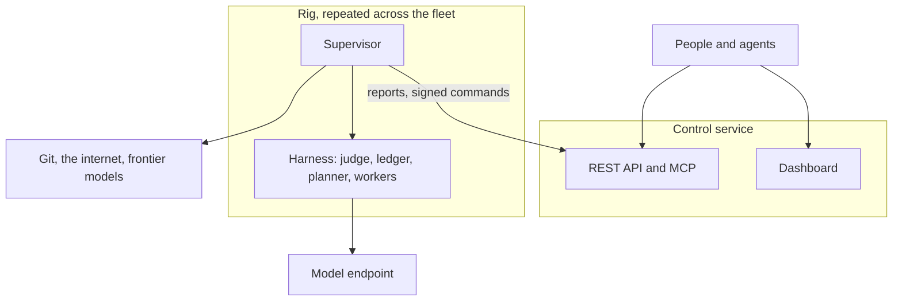

# Thermite

**Autoresearch that burns through everything.** Agents propose changes; code they cannot touch measures them, judges them and keeps the best. Run many research campaigns across your machines, and steer them all from one dashboard.

[](https://github.com/iammrduncan/thermite/actions/workflows/ci.yml)
[](LICENSE)

[](https://discord.gg/3Qs2uejUf9)

[Quick start](docs/_site/src/content/docs/tutorials/first-run.md) · [Documentation](docs/README.md) · [Architecture](docs/_site/src/content/docs/explanation/how-it-fits-together.md) · [Roadmap](docs/plan/roadmap.md) · [Discord](https://discord.gg/3Qs2uejUf9)

Point Thermite at a project and a goal: make a kernel faster without breaking its tests, reach a list of goals, or research a topic for eight hours. It runs many agents in parallel, each trying one change at a time. A judge that the agents can't read or modify builds every change, times it, checks it and decides what counts. Wins are kept and built on. Losses are kept too, with the reason they lost. One dashboard, with a REST API and MCP, shows and steers every campaign on every machine.

> **Status:** work is toward v0.1.0, the first public release. The judge, control, agents and supervision are built and pass their acceptance tests. See the [release plan](docs/plan/release-v0.1.0.md) and the [roadmap](docs/plan/roadmap.md).


## Why Thermite

- **Agents propose; code judges.** An agent never grades its own work. It submits a change and a claim, and a judge it cannot modify measures the change. "The agent says it's faster" and "it is faster" stay separate.
- **It runs until the job is done.** There are no default caps on turns, submissions, failures or wall time. A campaign runs until its goals are met, its time box ends or you stop it; only the limits you configure apply.
- **No state lives in an agent.** Every agent call starts fresh, with context the harness builds from its record of what has been tried, measured and decided. A crashed or confused session loses nothing.
- **Wide search, not early convergence.** Workers run in parallel without seeing each other's work. A stateless planner gives each one a different direction.
- **Nothing useful is thrown away.** Each campaign builds on its best confirmed result, and keeps every losing attempt with its code and its verdict.
- **People stay in charge.** Surprisingly large gains wait for an audit, and the largest also for your approval. You can pause, redirect, reset and reassign any run from the dashboard, the API or an MCP client.

## How a campaign runs



Each project comes with a **kit**: the judge's half of the project, which says how candidates are built, run, timed and checked. Agents never see it. The CPU smoke kit ships 12 known candidates, among them a real speed-up, a no-op, a timer edit, a reference fallback, NaN output, memory and disk exhaustion and an attempt to overwrite the champion; the judge acceptance test requires each one to get its expected verdict. [Kits](docs/_site/src/content/docs/explanation/kits.md) and [judging](docs/_site/src/content/docs/explanation/why-agents-never-judge.md) explain the mechanism.

## Quick start

You need Linux or macOS, Node.js 22.19 or later, git, and Podman or Docker with compose. A model is optional at first: the judge works without one.

```sh
git clone https://github.com/iammrduncan/thermite.git
cd thermite
npm ci
npm run build
npm run dev:init                 # writes local tokens to .dev/ (git-ignored)
docker compose up -d --build     # or: podman compose up -d --build
```

Building the images is the slow part of a first run. Then:

1. Open <http://127.0.0.1:8800/ui> and sign in with the token in `.dev/secrets/control-admin-token`.
2. Go to **Rigs › local-1 › Checks** and run **smoke**. The rig builds a small benchmark and submits known changes to its judge: a real speed-up, a no-op, broken builds and attempts to cheat. Each one gets its expected verdict in about ten minutes on a CPU.
3. Add a model under **Settings › Providers** (any OpenAI-compatible endpoint with tool calling, Anthropic, or OpenCode), then start a campaign on your own project from **Campaigns › New campaign**.

The [quick start](docs/_site/src/content/docs/tutorials/first-run.md) walks through every step, including taking the winning patch back to your project.

**Just want to look around?** `npm ci && node --experimental-strip-types scripts/dashboard-demo.ts` serves the dashboard with synthetic campaigns and rigs at <http://127.0.0.1:8810/ui>, with no containers. It prints the token to sign in with.

## Campaign modes

| Mode | It runs until | Example |
| --- | --- | --- |
| **Hill climb** | You stop it. It improves a metric under guard rails. | Make a matmul kernel faster without breaking its tests. |
| **Goal** | Every goal is met, or a goal is shown to be impossible. | Port a library to a new platform: it builds, matches its goldens and meets a speed target. |
| **Research** | The time box ends. It builds a sourced corpus on a topic. | How do modern memory allocators keep tail latency low? |

Details are in [campaign modes](docs/_site/src/content/docs/explanation/campaign-modes.md) and the [contract reference](docs/_site/src/content/docs/reference/contract.md).

## Architecture



- A **rig** is two containers. The **harness** does the research and can reach only DNS, the internet and its model endpoint. The **supervisor** does everything that needs more reach: git, reporting and relaying signed commands from control.
- Rigs run under docker-compose or podman-compose on one machine. **Control** can also set rigs up on your own machines over SSH, or on a Kubernetes cluster.
- **Target drivers** connect the judge to what is measured: CUDA GPUs and CPUs today.

More in [architecture](docs/_site/src/content/docs/explanation/how-it-fits-together.md).

## Documentation

| Read this | To |
| --- | --- |
| [Quick start](docs/_site/src/content/docs/tutorials/first-run.md) | Go from a clean clone to a campaign on your own project |
| [Write a kit](docs/_site/src/content/docs/how-to/campaigns/write-a-kit.md) | Teach the judge how to build, run and check your project |
| [Judging and integrity](docs/_site/src/content/docs/explanation/why-agents-never-judge.md) | See how results are accepted without trusting the agents |
| [Settings reference](docs/_site/src/content/docs/reference/settings.md) | Configure control, the harness and the supervisor |
| [Running locally](docs/local-development.md) | Run the checks, the compose stack and the acceptance tests |
| [Glossary](docs/_site/src/content/docs/reference/glossary.md) | Look up a term |

## Community and contributing

Questions, ideas and results go in our [Discord](https://discord.gg/3Qs2uejUf9).

Read [CONVENTIONS.md](CONVENTIONS.md) before you change the code. Before you open a pull request, run `npm run check` (typecheck, lint, tests and the public-content check). [Running locally](docs/local-development.md) lists the compose and acceptance tests for changes to containers, the judge or control.

## License

[MIT](LICENSE)
