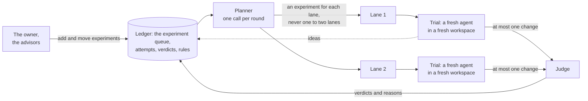
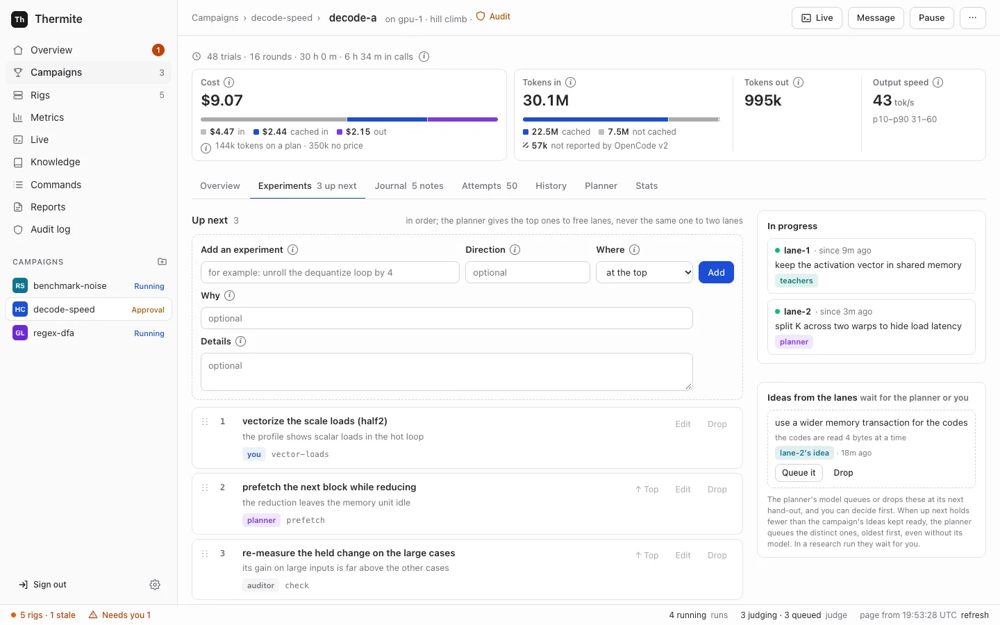

A rig does its research with AI agents, but no agent is in charge of the search, and no agent remembers it. This page explains how Thermite shares the work out among **lanes**, **trials** and a **planner**, how one **experiment queue** for each run holds what to try next, and why every agent starts with a fresh context.

The words here are in the [glossary](../reference/glossary.md). [Why agents never judge](why-agents-never-judge.md) covers what happens to a change after an agent submits it.

## From campaign to attempt

Thermite's work nests in five levels:

| Level | What it is |
| --- | --- |
| **Campaign** | One piece of research and its [contract](../reference/contract.md): what to improve or reach, and how it is judged |
| **Run** | The campaign at work on one rig, from one starting commit. A rig works on one run at a time |
| **Lane** | One line of search inside a run, with its own operating-system user, build cache and best result |
| **Trial** | One agent, starting fresh, working on one experiment from the run's queue for a set time. It submits at most one change, and may propose ideas for the queue |
| **Attempt** | The change a trial submits. The judge measures it and gives a verdict |

An **experiment** is one thing to try: a short title, some details, its **direction** (a named approach, such as `loop-tiling`) and why it is worth trying. Each run keeps its experiments in one queue, described [below](#the-experiment-queue).

Work is organised in **rounds**. At the start of each round, the planner gives every lane an experiment for its next trial. Then each lane runs a few trials, one after another (three by default), and each later trial takes the next experiment from the queue. When every lane has run its trials and the judge has settled their attempts, the next round is planned. The dashboard's own words say "round"; the contract's settings, the harness's records, the workers' briefs and the planner's lines in Live call a round an **epoch**.

The contract says how many lanes a run has (two by default). On the **New campaign** page, this is **Agents working at once**. How many trials a rig runs at the same moment is a setting of the rig: **Workers at a time** on its **Edit rig** page, one by default. When a run has more lanes than that, the lanes take turns.

A lane's next trial starts only after the judge has settled the change from its previous trial, so each trial can learn from the verdict before it. Rules like this make work wait; they never end it ([Why Thermite runs until the job is done](runs-until-done.md)). The [limits and pacing reference](../reference/limits-and-pacing.md#trials-and-lanes) gives every value.

## The experiment queue

Each run has one **experiment queue**: the experiments still to try, in order, and a log of the experiments already tried, with what became of each. It is the run's shared memory of what to try and what was tried. The planner, the advisors, the lanes and the owner all work from it, and it shows on the run's **Experiments** tab.

An experiment is always in one of five states:

| State | Where the **Experiments** tab shows it | What it means |
| --- | --- | --- |
| `proposed` | **Ideas from the lanes** | A lane's idea. It waits until the planner or the owner queues it or drops it |
| `queued` | **Up next** | Waiting for a lane, in order |
| `assigned` | **In progress** | A lane's trial works on it, so no other lane can get it |
| `done` | **Tried** | Its trial ended: with its attempt and the judge's verdict, or with no attempt and why |
| `dropped` | **Tried** | Someone dropped it, and said why. It stays in the log |

The queue is research state, so it lives in the harness's ledger, like the attempts and verdicts. Every change writes the experiment and one event, with who made it, in one step. Control builds the **Experiments** tab from those events, as it builds everything else from the rig's signed reports ([How the parts fit together](how-it-fits-together.md#the-experiment-queues-records)).

### Where experiments come from

- **The owner** adds experiments, moves them, edits them and drops them, and queues or drops the lanes' ideas: on the **Experiments** tab, or with the commands `queue_add`, `queue_move`, `queue_edit`, `queue_drop` and `queue_accept` over the REST API, the command line or MCP. Editing is only over those three. Each is a [signed command](../reference/signed-commands.md) in the owner's name. An operator's token, which the owner gives an agent that runs campaigns for them, may send them too; an agent's token can't.
- **The planner** adds experiments, moves them, drops them and queues the lanes' ideas, each with why. When the queue has nothing for a lane, the fixed rules add one ([below](#when-there-is-no-planner-answer)).
- **The advisors:** the teacher pair adds experiments and moves queued ones, from its reviews and its outside reading. The auditor can put a check at the top of the queue when it doubts a result that it can't settle. Advisors never drop an experiment or give out work ([Supervision](supervision.md#the-teacher-pair-and-the-combiner)).
- **The lanes:** a worker that sees something worth trying beyond its own experiment proposes it as an **idea**, with `thermite-trial idea` in OpenCode and Claude Code, or the `idea` tool in Pi. Its trial goes on. The idea waits as `proposed`.
- **Another run:** **Start a run** can copy the untried experiments of another run of the same campaign into the new run's queue: up next in order, then the lanes' ideas, each with who added it and why. The tried ones stay with their run.
- **The research plan,** in a research run ([Research campaigns](#research-campaigns)).

[Choose what a run tries next](../how-to/campaigns/choose-what-runs-next.md) shows the owner's side, step by step.

### Why one queue, with the planner as its coordinator

Before the queue, the plan existed only for the current round and was made again every round. The advisors' ideas reached the planner only as rules, a worker's idea was lost when its trial ended, and the owner could not see or change what came next. On one long campaign, the planner's model answer was refused in most rounds, so the fixed fallback plan did most of the planning.

The owner wanted one list of all the upcoming experiments and of those already tried, which they can see and change, and a planner that is "really a coordinator that divvies out the work to lanes and makes sure things don't overlap" ([goal 064](https://github.com/iammrduncan/thermite/blob/main/docs/plan/goals/064-experiment-queue.goal)). A queue that keeps its order and its reasons between rounds does both:

- **The planner's job gets smaller.** It gives out the next work without overlap, instead of inventing a whole plan each round, so there is less for its answer to get wrong.
- **Everyone's ideas stay visible.** An idea from an advisor, a lane or the owner sits in one place, with who added it and why, until someone tries it or drops it.
- **The memory stays with the harness.** The planner remains a fresh model call with no memory of its own. The queue is its memory, and the harness keeps it.

## The planner

The **planner** coordinates the lanes. It is one model call at the start of each round, with no memory of its own. Each time, the harness builds its input from the ledger:

- the objective, the champion, the approach families tried and their verdicts, recent attempts from every lane, and each lane's best result;
- the queue: up next in order, the lanes' ideas, what each lane is on now, and the newest experiments tried, with the judge's verdict and change for each attempt;
- each lane's last direction and experiment;
- the rules in force, including rules in the owner's own words;
- the owner's messages to the planner and to everyone working that it has not read yet, each with its number;
- in a goal campaign, the judge's latest report on which goals the champion meets.

A message counts as read by the planner only when its model answered. While the planner is switched off, or its model can't be reached, the owner's messages wait for the next plan. A message kept in force is not repeated in later plans: it is kept for the workers' briefs.

The planner answers with:

- **an experiment for each lane:** one from up next, a lane's idea, one it adds in the same answer, or a new one described in place; a starting point, either the champion or the lane's own best result; and why;
- **changes to the queue,** each with why: experiments to add, queued ones to move or drop, and ideas to queue or drop;
- **rules that an owner's message asks for,** such as "stop trying tiling". Each records the message it came from;
- new approach families, each with a short description. The planner makes up families as it goes.

### What code checks

Code checks the answer before anything changes. It refuses an answer that:

- doesn't give every lane exactly one experiment;
- gives out an experiment that is not up next, not a lane's idea and not added in the same answer, such as one in progress or one already tried;
- gives out an experiment that the same answer drops;
- gives the same experiment to two lanes;
- has a lane build on its best result when it has none yet;
- gives out an experiment in a direction that an **Avoid** rule names, or gives no lane one in a direction that an **Always** rule names;
- moves an experiment that isn't queued, drops one that isn't queued or an idea, or queues something that isn't an idea;
- adds a rule for a message that wasn't in its input.

A refused answer goes back to the model once, with the errors. If the second answer fails too, or the model can't be reached, the lanes take work by the fixed rules below. Planner trouble never pauses research.

Code checks the **Avoid** and **Always** rules that name a direction. A rule in plain words, such as "anything that uses shared memory", is for the model to apply: it is told to treat those words like a direction's name. Code doesn't check them, and the fixed rules don't use them.

A good answer is then applied in order: ideas queued and experiments dropped, new ones added, moves, the new rules, and last the hand-out. If the queue changed since the planner read it, for example because the owner moved or dropped that experiment in the meantime, the change is skipped, and the hand-out says so. A lane whose experiment can no longer be given out takes one by the fixed rules. Each **hand-out**, what went to which lane and why, is recorded. The run's **Planner** tab lists the hand-outs under **What the planner did**.

### When there is no planner answer

With the **Planner** switch off on **Edit rig**, when the planner's model can't be reached, or after a refused answer, the lanes take queued experiments by fixed rules:

1. A direction that an **Always** rule names, with nothing queued or in progress in it, gets an experiment at the top of the queue, so that a lane can keep to the rule.
2. Each lane takes the next queued experiment in order, skipping directions that an **Avoid** rule names. Directions that an **Always** rule names come first, then those that a **Try** rule names, then the rest.
3. Among the next few experiments of that rank (as many as the run has lanes), a lane takes one in its own last direction, if there is one.
4. Only when the queue has nothing for a lane do the fixed rules add an experiment for it: in an **Always** direction first, then a **Try** direction, then the least-tried one.

A lane prefers its last direction because that is where it has learned the most. Its worker's brief carries the lane's own recent attempts with the judge's reasons, and the lane may build on its own best result, so a next experiment in the same direction can use both. The lane reaches only a few places down the queue for it, so the queue's order mostly holds.

The same rules give out work within a round. A lane's first trial takes the experiment the round gave it. Each later trial takes the next experiment by the fixed rules, as a hand-out of its own, and leaves alone the experiments given to other lanes that have not started on them yet.

The planner uses the workers' model unless it has a model of its own on **Edit rig**. When the **Planner** switch there is off, the lanes take the queue by the fixed rules every round, and a message to the planner is refused, because nothing would read it. The run's **Live** view, under its **Planner** filter, shows each plan, as "planned by the model" or "taken from the queue by the fixed rules", and the run's **History** tab records each round.

### Directives

A **directive** is a recorded instruction that steers the planner. It comes from the owner, from the supervisor's teacher pair, or from the planner itself when an owner's message asks for a rule. It can tell the planner to avoid a direction, try it, always assign it or rank it, use fewer lanes, or note something. An avoid, try or always directive names a direction by its name, such as `loop-tiling`, or, from the owner and the planner, in plain words.

The owner's directives come first: a teacher's or the planner's directive about a family the owner has a directive for does not apply. A directive's reasons and notes are for the planner only; workers never see them. A directive can steer the search, but it can never change a verdict.

The dashboard calls directives **rules**. A run's **Planner** tab lists the rules in force, with who set each and why; a rule the planner added shows the message it came from. **Add a rule** takes the direction in your own words: words shaped like a direction's name, such as `loop-tiling`, are sent as that name, and anything else as plain words. **Remove** takes a rule out of force, whoever set it. The teachers' next set replaces their last one, so a teacher's rule comes back if they recommend it again. [Choose what a run tries next](../how-to/campaigns/choose-what-runs-next.md) shows how, and [Supervision](supervision.md) explains the teachers.

### Lane bests and fork rounds

A **lane best** is a lane's own judged win against the current champion that has not become the champion. The planner can tell a lane to build on it, so a promising line of work can go on before it is confirmed. It is dropped when the champion moves, when its win does not hold up, or when it becomes the champion.

Lanes that keep building on their own results can drift into a dead end. So on a fixed schedule there is a **fork round**: every lane's best is cleared, and every lane starts again from the champion. With a wall-time budget, fork rounds come at one third and two thirds of it; without one, every 20 rounds.

## One trial

A trial is where an agent works. Each one follows the same path:

1. **A fresh workspace.** The harness copies the starting point's files into a new one-commit git repository, owned by the lane's user. The agent never sees the project's history or other lanes' work. Only the lane's build cache carries over between trials.
2. **A brief from the ledger.** The agent gets its direction, and its experiment: **Focus** (the title), **Details** and **Why it is worth trying**. Then come the objective, the files it may change, its starting point, and the last few attempts of its own lane with the judge's reasons. Then come the owner's messages, under two headings. The first holds the messages kept in force, to everyone working or to this lane: every new trial's brief carries them until the owner removes them. The second holds the messages the lane has not read yet: to the lane, to everyone working, or to an earlier trial of the lane that ended before it read them (the agent is told so).
3. **A fresh agent session.** The agent runs in the rig's worker harness: Pi (built in), OpenCode v2 or Claude Code. In Pi it uses Thermite's own tools; in the others, that program's tools plus the [`thermite-trial`](../reference/command-line.md#thermite-trial) command.
4. **One submission.** The agent submits its change to the allowed files, with its hypothesis and any flaws it knows of, and the trial ends there. It also ends when its time is up (**One trial lasts (minutes)** on **Edit rig**, unless the contract sets it), at a turn limit if someone set one, or when the agent stops. Along the way, the agent may propose ideas for the queue; that doesn't end the trial.
5. **Clean-up.** The trial's token stops working, its processes are stopped, its development runs finish, and its workspace is deleted. Its experiment is then done, with its attempt or the reason there is none. A trial that was interrupted (by a pause, **Restart the lanes** or a harness restart) or that failed with an error didn't really try its experiment: a copy goes back to the top of the queue, by the same author, with why.

An experiment's text reaches the worker whoever added it: the owner, the planner, an advisor or another lane. It is what to try, not a verdict, and the judge measures the result like any other change.

The owner can also write to a lane while its trial runs. A Pi worker reads the message at its next step, between two calls to the model. OpenCode and Claude Code take no message into a run that is under way: when the agent's current run ends without a submission, the harness continues the session with the message. After a submission, no worker takes a message. The lane's next trial reads it in its brief, where it can still act on it. [How the parts fit together](how-it-fits-together.md#the-owners-messages) has the whole picture.

A **development run** is an agent's own run of a command on the device the judge measures on, to test or profile its change. Its numbers are marked "diagnostic only" and never count. [Sharing a device](sharing-a-device.md) explains how the judge and the agents take turns.

## Why every agent starts fresh

Thermite's rule is that **the harness owns all research state**. Every agent call, worker or planner, starts fresh from context that the harness builds out of its ledger. There are three reasons:

- **Nothing is lost when a session goes wrong.** A crashed, confused or stuck session holds no state, so it can simply end. The next trial starts from what the judge recorded, not from what the last agent believed. After a harness restart, unfinished trials are marked as interrupted, their experiments go back to the top of the queue, and the next plan is built from the same ledger.
- **Wide search, not early convergence.** Each worker sees only its own lane's attempts, so lanes do not all chase the first idea that worked. The planner is the one place that sees every lane and the whole queue, and it decides from the record, not from a conversation it has been part of for hours.
- **What carries forward is what the judge confirmed.** A worker learns from verdicts and the judge's reasons, never from another agent's account of its own success.

The cost is repeated reading. Each trial reads the relevant code again, which takes time and model tokens, and an insight the agent neither put in its hypothesis nor proposed as an idea is gone when the trial ends. The lane's build cache and the judge's reasons in each brief keep that cost down. The queue does the same for the planner: what to try next, and what was tried, carry over between rounds in the ledger, not in any agent.

## Research campaigns

A research campaign has no project to change and no judge to wait for, so its lanes work differently:

- **Research tasks are experiments.** There is no planner call, and no planner to message. A research task is an experiment in the run's queue: its direction is a kind of task (explore, find primary sources, look for contradictions, or consolidate), and its details hold one of the campaign's questions. At the start of each round, when the queue holds fewer tasks than the run has lanes, the **research plan** adds tasks: the least-covered questions first, with the kinds of task in turn, and primary sources and contradictions first when an hour passed with nothing new. Each lane then takes the next task in queue order, whoever added it, the owner and the teachers as much as the plan. There is no preference for a lane's last direction.
- **Rules on kinds of task.** Rules apply to task kinds as to directions: **Avoid** removes a kind, **Always** and **Try** put it first, and a try or always rule with a question's number puts that question first in the plan's tasks.
- **Rounds set by the research plan.** The record of each round says the research plan set it (`plan: "research"`), so the run's **History** tab reads "The research plan set round N", the agent figures on its **Planner** tab count **Rounds** "set by the research plan", and each round's hand-out shows there too. A message to everyone working reaches the lanes only. A model planner for research is planned in [goal 047](https://github.com/iammrduncan/thermite/blob/main/docs/plan/goals/047-research-planner.goal).
- **Trials back to back.** A lane's trials run one after another without waiting for a verdict. A trial's brief gives its task as its focus, with why.
- **Different tools.** Research workers fetch and archive pages, search what was archived, and record claims with exact quotes and findings, which code then checks. In Pi they have the research tools and file tools, and no shell. In OpenCode v2 they keep OpenCode's own tools and run the research tools as `thermite-trial research` commands. Claude Code doesn't run research workers. A research worker can propose another task as an idea, too. With no planner model to take it, the idea waits for the owner.
- **A folder that carries over.** Each run has a research folder. The harness writes what the run has learned into it from its records: the archived pages as text, every claim, finding, hypothesis and note, an index and the newest report. Each lane also has a working area there, kept for its next trial and shown to the other lanes when a trial ends. Every trial is still a fresh session; what carries over is files the harness keeps, not the agent's memory.

[Campaign modes](campaign-modes.md) explains how research is checked and when it ends.
