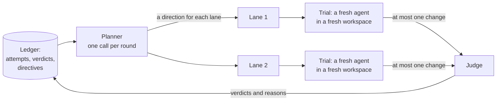

A rig does its research with AI agents, but no agent is in charge of the search, and no agent remembers it. This page explains how Thermite shares the work out among **lanes**, **trials** and a **planner**, and why every agent starts with a fresh context.

The words here are in the [glossary](../reference/glossary.md). [Why agents never judge](why-agents-never-judge.md) covers what happens to a change after an agent submits it.

## From campaign to attempt

Thermite's work nests in five levels:

| Level | What it is |
| --- | --- |
| **Campaign** | One piece of research and its [contract](../reference/contract.md): what to improve or reach, and how it is judged |
| **Run** | The campaign at work on one rig, from one starting commit. A rig works on one run at a time |
| **Lane** | One line of search inside a run, with its own operating-system user, build cache and best result |
| **Trial** | One agent, starting fresh, working on one idea in its lane for a set time. It submits at most one change |
| **Attempt** | The change a trial submits. The judge measures it and gives a verdict |

Work is organised in **rounds**. At the start of each round, the planner gives every lane a direction. Then each lane runs a few trials in that direction, one after another (three by default). When every lane has run its trials and the judge has settled their attempts, the next round is planned. The dashboard's own words say "round"; the contract's settings, the harness's records and the planner's lines in Live call a round an **epoch**.

The contract says how many lanes a run has (two by default). On the **New campaign** page, this is **Agents working at once**. How many trials a rig runs at the same moment is a setting of the rig: **Workers at a time** on its **Edit rig** page, one by default. When a run has more lanes than that, the lanes take turns.

A lane's next trial starts only after the judge has settled the change from its previous trial, so each trial can learn from the verdict before it. Rules like this make work wait; they never end it ([Why Thermite runs until the job is done](runs-until-done.md)). The [limits and pacing reference](../reference/limits-and-pacing.md#trials-and-lanes) gives every value.

## The planner

The **planner** is one model call at the start of each round, with no memory of its own. Each time, the harness builds its input from the ledger: the objective, the champion, the approach families tried and their verdicts, recent attempts from every lane, the directives in force, each lane's best result, and the owner's messages to the planner and to everyone working that it has not read yet. In a goal campaign it also gets the judge's latest report on which goals the champion meets.

A message counts as read by the planner only when its model answered. While the planner is switched off, or its model can't be reached, the owner's messages wait for the next plan. A message kept in force is not repeated in later plans: it is kept for the workers' briefs.

The planner answers with one plan. For each lane it gives an **approach family** (a named direction, such as `loop-tiling`), a concrete focus, and a starting point: the champion, or the lane's own best result. The planner makes up new families as it goes, each with a short description. A directive may also name a family the planner has not used yet; the planner then reads the directive's reasons to learn what it means.

Code then checks the plan. Every lane must get exactly one assignment, and the plan must obey the directives: a family under an avoid directive is never assigned, and one marked always (`mandate`, **Always** on the dashboard) always is. A plan that breaks a rule goes back to the model once, with the errors. If the second try fails too, or the model can't be reached, the harness uses its **fallback plan**: mandated families first, then families to try, then the least-tried ones. Planner trouble never pauses research.

The planner uses the workers' model unless it has a model of its own on **Edit rig**. When the **Planner** switch there is off, every round gets the fallback plan, and a message to the planner is refused, because nothing would read it. The run's **Live** view, under its **Planner** filter, shows each plan and who made it, and the run's **History** tab records each round.

### Directives

A **directive** is a recorded instruction that steers the planner, from the owner or from the supervisor's teacher pair. It can tell the planner to avoid a family, try it, always assign it or rank it, use fewer lanes, or note something.

The owner's directives come first: a teacher's directive about a family the owner has a directive for does not apply. A directive's reasons and notes are for the planner only; workers never see them. A directive can steer the search, but it can never change a verdict.

The dashboard calls directives **rules**. A run's **Planner** tab lists the rules in force, with who set each and why, and **Add a rule** adds one for a direction by its name, such as `loop-tiling`. [Steer a run](../how-to/campaigns/steer-a-run.md) shows how to give one, and [Supervision](supervision.md) explains the teachers.

### Lane bests and fork rounds

A **lane best** is a lane's own judged win against the current champion that has not become the champion. The planner can tell a lane to build on it, so a promising line of work can go on before it is confirmed. It is dropped when the champion moves, when its win does not hold up, or when it becomes the champion.

Lanes that keep building on their own results can drift into a dead end. So on a fixed schedule there is a **fork round**: every lane's best is cleared, and every lane starts again from the champion. With a wall-time budget, fork rounds come at one third and two thirds of it; without one, every 20 rounds.

## One trial

A trial is where an agent works. Each one follows the same path:

1. **A fresh workspace.** The harness copies the starting point's files into a new one-commit git repository, owned by the lane's user. The agent never sees the project's history or other lanes' work. Only the lane's build cache carries over between trials.
2. **A brief from the ledger.** The agent gets its direction and focus, the objective, the files it may change, its starting point, and the last few attempts of its own lane with the judge's reasons. Then come the owner's messages, under two headings. The first holds the messages kept in force, to everyone working or to this lane: every new trial's brief carries them until the owner removes them. The second holds the messages the lane has not read yet: to the lane, to everyone working, or to an earlier trial of the lane that ended before it read them (the agent is told so).
3. **A fresh agent session.** The agent runs in the rig's worker harness: Pi (built in), OpenCode v2 or Claude Code. In Pi it uses Thermite's own tools; in the others, that program's tools plus the [`thermite-trial`](../reference/command-line.md#thermite-trial) command.
4. **One submission.** The agent submits its change to the allowed files, with its hypothesis and any flaws it knows of, and the trial ends there. It also ends when its time is up (**One trial lasts (minutes)** on **Edit rig**, unless the contract sets it), at a turn limit if someone set one, or when the agent stops.
5. **Clean-up.** The trial's token stops working, its processes are stopped, its development runs finish, and its workspace is deleted.

The owner can also write to a lane while its trial runs. A Pi worker reads the message at its next step, between two calls to the model. OpenCode and Claude Code take no message into a run that is under way: when the agent's current run ends without a submission, the harness continues the session with the message. After a submission, no worker takes a message. The lane's next trial reads it in its brief, where it can still act on it. [How the parts fit together](how-it-fits-together.md#the-owners-messages) has the whole picture.

A **development run** is an agent's own run of a command on the device the judge measures on, to test or profile its change. Its numbers are marked "diagnostic only" and never count. [Sharing a device](sharing-a-device.md) explains how the judge and the agents take turns.

## Why every agent starts fresh

Thermite's rule is that **the harness owns all research state**. Every agent call, worker or planner, starts fresh from context that the harness builds out of its ledger. There are three reasons:

- **Nothing is lost when a session goes wrong.** A crashed, confused or stuck session holds no state, so it can simply end. The next trial starts from what the judge recorded, not from what the last agent believed. After a harness restart, unfinished trials are marked as interrupted, and the next plan is built from the same ledger.
- **Wide search, not early convergence.** Each worker sees only its own lane's attempts, so lanes do not all chase the first idea that worked. The planner is the one place that sees every lane, and it decides from the record, not from a conversation it has been part of for hours.
- **What carries forward is what the judge confirmed.** A worker learns from verdicts and the judge's reasons, never from another agent's account of its own success.

The cost is repeated reading. Each trial reads the relevant code again, which takes time and model tokens, and an insight the agent did not put in its hypothesis is gone when the trial ends. The lane's build cache and the judge's reasons in each brief keep that cost down.

## Research campaigns

A research campaign has no project to change and no judge to wait for, so its lanes work differently:

- **Planning by fixed rules.** There is no planner call, and no planner to message. Each round gives every lane a kind of task (explore, find primary sources, look for contradictions, or consolidate) and a question, the least-covered first. Directives still reorder or remove task kinds. The record of each round says the research plan set it (`plan: "research"`), so the run's **History** tab reads "The research plan set round N", and the agent figures on its **Planner** tab count **Rounds** "set by the research plan". A message to everyone working reaches the lanes only. A model planner for research is planned in [goal 047](https://github.com/iammrduncan/thermite/blob/main/docs/plan/goals/047-research-planner.goal).
- **Trials back to back.** A lane's trials run one after another without waiting for a verdict.
- **Different tools.** Research workers fetch and archive pages, search what was archived, and record claims with exact quotes and findings, which code then checks. In Pi they have the research tools and file tools, and no shell. In OpenCode v2 they keep OpenCode's own tools and run the research tools as `thermite-trial research` commands. Claude Code doesn't run research workers.
- **A folder that carries over.** Each run has a research folder. The harness writes what the run has learned into it from its records: the archived pages as text, every claim, finding, hypothesis and note, an index and the newest report. Each lane also has a working area there, kept for its next trial and shown to the other lanes when a trial ends. Every trial is still a fresh session; what carries over is files the harness keeps, not the agent's memory.

[Campaign modes](campaign-modes.md) explains how research is checked and when it ends.
