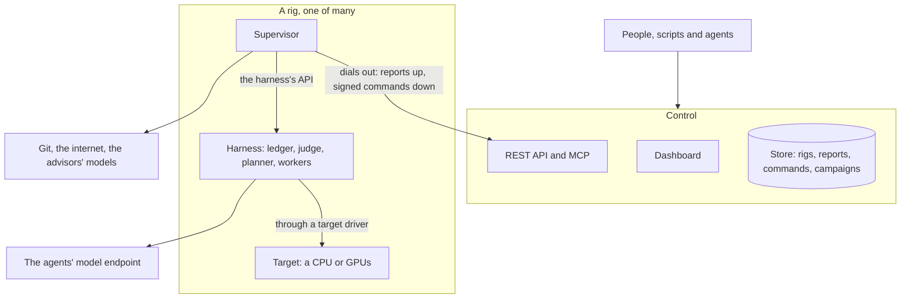
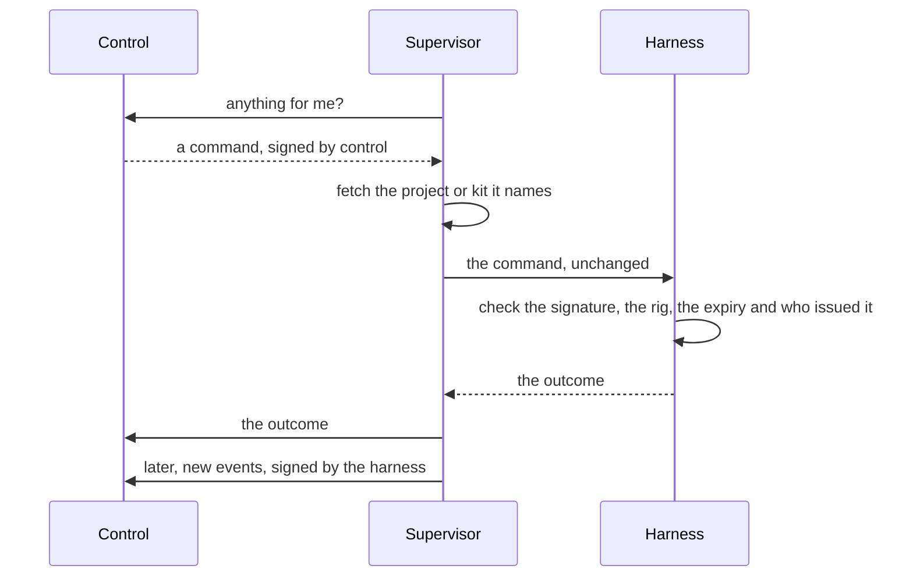

Thermite has three parts. **Control** is one central service that shows and steers everything. A **rig** does the research, and a rig is two containers. **Target drivers** connect a rig's judge to the hardware that the work is measured on. This page explains what each part does, how they talk to each other and where they can run, and why Thermite is split this way. The [glossary](../reference/glossary.md) explains any Thermite word that this page does not.

## Control

Control is the one place where people, scripts and AI agents watch and steer the work. It serves a **dashboard** for people, a **REST API** for scripts and an **MCP server** for AI agents. Its **store** keeps what the rigs report, the commands sent to them, and the campaigns, kits, providers and machines you give it, with every key sealed.

Control measures nothing and decides no verdict. It shows what the rigs report and passes on what people decide, as commands that it signs with a key of its own. A decision that only the owner may make, such as approving a promotion, names the owner inside the signed command, and the rig checks that again.

There is one control service, with one store. That keeps every campaign in one place and makes control simple to run. The price is that steering waits while control is down; the research does not (see [How they talk](#how-they-talk)). [The REST API](../reference/rest-api.md), [the MCP tools](../reference/mcp-tools.md) and [Tokens and roles](../reference/tokens.md) say what each way in offers and who may use it.

## A rig

A rig is one **harness** container and one **supervisor** container, with the devices that it measures on. A rig works on one **run** (one campaign on this rig) at a time, and one machine can host several rigs.

The two containers are split by what they are trusted with. The harness runs code that agents wrote, so it gets as little reach as possible. The supervisor holds the rig's credentials for git and for control, and no worker's or candidate's code ever runs in it.

### The harness: where the research happens

- **The ledger:** the rig's own database, and the authority on everything that happened: campaigns, runs, attempts, measurements, verdicts, champions and steering.
- **The judge:** it builds each submitted change, measures it against the champion, gives the verdict and promotes winners.
- **The scheduler and the planner:** they split each run into **lanes**, plan each round of work, and start **trials**.
- **Workers:** one fresh agent session per trial. Each runs in the rig's **worker harness**, the program that gives the model its tools (Pi, OpenCode v2 or Claude Code), and works in its own copy of the code.
- **A small broker,** the only part that runs as root. It starts every other process as its own operating-system user, so no agent, build or measured run can read the judge's files.

The judge, the scheduler and the exports run as separate loops, so a slow model call never holds up a measurement. The harness's API needs a token for everything but a health check, and the only part of Thermite that calls it from outside is the rig's own supervisor. The harness's own connections go out to its model endpoint and the internet.

[Agents, lanes and the planner](agents-lanes-planner.md) and [Isolation inside a rig](isolation.md) go deeper.

### The supervisor: the rig's link to everything else

The supervisor connects the rig to the outside. It runs five loops side by side, so a slow one never holds up the others:

- **Reports:** it sends the harness's new events to control, pushes the rig's results to git and uploads each new champion's patch to control, once a minute by default.
- **Commands:** it fetches control's pending commands, fetches any project, kit or champion they name, and hands them to the harness. It asks every 5 seconds by default, so a pause or a message lands quickly.
- **Live view:** it sends the harness's newest live lines to control, for the rig's live view on the dashboard (**Live** in the sidebar).
- **Model route:** it hands the harness the agents' model and key chosen on control, by the owner or an operator's agent.
- **Advisors:** it runs the teachers, the auditor and the review panel, but only those the rig is given, in an advisors file or as models on the rig's **Edit rig** page. [Supervision](supervision.md) explains them.

The supervisor does all of the rig's git work. It holds no signing key: it carries commands in and reports out, but it cannot write either one. [Trust between control and rigs](trust.md) explains how that is checked, and [the settings reference](../reference/settings.md#how-often-it-talks-to-control) lists each loop's interval.

## Targets and drivers

A **target** is what a campaign is measured on. The judge reaches it through a **target driver**. Thermite has drivers for CPUs (`cpu`) and for NVIDIA GPUs (`cuda-gpu`). A rig with GPUs measures on `cuda-gpu`, and a rig without measures on `cpu`.

A driver identifies the device, so that results from different devices are never compared. It checks that the device is idle and healthy before every timed block, and reports anything that spoiled a block, such as a GPU too hot to keep its speed, so the block is measured again. It does not hold the clock: the broker times every measured run from outside, so nothing a change prints about itself is ever its score.

Each kit names the one kind of target it measures on, and a rig accepts only a kit for its own kind. [Kits and rigs, side by side](kits-and-rigs.md) explains how the two meet, and [Sharing a device](sharing-a-device.md) explains when the judge and the agents share one device and when each has its own. Drivers for other hardware, such as boards on a serial line, are planned in [goal 052](https://github.com/iammrduncan/thermite/blob/main/docs/plan/goals/052-more-target-drivers.goal).

## How they talk

**Everything starts from the rig.** The supervisor dials out to control: it sends reports and asks for commands. Control never opens a connection to a rig's containers, and the supervisor listens on no port. A rig only has to be able to reach control, so it can sit behind a home router or a firewall that lets connections out but not in.

- **Commands go in signed.** The harness checks each one before it acts on it. A command that brings content, such as a project, a kit or another rig's champion, names that content by its git commit or its hash. The supervisor fetches it, and the harness accepts it only if it matches.
- **Reports come out signed.** The harness signs its events with the rig's own key. Control pins that key at the rig's first report, or holds it until the owner accepts it. It takes a report only if it follows on from the ones it already has. So the supervisor relays reports, but it cannot forge, replay or skip events.
- **Results go to git.** At most once an hour by default, when something new happened, the harness writes an export: its new events, its ledger without the hidden test results, and each new attempt and champion as a patch. The supervisor pushes it to the rig's results repository, when the rig has one. [Set up the results repository](../how-to/operate/results-repository.md) shows how. Rigs that control sets up on machines and clusters, and joined rigs, have none yet ([goal 061](https://github.com/iammrduncan/thermite/blob/main/docs/plan/goals/061-gaps-found-by-the-docs.goal)).

**A rig keeps researching when control is down.** The harness has everything it needs for the run it has: the project, the kit, the model route and its own ledger. Reports and commands wait, and catch up when control is back. (One exception: a rig whose agents use a ChatGPT sign-in gets a one-hour access token, and only control renews it.)

To set up and manage a rig, control does connect to the machine over SSH, or to the cluster's API. That reaches the machine or the cluster, never the rig's containers.

## Where rigs run

The same two images run in each of these ways, and every rig reports to control in the same way, by dialing out:

| Way | What it is | Who sets it up and manages it |
| --- | --- | --- |
| **Compose, on one computer** | Control and a CPU rig, `local-1`, in one stack; a second rig is optional | You, with `docker compose`, `podman compose` or podman-compose |
| **A machine, over SSH** | The two containers as systemd services, so the rig survives logouts and reboots | Control, from **Rigs › Add a rig** and the rig's page |
| **A Kubernetes cluster** | The two containers in two pods on one node, in a namespace control creates or one the cluster's operators made for Thermite | Control, from **Rigs › Add a rig** and the rig's page |
| **Joined by you** | The same as the two ways above, for a machine or namespace that control cannot connect to | You: a one-time join command sets it up, and the rig's page shows the commands to manage it |

GPU rigs under compose are not built yet ([goal 037](https://github.com/iammrduncan/thermite/blob/main/docs/plan/goals/037-gpu-compose.goal)). Control can start short test pods on RunPod to check a GPU there, but rigs on RunPod are still being built ([goal 019](https://github.com/iammrduncan/thermite/blob/main/docs/plan/goals/019-rig-only-entry.goal)).

The how-to guides give the steps for each way: [Install Thermite on one machine](../how-to/install/one-machine.md), [Add a rig on a machine over SSH](../how-to/install/rig-on-a-machine.md), [Add a rig on a Kubernetes cluster](../how-to/install/rig-on-a-cluster.md) and [Join a rig yourself](../how-to/install/join-a-rig.md). [Stop, restart, remove or reset a rig](../how-to/operate/rig-lifecycle.md) explains what each of those keeps.

## Where to read more

- Models and keys: [Connect a model provider](../how-to/models/connect-a-provider.md) and [Who holds your keys](who-holds-your-keys.md).
- GPUs: [Give a rig several GPUs](../how-to/install/several-gpus.md).
- Every setting, port, volume and secret file: [Settings](../reference/settings.md) and [Ports, volumes and secret files](../reference/ports-volumes-secrets.md).
