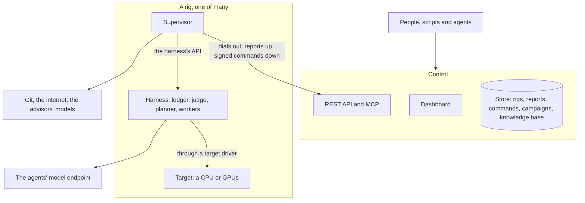
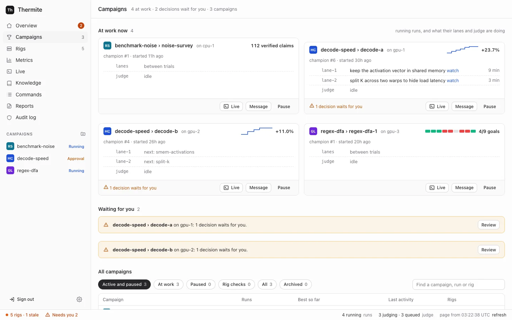
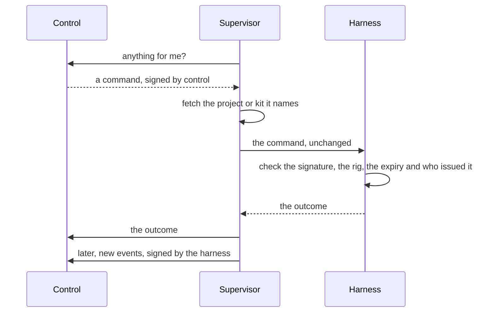
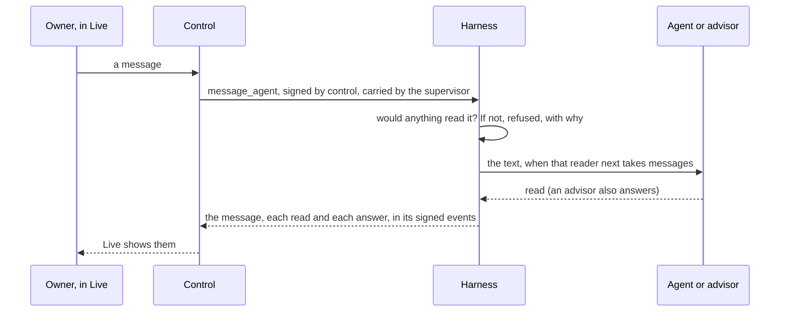

Thermite has three parts. **Control** is one central service that shows and steers everything. A **rig** does the research, and a rig is two containers. **Target drivers** connect a rig's judge to the hardware that the work is measured on. This page explains what each part does, how they talk to each other and where they can run, and why Thermite is split this way. The [glossary](../reference/glossary.md) explains any Thermite word that this page does not.

## Control

Control is the one place where people, scripts and AI agents watch and steer the work. It serves a **dashboard** for people, a **REST API** for scripts and an **MCP server** for AI agents. Its **store** keeps what the rigs report, the commands sent to them, and the campaigns, kits, providers and machines you give it, with every key sealed. It also keeps **Thermite's knowledge base**: a folder for each campaign, built from what the campaign's runs report ([The knowledge base](#the-knowledge-base)).

Control measures nothing and decides no verdict. It shows what the rigs report and passes on what people decide, as commands that it signs with a key of its own. A decision that only the owner may make, such as approving a promotion, names the owner inside the signed command, and the rig checks that again.

There is one control service, with one store. That keeps every campaign in one place and makes control simple to run. The price is that steering waits while control is down; the research does not (see [How they talk](#how-they-talk)). [The REST API](../reference/rest-api.md), [the MCP tools](../reference/mcp-tools.md) and [Tokens and roles](../reference/tokens.md) say what each way in offers and who may use it.

### The dashboard's pages

The dashboard follows the levels of the work: a campaign, its runs on the rigs, and what each run's agents are doing.

- **Campaigns** puts the runs at work now first, then the decisions that wait for you, then one row per campaign: its runs, its best result, its last activity and its rigs. Filters and a search box narrow the list. By default it hides finished campaigns and rig checks (the campaigns named `rig-check-*` that a rig's smoke check makes, when someone runs it); the **All** and **Rig checks** filters show them.
- **A campaign's page** shows what the campaign is for, its runs at work, and its earlier runs in one table. In a hill climb, an earlier run whose champion other rigs' judges confirmed is marked `cross-verified on …`, and the line under the title links to the **leaderboard**. **Start a run** starts a run of it on a rig you choose, with its agents on or off. Only a rig with the hardware that the campaign's kit measures on can take it. With the agents on, it can also copy the experiments that another run of the campaign had not tried yet into the new run's queue, and pick items **From past research**: experiments for the queue, and findings, claims, notes and reports as background for every agent's brief. A campaign assigned over the API, MCP or the command line can be started again here too, even before a rig reports a run of it: control assigns it as before, with the same contract, starting point and imports, as a new run. Under the runs, the **Knowledge** section shows the campaign's folder, the other folders its agents may read (**Can read from**) and the campaigns that read it. When an outside knowledge base is set in **Settings › Providers**, an **Outside knowledge bases** section switches a copy of the folder, and its search for the campaign's teachers, on and off.
- **A run's page** has six tabs: **Overview**, **Experiments** (the run's experiment queue: up next, what each lane is on, the lanes' ideas, and everything tried with its result), **Journal** (the field notes that the lanes, the planner and the advisors write as they work, and the run's research notes), **Attempts** (with the run's audits and reviews), **History** (what happened, in words: verdicts, rounds and hand-outs, changes to the queue, and rules set or removed) and **Planner** (the rules for the plan, what the planner gave each lane and why, and the agents' figures). Its header holds **Live**, **Message**, **Pause** (or **Resume**) and, while the run is running, **Restart the lanes** under **⋯**.
- **Live** shows one run at a time as its agents, its judge and its advisors work. It has a filter for everyone, for each lane (a lane that starts while the page is open gets one too), the planner, the judge, the advisors, and your own messages. Under the stream, one message box writes to the run's agents and advisors (see [The owner's messages](#the-owners-messages)). A rig's page still opens that rig's own live view, with every session on the rig. That view has no message box: it links to the Live view of each run on the rig.
- **Knowledge** lists every campaign's folder in the knowledge base, with what it holds and which folders each campaign reads, and searches them all.

## A rig

A rig is one **harness** container and one **supervisor** container, with the devices that it measures on. A rig works on one **run** (one campaign on this rig) at a time, and one machine can host several rigs.

The two containers are split by what they are trusted with. The harness runs code that agents wrote, so it gets as little reach as possible. The supervisor holds the rig's credentials for git and for control, and no worker's or candidate's code ever runs in it.

### The harness: where the research happens

- **The ledger:** the rig's own database, and the authority on everything that happened: campaigns, runs, attempts, measurements, verdicts, champions, each run's experiment queue, the agents' field notes, each run's briefing from past research, and steering.
- **The judge:** it builds each submitted change, measures it against the champion, gives the verdict and promotes winners.
- **The scheduler and the planner:** they split each run into **lanes**, give each lane its next **experiment** from the run's queue, never the same one to two lanes, and start **trials**. A research run has no planner: a fixed method, the research plan, adds research tasks to the queue, and the record of each round says so (`plan: "research"`).
- **Workers:** one fresh agent session per trial. Each runs in the rig's **worker harness**, the program that gives the model its tools (Pi, OpenCode v2 or Claude Code), and works in its own copy of the code.
- **A small broker,** the only part that runs as root. It starts every other process as its own operating-system user, so no agent, build or measured run can read the judge's files.

The judge, the scheduler and the exports run as separate loops, so a slow model call never holds up a measurement. The harness's API needs a token for everything but a health check, and the only part of Thermite that calls it from outside is the rig's own supervisor. The harness's own connections go out to its model endpoint and the internet.

[Agents, lanes and the planner](agents-lanes-planner.md) and [Isolation inside a rig](isolation.md) go deeper.

### The supervisor: the rig's link to everything else

The supervisor connects the rig to the outside. It runs six loops side by side, so a slow one never holds up the others:

- **Reports:** it sends the harness's new events to control, pushes the rig's results to git and uploads each new champion's patch to control, once a minute by default.
- **Commands:** it fetches control's pending commands, fetches any project, kit or champion they name, and hands them to the harness. It asks every 5 seconds by default, so a pause or a message lands quickly.
- **Live view:** every few seconds, it sends the harness's newest live lines to control, with lines of its own, for **Live** on the dashboard.
- **Model route:** it hands the harness the agents' model and key chosen on control, by the owner or an operator's agent.
- **Past research:** every three minutes by default, it fetches from control the new items of the folders that each running run's campaign may read, and hands them to the harness, which writes them into the run's `knowledge/` folder.
- **Advisors:** it runs the teachers, the auditor and the review panel, but only those the rig is given, in an advisors file or as models on the rig's **Edit rig** page. The teachers set directives for the planner and add experiments to the run's queue; the auditor can add a check to it. Each advisor may also keep field notes, which the supervisor passes to the harness. The teachers can search a knowledge base: one in the advisors file, or an outside one that the owner let the campaign's advisors search. Each step of an advisor round is a line in the run's Live view: what each teacher suggested, the directives set and why, the experiments added, each audit and each review. A message from the owner to the teachers starts their round at once. [Supervision](supervision.md) explains them.

The supervisor does all of the rig's git work. It holds no signing key: it carries commands in and reports out, but it cannot write either one. [Trust between control and rigs](trust.md) explains how that is checked, and [the settings reference](../reference/settings.md#how-often-it-talks-to-control) lists each loop's interval.

## Targets and drivers

A **target** is what a campaign is measured on. The judge reaches it through a **target driver**. Thermite has drivers for CPUs (`cpu`) and for NVIDIA GPUs (`cuda-gpu`). A rig with GPUs measures on `cuda-gpu`, and a rig without measures on `cpu`.

A driver identifies the device, so that results from different devices are never compared. It checks that the device is idle and healthy before every timed block, and reports anything that spoiled a block, such as a GPU too hot to keep its speed, so the block is measured again. It does not hold the clock: the broker times every measured run from outside, so nothing a change prints about itself is ever its score.

Each kit names the one kind of target it measures on, and a rig accepts only a kit for its own kind. [Kits and rigs, side by side](kits-and-rigs.md) explains how the two meet, and [Sharing a device](sharing-a-device.md) explains when the judge and the agents share one device and when each has its own. Drivers for other hardware, such as boards on a serial line, are planned in [goal 052](https://github.com/iammrduncan/thermite/blob/main/docs/plan/goals/052-more-target-drivers.goal).

## How they talk

**Everything starts from the rig.** The supervisor dials out to control: it sends reports and asks for commands. Control never opens a connection to a rig's containers, and the supervisor listens on no port. A rig only has to be able to reach control, so it can sit behind a home router or a firewall that lets connections out but not in.

- **Commands go in signed.** The harness checks each one before it acts on it. A command that brings content, such as a project, a kit or another rig's champion, names that content by its git commit or its hash. The supervisor fetches it, and the harness accepts it only if it matches.
- **Reports come out signed.** The harness signs its events with the rig's own key. Control pins that key at the rig's first report, or holds it until the owner accepts it. It takes a report only if it follows on from the ones it already has. So the supervisor relays reports, but it cannot forge, replay or skip events.
- **Results go to git.** At most once an hour by default, when something new happened, the harness writes an export: its new events, its ledger without the hidden test results, each new attempt and champion as a patch, the field notes and research notes recorded since the last export, the briefing of each new run, and each finished run's research folder when it has one. The supervisor pushes it to the rig's results repository, when the rig has one. [Set up the results repository](../how-to/operate/results-repository.md) shows how. Rigs that control sets up on machines and clusters, and joined rigs, have none yet ([goal 061](https://github.com/iammrduncan/thermite/blob/main/docs/plan/goals/061-gaps-found-by-the-docs.goal)).

**A rig keeps researching when control is down.** The harness has everything it needs for the run it has: the project, the kit, the model route and its own ledger. Reports and commands wait, and catch up when control is back. (One exception: a rig whose agents use a ChatGPT sign-in gets a one-hour access token, and only control renews it.)

To set up and manage a rig, control does connect to the machine over SSH, or to the cluster's API. That reaches the machine or the cluster, never the rig's containers.

## The owner's messages

The owner can write to a run's agents and advisors while they work. The message box is under the run's stream in **Live**, and the **Message** button on a run opens it; the run's **Planner** tab has a box for the planner alone. Each message is a signed command, `message_agent`, that only the owner may issue. An operator's token, which the owner gives an agent that runs campaigns for them, may send one in the owner's name. No worker, planner or advisor can send one. The judge takes no messages: it is code, and no message can change a measurement.

**Who can read it.** A message goes to one of these:

- **everyone working** (`all`): every lane at work, and the planner of a hill-climb or goal run when the planner is on. The lanes at work are the contract's lanes, or fewer when a rule for the number of lanes says so;
- one **lane** (`lane-N`), or one **trial** of a lane (`trial:ID`). A message to a trial that ends before it reads it goes to the lane's next trial, which is told so;
- **the planner**;
- **the advisors**: all of them (`advisors`), or only the teacher pair (`teachers`), the auditor (`auditor`) or the review panel (`panel`).

Live's box offers all of them but a single trial, which only the REST API, MCP and the command line can reach.

**Refusals.** The harness refuses a message that nothing would read, and says why. For example: the planner of a research run, a part switched off on **Edit rig**, the auditor of a research run, the review panel of a run with no goal it reviews, a lane the run doesn't have, a closed run, or the lanes and the planner of a run without agents (a try, where the judge alone measures the kit). The command then shows as failed on the **Commands** page, with the reason. Once the rig's answer is back, the run's **Live** shows **Not sent.** and the rig's reason above the message box. A message that control itself refuses never reaches the rig: **Live** shows **Not sent.** with control's reason at once, and control's audit log records the refusal. The run's **Planner** tab does the same for a message to the planner, above **Tell the planner**. Live also greys out a recipient that would never read the message, with why, such as an advisor that the rig's supervisor has not set up.

**Kept in force.** A message to everyone working or to a lane can be kept in force (📌 in Live's message box). Every new trial's brief then carries it, under its own heading, until the owner removes it: **Remove** in Live's list of kept messages, or the `unkeep_message` command. Other messages are given once to each reader.

**When each reader reads it.** Each reader (each lane, the planner, and each advisor role) reads a message once; only a message kept in force is read again, by each new trial. A read counts only when the agent works with the text. A message in a trial's brief counts once the trial's agent is at work: its first line in Live, or a turn or tokens used. A trial that fails before then leaves the message for the lane's next trial. A message given at a worker's next step, or in a continued session, counts at once. An advisor's read counts with its work: the teachers' once a teacher gives a review, the auditor's and the review panel's once their audit or review is posted. Fetching a message is not reading it.

| Reader | When it reads a message |
| --- | --- |
| A lane with no trial running | In the brief of its next trial, once that trial's agent is at work |
| A Pi worker | At its next step: when the model's current turn ends, before its next call to the model |
| An OpenCode or Claude Code worker | When its current run of `opencode run` or `claude -p` ends without a submission. The harness then continues the session with the message. These programs take no message into a run that is under way, and a run goes on until the model stops by itself, the agent submits or the trial's time is up |
| Any worker, after it submits | It doesn't. A submission ends the trial, and the lane's next trial reads the message in its brief, where it can act on it |
| The planner | In its next plan, if its model answers. While the planner is off or its model can't be reached, the message waits |
| The teacher pair | In a round that starts at once, for a running run. Between rounds, the supervisor looks for new messages to the teachers every few seconds; a round already under way finishes first |
| The auditor and the review panel | In the package of their next audit or review. One comes only when the judge holds a result for an audit, or a goal needs a review |

**Answers.** Each advisor that reads a message is asked to answer it in one or two sentences, as part of the answer it gives anyway. The supervisor passes the reads and the answers to the harness, which records them. An answer is for the owner only: it can't change a verdict, pause a run or reach a worker. [Supervision](supervision.md#the-owners-messages) says more.

**Records.** The harness keeps all of it in the run's ledger, as events. They reach control in the rig's signed reports, and go into the rig's exports:

| Event | What it records |
| --- | --- |
| `agent_message` | The message: its text, who it is for, and whether it is kept in force |
| `agent_message_read` | Each reader's first read: a lane (with its trial), the planner or an advisor role |
| `agent_message_unkept` | The owner took a message out of force |
| `advisor_answer` | An advisor's answer |

Live shows the message, a ✓ line as each reader reads it, and each advisor's answer. It draws them as such only from lines that the harness signed. A line that the harness files under the planner or the advisors shows at once, in its own words. A line filed under a trial, such as a message to a trial or a lane's ✓, shows as a plain line until the run's signed event arrives with the rig's next report; Live then draws it again in place, with the words from the event. A line that isn't signed always shows as a plain log line, whatever it claims. A worker can't make one up: a trial may post only its own session's text, thinking, tool calls and results. Live's **You** filter gathers them. [Steer a run](../how-to/campaigns/steer-a-run.md) shows how to send one, and the [signed commands reference](../reference/signed-commands.md) gives the command's fields.

## The experiment queue's records

Each run has one **experiment queue**: what its lanes will try next, in order, and everything they tried. It is research state, so it lives in the harness's ledger, and the planner gives its experiments out to the lanes ([Agents, lanes and the planner](agents-lanes-planner.md#the-experiment-queue) explains how). Three kinds of writer reach it, each in its own way:

- **The owner** changes it with signed commands, like any other steering: `queue_add`, `queue_move`, `queue_edit`, `queue_drop` and `queue_accept`, plus `drop_directive` to remove a rule. They are the owner's alone: an operator's token may send them in the owner's name, and an agent's token can't.
- **The teacher pair and the auditor** add experiments through the supervisor, and the teachers move them too. The harness records each with the advisor's role as its author. The review panel has no way into the queue.
- **A lane's worker** proposes an idea with its own trial's token, only while its trial is open.

A new run's queue can also start with another run's untried experiments, at most 500, which come in its `assign_campaign` command. **Start a run** offers this only for a run with agents, and takes each one from control's records of the earlier run. Over MCP, control does the same whatever the caller wrote: each one's title, details, direction, why and author come from control's own record of it, with every edit. One that control has no record of keeps the caller's words, and its author is `copied`.

The planner's own changes, its hand-outs and each trial's result are written inside the harness. Every change is an event in the run's ledger, with who made it:

| Event | What it records |
| --- | --- |
| `experiment_added` | A new experiment: its title, details, direction, why, who added it and its state (`queued`, or `proposed` for a lane's idea). A copied one also names the run it came from |
| `experiment_accepted` | A lane's idea, queued |
| `experiment_moved` | A new place in the queue |
| `experiment_edited` | New text |
| `experiment_dropped` | Dropped, with who dropped it and why |
| `experiment_assigned` | Given to a lane's trial |
| `experiment_finished` | Its trial ended, with the attempt or the reason there is none |
| `planner_handout` | One hand-out: which experiment went to which lane, and why |
| `directive_dropped` | A rule taken out of force |
| `directives_left_out` | Rules that the advisors' or the planner's new set named, left out because the owner had removed them, with why |

Control builds a run's **Experiments** and **Planner** tabs, and the MCP tool `run_queue`, from these events alone, as it does for the owner's messages. The run's **History** tab tells each change in words, such as "You dropped "…": why." or "The planner moved "…" to place 1." [Choose what a run tries next](../how-to/campaigns/choose-what-runs-next.md) shows how to change the queue.

## The knowledge base

The agents write down what they learn as they work: the lanes, the planner and the advisors keep short **field notes**, and workers in every mode can record the sources they read, claims with their quotes and research notes. Each run's ledger keeps them, with who wrote each and when, and they show on the run's **Journal** tab.

Control turns the rigs' records into **Thermite's knowledge base**, with one **folder** for each campaign. It builds the folders from the events in the rigs' signed reports, as it builds every other view, so no agent writes to a folder. A folder holds everything the campaign's runs record: experiments with their results, attempts with their verdicts, field notes and research notes, sources, claims, findings and reports, each with its rig, run, writer and time.

Past research then flows back to the rigs:

- **Into each running run.** The supervisor's past-research loop fetches the items of the folders that the run's campaign may read: its own campaign's other runs, and the folders the owner granted it. The harness writes them under `knowledge/` in the run's research folder, where the workers search them. The planner and the teacher pair get one line that says what is there.
- **Into a new run's briefing.** **Start a run › From past research** puts ticked experiments in the new run's queue, and ticked findings, claims, notes and reports in its **briefing**, inside the signed `assign_campaign` command. Every agent's brief shows the briefing as background.
- **Out to an outside knowledge base, when you want one.** Control can copy a campaign's whole folder to an outside knowledge base set in **Settings › Providers**, such as GBrain, and keep the copy current. The campaign's teachers can be allowed to search it. Control connects to that server for the copy, and the supervisor for the teachers' search. Workers never call it.

Each export also carries the run's field notes, its research notes and its briefing to the results repository. [Journals and the knowledge base](journals-and-knowledge.md) explains why it works this way, and [the knowledge base reference](../reference/knowledge-base.md) lists what each folder and file holds.

## Where rigs run

The same two images run in each of these ways, and every rig reports to control in the same way, by dialing out:

| Way | What it is | Who sets it up and manages it |
| --- | --- | --- |
| **Compose, on one computer** | Control and a CPU rig, `local-1`, in one stack; a second rig is optional | You, with `docker compose`, `podman compose` or podman-compose |
| **A machine, over SSH** | The two containers as systemd services, so the rig survives logouts and reboots | Control, from **Rigs › Add a rig** and the rig's page |
| **A Kubernetes cluster** | The two containers in two pods on one node, in a namespace control creates or one the cluster's operators made for Thermite | Control, from **Rigs › Add a rig** and the rig's page |
| **Joined by you** | The same as the two ways above, for a machine or namespace that control cannot connect to | You: a one-time join command sets it up, and the rig's page shows the commands to manage it |

GPU rigs under compose are not built yet ([goal 037](https://github.com/iammrduncan/thermite/blob/main/docs/plan/goals/037-gpu-compose.goal)). Control can start short test pods on RunPod to check a GPU there, but rigs on RunPod are still being built ([goal 019](https://github.com/iammrduncan/thermite/blob/main/docs/plan/goals/019-rig-only-entry.goal)).

**New images for a rig on a cluster.** After control itself is updated, it may deploy other images than a rig it set up on a cluster runs. The rig's page then offers **Update to these images**, and MCP has `update_rig_images`. Control applies the rig's two deployments again with its images and its address for rigs, then waits for the new pods and for a report from them, and shows each step on the rig's page. Only the deployments change. The rig's secret (so its tokens), its volume, its service and its network rules stay, and so do its runs and results. A trial in progress stops, and its experiment goes back to the top of the run's queue. A stopped rig stays stopped, and runs the new images when it starts. A newer harness upgrades the rig's ledger, so an older image may not open it again. Rigs on machines, and rigs you joined, can't be moved to new images from control yet ([goal 035](https://github.com/iammrduncan/thermite/blob/main/docs/plan/goals/035-rig-upgrades.goal)).

An update also carries control's address for rigs ([`THERMITE_CONTROL_PUBLIC_URL`](../reference/settings.md#rigs-that-control-sets-up)), so it needs that address to be set, or the rig would no longer know where to report. Control records the address it gave each rig. When only that address changed, the rig's page offers **Give it control's new address**, which restarts the rig's pods with the new address on the same images. After an update that failed, the page offers **Try the update again**, on control's images. `update_rig_images` does each of these over MCP. Control makes one change at a time: it refuses an update while the rig is still being updated or starting. A start or a restart waits for the pods and for a report from them, as an update does, with steps of its own on the rig's page. A stop or a removal ends that wait, so a rig stopped in the meantime isn't marked failed later. Over MCP, `cluster_rig` also stops, starts or restarts such a rig, as its page does, and `rig_setup` shows each step.

The how-to guides give the steps for each way: [Install Thermite on one machine](../how-to/install/one-machine.md), [Add a rig on a machine over SSH](../how-to/install/rig-on-a-machine.md), [Add a rig on a Kubernetes cluster](../how-to/install/rig-on-a-cluster.md) and [Join a rig yourself](../how-to/install/join-a-rig.md). [Stop, restart, remove or reset a rig](../how-to/operate/rig-lifecycle.md) explains what each of those keeps.

## Where to read more

- Models and keys: [Connect a model provider](../how-to/models/connect-a-provider.md) and [Who holds your keys](who-holds-your-keys.md).
- GPUs: [Give a rig several GPUs](../how-to/install/several-gpus.md).
- Every setting, port, volume and secret file: [Settings](../reference/settings.md) and [Ports, volumes and secret files](../reference/ports-volumes-secrets.md).
