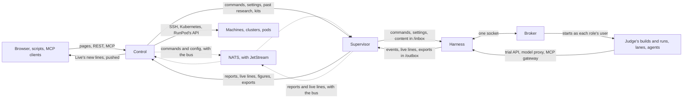

[How the parts fit together](how-it-fits-together.md) explains what control, a rig and its targets are, and why a rig dials out. This page goes one level down. It follows each channel between the parts: what travels on it, which side starts it, how often it runs by default, and so how long a change takes to reach the other side. The settings it names are in [Settings](../reference/settings.md), and [Trust](trust.md) explains the signatures that every command and report carries.

## Control and a rig

Every channel between control and a rig is started by the rig's supervisor, on a timer. The supervisor asks control, and control answers; control never waits on a rig. A rig on RunPod is the one exception, below.

| What travels | Direction | How often, by default | Setting |
| --- | --- | --- | --- |
| The harness's new events, in pages of up to 1,000, each signed by the harness | rig → control | every 60 seconds | `THERMITE_POLL_SECONDS` |
| The supervisor's own figures | rig → control | every 60 seconds, with the events | `THERMITE_POLL_SECONDS` |
| Commands waiting for the rig, each signed by control, and their outcomes | control → rig, then back | every 5 seconds | `THERMITE_COMMAND_POLL_SECONDS` |
| Live lines: what the lanes, the planner, the judge and the advisors are doing | rig → control | every 3 seconds, when there are new lines | `THERMITE_LIVE_INTERVAL_MS` |
| The agents' model route, and the MCP servers they may use | control → rig | every 30 seconds; with the message bus, as control changes them | `THERMITE_MODEL_ROUTE_POLL_SECONDS` |
| The advisors' models | control → rig | at the start of each advisors' round; with the message bus, as control changes them | — |
| Past research for each running run, from the knowledge base | control → rig | every 180 seconds | `THERMITE_KB_SYNC_SECONDS` |
| Exports, when the rig has no results repository, in parts of 8 MiB | rig → control | after each export, at most once an hour | `THERMITE_EXPORT_MINUTES` |
| Each new champion's patch | rig → control | after each export that holds one | — |
| The daily report | rig → control | once a day | — |
| A kit or a project kept on control, as git over HTTP | control → rig | when an assignment needs it | — |

Each channel keeps its own place, so a call that fails is simply made again at the next tick, and nothing is lost or taken twice:

- **Events** carry a cursor. Control takes a page only if it follows on from the last one it has, and tells the supervisor where to start if it does not. A page that control refuses as too large is sent again in halves.
- **Commands** stay pending on control until the harness's outcome comes back. The harness takes each one once, whatever the number of times it is delivered.
- **Live lines** are a view of what is happening now, and control keeps only the latest of them; the record is the events.
- **A call that hangs** ends after 5 minutes with no answer, and is made again at the next tick, as a call that failed.

### Reports over the message bus

The events travel on a message bus: a NATS server with JetStream, which runs beside control, as the compose stack's `nats` service. When `THERMITE_NATS_URL` names it for control and the supervisor, as it does by default in the compose stack and on every rig control sets up on a machine or a cluster, the supervisor publishes each page of events, as the harness signed it, to the rig's own subject, `thermite.rig.<rig>.report`, in the `REPORTS` stream, instead of posting it to control. Control reads the stream with one consumer, one message at a time, in order, and takes each page with the same checks as a page posted to it. Commands, live lines and the rig's config travel on the bus too, below. The other channels in the table stay on HTTP, and the supervisor still reads its harness's new events every `THERMITE_POLL_SECONDS`.

- **The supervisor moves on once the bus has a page.** A page's message id names its ledger and its events, so a page published twice within two minutes is kept once. A page too large for one message, 8 MiB, goes in halves.
- **The stream keeps every report:** no limit on their count, size or age, and none can be deleted. Nor can the stream itself: control's own user on the bus may not delete or purge it.
- **Control reads on past a page it refuses.** A page control has already is passed over. A page it refuses is recorded as one posted to it would be (a gap in the events, for one, is `report_refused` in its audit log), its log says why in a line `report from the bus refused`, and it reads on.
- **Control's answer sends the supervisor back.** No answer to a page on the bus reaches the supervisor, so a page control refused, for example while the rig's key waits for the owner or while the rig's clock is ahead, would leave every later page refused as a gap. Instead, control's answer to the supervisor's figures, its regular call, names where control is in the rig's events: the ledger and the cursor after the last event it holds. When control is still behind what the supervisor had sent by its call a round before, in the same ledger or holding none of that ledger, control is not just slow to read: it refused a page. The supervisor goes back to where control is, and its log says `control is behind this rig's reports on the bus; sending again from its cursor`. It then sends one page a round, as a page posted to control is tried again once a round, until control's answer shows that control took it; then the rest goes at once. A page sent again unchanged within the bus's two minutes is kept once, so it reaches control a round or two later. A rig whose builds control refuses gets no answer at all, so it goes back once control works with it again.

### Commands over the message bus

With the same setting, control publishes each command it issues to the rig's own subject, `thermite.rig.<rig>.cmd`, in the `COMMANDS` stream, as well as keeping it as before. The message is the command exactly as control signed and stored it, with the command's id as its message id, so a command published twice is kept once. The supervisor takes its rig's commands from its own consumer, `rig-<rig>-commands`, as soon as they are published, and delivers each one as it delivers one it fetched: it stages the content, hands the command to the harness, and gives control the harness's answer. A command reaches the harness within a fraction of a second, instead of at the next poll.

- **Control's store stays the record.** A command's status there stays the truth, and the harness still checks control's signature on every command.
- **The supervisor acks a command only once control has its outcome.** Until then, the bus hands it again every 5 seconds: while its content is still being fetched, while the harness is applying it, or while control does not answer. The commands after it go on meanwhile. A command the supervisor delivered already is acked and not delivered again, and one past its expiry is acked and not delivered.
- **The poll stays, slower.** With the bus, the supervisor asks control for its pending commands every 3 minutes instead of every `THERMITE_COMMAND_POLL_SECONDS`, for a command that reached control's store but not the bus. A publish that fails leaves the command pending, and that poll delivers it. The poll also keeps a command alive while its content is fetched, as without the bus.
- **The stream is a work queue.** A command the supervisor acked is gone from it. It holds up to 100 commands for each rig, and a command for at most a week: a full queue refuses the next command, which stays pending on control for the poll.
- **A cancelled command is taken off the bus,** so the rig's supervisor never delivers it, unless the supervisor had taken it already.

### Live lines over the message bus

With the same setting, the supervisor publishes the live lines to the bus instead of posting them to control. It still reads its harness's new lines every `THERMITE_LIVE_INTERVAL_MS`, and the harness hands them over ready for the bus: the lines of each source of each run (the planner's, the judge's, one trial's) in a message of their own, signed by the harness as a batch sent over HTTP is. Each message goes to its run's subject, `thermite.run.<run>.live.<source>`, in the `LIVE` stream. A line that names no run, such as the judge's between runs, goes to the rig's own subject, `thermite.rig.<rig>.live.<source>`. In a subject, a trial's source is `trial-<trial>`, and the rig travels in the message's `Thermite-Rig` header. The supervisor's own lines, its advisors', go the same way, unsigned, as they always have.

- **The stream is a view.** It keeps a message for an hour at most, at most 1,000 messages of each subject, and 256 MiB in all. When one of these is reached, the oldest messages go first, so a publish is never refused for room, and long lines can't fill the disk that the reports need. A message holds at most 1 MiB: the harness puts a source's lines in more than one message when they would not fit, and never cuts a line.
- **Control folds them in order,** with its consumer `control-live`, into the same live view as lines posted to it, after the same checks: the harness's signature against the rig's accepted key, and the supervisor's unsigned lines only under its own source. It also checks that its run registry gives the run to the rig. A message it refuses is counted by why, logged as `live lines from the bus refused`, and passed over: the live view is not a record. While control is away, the stream keeps the lines for it, for an hour at most.
- **What control refuses is not shown later.** A message that fails control's checks, such as one from a rig whose new key the owner has not accepted yet, is left out and counted, where a post over HTTP is sent again until control takes it. Live lines are a view of what the agents are doing, not a record: the rig's ledger and its reports keep the record.
- **A run the bus doesn't open to the rig yet.** A rig may publish only its own runs' live lines and its own (below). Control gives the rig's user a new run within seconds of assigning it, or of the rig's first report of a run it made itself, such as a rig check. Until then, the supervisor sends that run's lines on the rig's own subject, each line still naming its run, and control takes them there.
- **The supervisor counts what it published and what it dropped,** in its figures: in all, and by subject for the 100 subjects it used last. It drops a message only when the bus refuses it on the rig's own subject too, or when it is too large. When the bus does not answer, the supervisor keeps its place and sends the round again; the bus keeps each message once, by its id: its log and its first and last line.
- **The live view's posts go.** With the bus, the supervisor no longer posts live lines to control. A rig without the bus still does.

### Config over the message bus

With the same setting, control writes each rig's configuration to the `CONFIG` stream, a key-value bucket that keeps the latest value of each key, and the supervisor no longer asks control for it. Each rig has three keys, one for each kind of value, so that a change to one rewrites only it:

| Key | Subject | What it holds |
| --- | --- | --- |
| `model-route` | `thermite.rig.<rig>.config.model-route` | The model route of the rig's agents and the planner's own, each with its provider's key or a subscription's token, as `GET /v1/rigs/<rig>/model-route` answers |
| `advisor-routes` | `thermite.rig.<rig>.config.advisor-routes` | The advisors' routes by role, as `GET /v1/rigs/<rig>/advisor-routes` answers |
| `mcp-servers` | `thermite.rig.<rig>.config.mcp-servers` | The MCP servers the runs control assigned the rig name, each with its sign-in as headers, and those control can't give, as `GET /v1/rigs/<rig>/mcp-servers` answers |

- **Control writes a key only when its value changes.** It looks at every rig on the bus every 5 seconds, makes each value as the routes above make it, and compares it with the one on the bus by its revision. The revision changes with the value and with the seal key it is sealed to, and only control's secrets key makes it, so it tells nothing of a secret. Each look also renews what a value holds before it ends, a ChatGPT login's token or an MCP server's sign-in, as the rig's poll did. Control started again reads each key's revision back from the bus, and writes nothing that did not change.
- **Each value is sealed to the rig's own seal key.** The supervisor makes this key beside its key on the bus, keeps its private part in `bus-seal.pem` in its state folder, and sends its public part on the same call (below). Control seals each value whole to it: a fresh key for each value, as the pull-mode tunnel seals its bodies, bound to the rig and the key. Only that rig's supervisor opens it, and a value can't pass for another key's or another rig's. The bus and its store hold no secret in the clear.
- **The supervisor applies a change at once.** It watches its rig's keys with its own consumer, `rig-<rig>-config`, which it makes again each time it starts watching, so it gets the latest value of each key first and then each new one. It hands a new route to the harness, and new MCP servers to the harness and to the advisors, as soon as it opens them; the advisors use their new routes from their next round, and an idle advisors' loop looks at once. A value written reaches the supervisor within milliseconds.
- **It keeps what it knows.** A message it can't take, such as one it can't open or a key a newer control writes, is counted and passed over, and the value it holds stays. While the bus is away, it keeps every value it holds, and takes the next one when the bus is back. A value control can't make, such as a provider's key that no longer opens, is not written, and the rig keeps the one it has, as an error over HTTP changes nothing.
- **The polls go.** With the bus, the supervisor no longer asks control for its model route, its MCP servers or its advisors' routes. Every `THERMITE_MODEL_ROUTE_POLL_SECONDS` it only looks at its own harness, and hands it again what it lost, such as its MCP servers after a restart. A rig without the bus still polls.
- **Its figures count the updates** it took and the messages it refused, in all and by subject.

### Where the bus runs, and how rigs reach it

The bus runs beside control, and every connection to it is over TLS on NATS's own port, 4222. The compose stack's own rigs reach it inside the stack, as `nats:4222`. A rig control sets up on a machine or a cluster, or one you join yourself, reaches it from outside, at control's host on the same port, or at `THERMITE_NATS_PUBLIC_URL`: a second port beside control's HTTPS, which the operator opens to the rigs. NATS's port takes no HTTP proxy, so the bus brings its own TLS.

- **Control is the bus's certificate authority.** At its first start with the bus, control makes an authority of its own and keeps it beside its signing key. It signs the server's certificate for the names the server is reached by, and makes a new one before it ends.
- **Each rig gets the authority's certificate as it gets control's public key:** with its files and units at setup on a machine, in its deployment on a cluster, from control's volume in the compose stack. An update of the rig's images gives it the one control has then. The rig trusts the bus's server through that certificate alone, and signs in with the key it made itself.
- **No secret travels for TLS.** The authority's key stays in control's state; the server's key is written only to the folder the server reads; a rig holds only a certificate.
- **A rig on RunPod** keeps [pull mode](#a-rig-on-runpod): control reaches the pod, and the pod never dials the bus.

With `THERMITE_NATS_URL` unset, everything travels over HTTP, as the table at the top says: [Run the message bus](../how-to/operate/message-bus.md#turn-it-off) says how to turn the bus off.

### The bus's state

Control's health, `GET /v1/health`, says whether control holds a connection to the bus now (`connected`), holds none and tries again (`away`), or runs without it (`off`). Control's `GET /v1/bus`, the MCP tool `bus_state` and `/metrics` show the bus as control sees it: whether control reaches its server, each stream with its messages and what each consumer has still to take, the live stream's figures, from control (the lines it took and the messages it refused, by why) and from each rig's supervisor (the lines it published and dropped), and the config bucket's, from control (the values it wrote, by key, and those it could not write) and from each rig's supervisor (the updates it took and refused). The owner's and the reader's tokens read it. [The REST API](../reference/rest-api.md#the-message-bus) lists its fields.

### Who may use the message bus

Only control and the rigs' supervisors sign in to the bus, each with a NATS user key of its own, an nkey. The server knows each key by its public part. The secret part, the key's seed, never leaves the part that made it.

- **A rig's supervisor makes its own key** the first time it starts with the bus, and keeps the seed in its state folder, `bus-key.seed`. It sends the key's public part to control on its regular call, the one that carries its figures, which the rig's token already authenticates: once before its first report, then with every call. Beside it, it makes its seal key, `bus-seal.pem`, and sends that key's public part on the same call, for its config. A NATS user key signs; it can't be sealed to, so the seal key is an X25519 key of its own.
- **Control writes the server's users.** It records the key for the rig, writes every user to the users file that the server's settings include, and asks the server to reload the file, which the server does without a restart. Control answers the supervisor's call once the server has reloaded, so the supervisor can sign in at once. A rig with no key registered has no user.
- **A new key replaces the old one.** A supervisor that lost its state folder makes a new key at its next start. Control keeps the change as a step in the rig's history, `bus_key_changed`, and in its audit log, `rig_bus_key_changed`, each with the fingerprints of the old key and the new one, and the old key no longer signs in. A new seal key is `seal_key_changed` and `rig_seal_key_changed` in the same way, and control seals the rig's config to it at once. A full reset keeps both keys.
- **Control looks at its users every 5 seconds.** It writes the file, and asks the server to reload it, only when the users changed: a rig retired loses its user, a rig brought back has it again, and a run control gives a rig opens that run's live lines to the rig.

Each user may do only its part:

| User | May |
| --- | --- |
| Control | Everything on the bus but delete or purge the `REPORTS` stream, which is kept for good: make the streams, fold the reports, publish commands and take back a cancelled one, and write each rig's config |
| A rig's supervisor | Publish to its own report subject, `thermite.rig.<rig>.report`; publish its own live lines, `thermite.rig.<rig>.live.*`, and those of each run that control's run registry gives the rig (assigned to it, or made there), `thermite.run.<run>.live.*`, the newest 1,000; make, read and take from its own consumer of the commands, `rig-<rig>-commands`, which the server lets take only the rig's own subject; make again, read and take from its own consumer of its config, `rig-<rig>-config`, which the server lets take only the rig's own keys; ack what it took; and receive replies only under its own inbox, `_INBOX.rig.<rig>` |
| Control's system user | Ask the server to reload its users |

So a rig can't publish another rig's reports or the live lines of another rig's runs, take another rig's commands, read another rig's config or another rig's consumer, or write any config, its own included; and a key the server does not know is refused. The bus's credentials add to the signatures and do not replace them: each report still carries the harness's signature, and each command control's.

### A rig on RunPod

A RunPod pod can't be reached from outside except through RunPod's own HTTPS proxy, and it has no fixed address to dial. So for a rig on RunPod, **control** starts every connection: after the pod enrolls, control calls it through the proxy in a loop, and each call carries what control has for the rig and brings back what the rig has for control. The supervisor's own calls to control go to a port inside the pod and wait there for the next exchange. Because the proxy ends TLS, every exchange is also sealed and signed by Thermite itself. [Trust](trust.md#rigs-in-pull-mode) explains it.

## Inside a rig

The supervisor and the harness are two containers, and they talk two ways:

- **The harness's API.** The supervisor calls it: for the events and live lines it relays, for the commands it delivers, for the run's settings, and, for the advisors, about 25 routes that read the run and post their answers. The harness never calls the supervisor.
- **Two shared folders.** The supervisor puts what a command brings (a project, a kit, another rig's champion, a model) in `/inbox`, which the harness may only read. The harness writes each export to `/outbox`, and the supervisor takes it from there to git or to control, then tells the harness it is done.

Inside the harness container, the **controller** (the harness itself) and the **broker** talk over one socket, a JSON object per line each way. The broker runs as root and starts every other process as its role's own user: each lane's agent, the judge's builds and runs, and the kit's checks. The judge takes its jobs from the ledger, where the controller queues each attempt. [Isolation](isolation.md) explains the users and what each one can reach.

## The agents

A worker is a process the broker starts for one trial, as the lane's user.

- **Its trial** comes in a file that only it can read, and its result goes back as the last line it prints.
- **While it works,** it calls the harness's trial API on the container's own loopback: for its live lines and progress, its model use, and the tools that change the lane's files. An agent program such as Claude Code, Codex or OpenCode writes its events to a file in the lane's folder, and the harness reads the new lines every second.
- **Its model.** OpenCode, Codex, a Pi worker on a ChatGPT route, and the planner reach the provider through the harness's **model proxy**, which adds the provider's key to each call. The agents' MCP servers are reached through the harness's **MCP gateway**, which adds each server's sign-in.
- **The owner's messages** reach a Pi worker at the end of its turn. An agent program gets them in its next prompt, when it is started again within the trial.

The advisors run in the supervisor, not in the harness. They reach their models the same ways, from there.

## People and programs

- **The dashboard** is pages that control renders. Live gets its new lines pushed: control sends them to the page as server-sent events as soon as it has them, from the message bus or over HTTP alike, and the browser connects again on its own after a drop, from the last line it has. A page that falls behind, with more than 500 lines waiting for it, keeps what it shows, gets the newest 500, and says how many lines it did not get. A page that follows a change (a command's progress, a rig's set-up) asks every 2 seconds for its first 2 minutes, then every 5. Other pages show what control had when they were loaded.
- **REST** and **MCP** answer on demand. MCP uses streamable HTTP, and each request is answered on its own.
- **The command line** calls control's REST API, or a rig's harness on the rig's own machine.

Control also reaches out, to set up and manage rigs: to a machine over SSH, with its host key pinned; to a cluster through the Kubernetes API; and to RunPod's API, every 30 seconds for each RunPod rig.

## How long a change takes to show

Because each hop waits for its timer, the time a change takes to show is the sum of the waits on its way, at the defaults above:

| A change | Its way | At most, by default |
| --- | --- | --- |
| A command, such as **Pause** | control → supervisor → harness | 5 seconds; with the message bus, a fraction of a second |
| A step of an agent, in Live | agent → harness → supervisor → control → Live | about 3 seconds; Live shows it as soon as control has it |
| A verdict, on the run's page | judge → ledger → supervisor → control | 60 seconds, then a reload of the page |
| A new model route | control → supervisor → harness | 30 seconds; with the message bus, 5 seconds |
| New items in the knowledge base, for a running run | control → supervisor → the run's folder | 180 seconds |

The research itself never waits on these channels. A rig runs its trials and judges its attempts on its own, and keeps working while control is away; the channels only carry what happened and what the owner decided.

## Where to read more

- [How the parts fit together](how-it-fits-together.md): control, a rig and targets.
- [Trust](trust.md): signed commands, signed reports and pinned keys.
- [Isolation](isolation.md): the users inside a rig.
- [Settings](../reference/settings.md): each interval above.
- [Signed commands](../reference/signed-commands.md): every command a rig takes.
