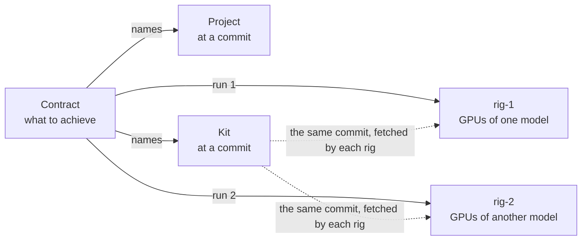

New users often mix up kits and rigs. Both sit between your project and a result, and both are set up once and used many times. But they answer different questions:

- A **kit** says **how** to measure a project: how to build it, run it, score it and check it.
- A **rig** is **where** the measuring happens: two containers on a machine, with the CPU or GPUs that the work runs on, and the agents and the judge that do the work.

A campaign brings the two together. This page compares them and shows how they meet.

## Side by side

| | Kit | Rig |
| --- | --- | --- |
| **What it is** | A git repository with `kit.json` and the project's build, run and check scripts | A harness container and a supervisor container on a machine or a cluster, with its devices |
| **The question it answers** | How is a change built, run, scored and checked? | Where is it measured, and who does the work? |
| **What it belongs to** | One project, and one kind of hardware | A machine or a cluster. One machine can host several rigs |
| **Who makes it** | You write it, or the **New campaign** page writes a simple one from your answers | You start it with compose or a join command, or control sets it up over SSH or on Kubernetes |
| **How it is named** | Its repository and commit, in the contract | Its name, such as `rig-1` |
| **How it changes** | Every change is a new commit, so a new contract version | Its settings change on its **Edit rig** page and apply at once; a new GPU split restarts its harness |
| **Kind of hardware** | Names one: `cpu` or `cuda-gpu` | Has one: `cpu` without GPUs, `cuda-gpu` with them |
| **Can agents see it?** | Never | They work inside it, each as its own user, with no way into the judge's files |
| **Does it keep results?** | No. It holds no results at all | Yes. Its ledger keeps every run, attempt and verdict |

[Why the benchmark lives in a kit](kits.md) explains the kit, and [How the parts fit together](how-it-fits-together.md) explains the rig.

## How a campaign joins them

A campaign's **contract** names the project and its starting commit, and the kit and its commit. It does not name a rig. A rig is chosen each time a **run** starts: a run is the campaign on one rig.

When a run starts, control sends the rig a signed assignment that names the project's commit and the kit's commit. The rig's supervisor fetches whichever the rig does not have yet, and the harness checks them before any agent starts:

- the kit measures on the rig's kind of hardware;
- every test case, metric and verifier that the contract names is in the kit. The kit and the contract call a test case a **cell**; the dashboard calls it a **case**.

A run that fails these checks never starts, and the refusal says why. On the dashboard, the card that starts another run greys out rigs whose hardware differs from the kit's. From then on, the judge uses the kit on the rig's own device, and the agents use the rig's model.

## Where each choice is made

A setting lives with the part it belongs to. How a change is judged comes from the kit and the contract; the rig decides who does the work and how fast.

| Choice | Made in |
| --- | --- |
| How to build, run and check the project, and the time, memory and disk each build and run may use | The kit |
| The test cases, including hidden ones; what counts as better; what must not get worse | The contract (from the kit's test cases and metrics) |
| Which files agents may change; how many lanes; each agent's memory and disk; budgets | The contract |
| The agents' model and the program they run in (the [worker harness](../reference/glossary.md)); how many workers run at a time; how long a trial lasts unless the contract says; whether promotions wait for you by default; how many GPUs are the judge's | The rig |
| The compilers and tools that builds can use | The rig's harness image ([Extend the harness image](../how-to/install/extend-harness-image.md)) |

How many agents really work at the same moment depends on both: the contract's number of **lanes** (lines of search, one worker each), and the rig's **Workers at a time**, which is one unless you raise it.

## One kit on many rigs

A campaign can run on several rigs at once, all with the same kit commit. A `cuda-gpu` kit runs on any GPU rig, whatever the GPU model, so two rigs can give quite different raw numbers. Thermite never compares them:

- each rig measures every change against its own starting point, on its own device;
- a rig's champion can be sent to another rig, whose own judge measures it again against that rig's champion. If it wins there too, it is shown as **cross-verified**.

[Run a campaign on several rigs](../how-to/campaigns/several-rigs.md) shows how.

## One rig, many kits over time

A rig works on one run at a time. Starting or resuming a run pauses the run that was running there. Each run brings its own kit, so over time one rig can measure many projects, each with its own kit, as long as each kit is for the rig's kind of hardware.

The rig keeps what it has seen. Every kit it imported stays in its private store, and every run's attempts and verdicts stay in its ledger, so a paused run can be resumed later and a new run can use a kit that is already there. A full reset of the rig clears them, after the rig's results have reached its results repository. Rigs that control sets up on machines and clusters, and joined rigs, have no results repository yet, so they can't be fully reset ([goal 061](https://github.com/iammrduncan/thermite/blob/main/docs/plan/goals/061-gaps-found-by-the-docs.goal)).

The rig's own **smoke check** is an example. The harness image carries a small smoke kit for each kind of hardware. When you run the check, the rig pauses its running run, judges a set of known changes with that kit, and then resumes the run.

## Common mix-ups

- **"Each project needs its own rig."** It does not. A rig runs any project whose kit matches its hardware, one run at a time.
- **"A CPU kit can run on my GPU rig."** It cannot. A rig with GPUs measures on `cuda-gpu`, so it refuses a `cpu` kit. Use a rig without GPUs, or write a `cuda-gpu` kit.
- **"The kit installs the compiler."** It does not. Builds run inside the rig's harness image and use the tools in it. A project that needs more tools needs an extended image.
- **"Changing a rig's settings changes the verdicts."** It does not. Verdicts follow the kit and the contract. A rig's settings change the model, the pace and who decides promotions, never what counts as better.
