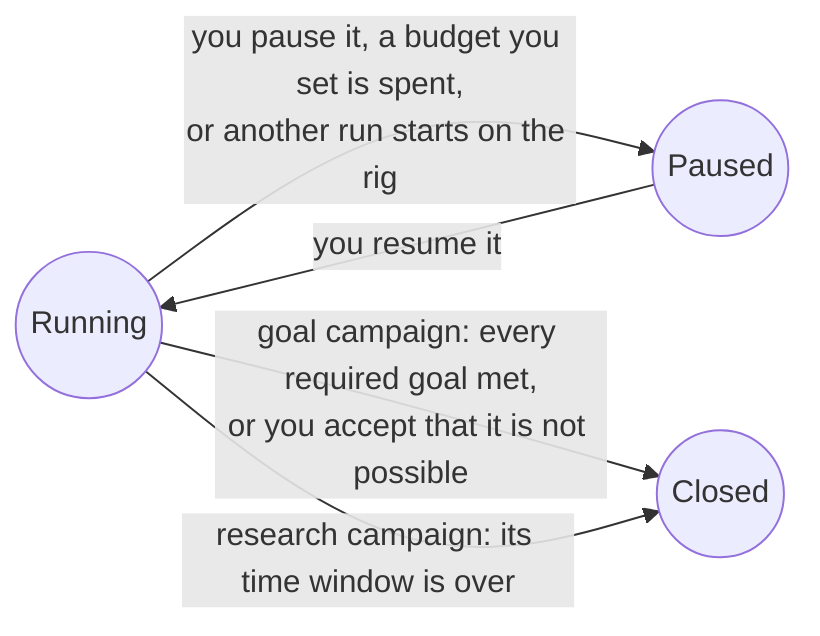

Thermite has no default limit on turns, attempts, failures, money or time. A campaign runs until its job is done, or until you stop it. This page explains why, what keeps a long run orderly without a limit, what ends each kind of campaign, and where to set a limit when you want one.

The words here are in the [glossary](../reference/glossary.md).

## The rule

Thermite follows one rule, a [settled decision](https://github.com/iammrduncan/thermite/blob/main/docs/plan/decisions.md) since 2026-10-15: **research runs until its goals are met. A cap exists only when someone sets it.** Nothing ends or cuts research short by default.

There are three reasons:

- **Good results come after long dry spells.** A search for a faster program can go many attempts without a win, and then find one. A loop that stops after a fixed number of failures ends the search at the first long dry spell, whether or not the next idea would have worked. [Where Thermite came from](where-thermite-came-from.md) tells how this was learned.
- **Any default would be a guess.** Thermite can't know how long your project needs, how noisy your hardware is, or what your time is worth. A wrong guess fails quietly: you come back in the morning to a campaign that stopped at midnight.
- **A limit is your decision.** How much money and time to spend is yours to decide, so Thermite asks you rather than deciding for you.

Without a limit, nothing runs wild either. Code, not an agent, decides when a campaign is done, and the rest of this page is about what keeps it in order meanwhile.

A hill climb has no arrow to **Closed**: a faster program can always be tried, so it runs until you pause it. The dashboard labels a closed run **Finished**.

## What keeps a long run in order

Thermite uses three kinds of limits that never end a campaign:

- **Pacing** spaces work out. It ends one trial, or makes the agents rest for a while, and then the work goes on.
- **Back-pressure** holds new work until earlier work settles. Work waits; nothing ends.
- **Per-process limits** bound one build, run or command, so that one runaway process can't take the rig down. That one process ends; the lane goes on.

| Example | Kind | What happens |
| --- | --- | --- |
| A trial's time is up (20 minutes by default) | Pacing | The trial ends, and the lane's next trial starts fresh |
| Trials keep achieving nothing | Pacing | The lane waits a little longer before each next trial, up to 10 minutes |
| Many trials in a row end in errors, as in a model outage | Pacing | The agents rest for a while, then try again. A new model for the rig, or resuming the run, ends the rest at once |
| A subscription's usage window is full | Pacing | The agents wait for it. Nothing pays for more |
| A lane's last change is still with the judge | Back-pressure | The lane waits for the verdict |
| Too many changes wait for the judge | Back-pressure | New trials wait until fewer are open |
| A build, a timed run or a lane's command uses too much memory or disk, or a judge's step runs past the kit's time limit | Per-process | That one process ends |

A trial "achieves nothing" when it ends in an error, without a change, with a change refused before it is built, or with a change identical to an earlier one. The [limits and pacing reference](../reference/limits-and-pacing.md) lists every value and where it is set.

Long runs also take care of their own measurement: once a day, when it has nothing else to do, a hill climb's judge times the champion against itself to learn how noisy the device is ([Campaign modes](campaign-modes.md)).

## What ends each mode

No agent can end a campaign. What ends one is written in code, the same for every campaign of a mode:

| Mode | Ends when | Without that |
| --- | --- | --- |
| **Hill climb** | Never on its own | It runs until you pause it, a budget you set pauses it, or another run starts on its rig |
| **Goal** | Every required goal is met (or, if the contract says so, enough of them), confirmed by two independent checks of the champion. Or you accept a "not possible" proposal | It has no time limit of its own |
| **Research** | Its time window is over: the contract's maximum duration, or its minimum duration when it sets no maximum. Only running time counts | The window is part of every research contract: its author sets it |

A run that has stopped is **paused**, not closed, and keeps everything it found, including its experiment queue: the experiments its lanes were on go back to the top. A **closed** run is finished. Either way, its champion and its results stay, ready to take. [Campaign modes](campaign-modes.md) explains each ending in full.

## Setting a limit

When you want a limit, you set it. Each one does exactly what it says, and nothing else:

| Limit | Where | What it does |
| --- | --- | --- |
| Hours since the run started | `budget.wall_hours` in the contract, or **Stop after (hours)** on the **New campaign** page | Agents stop starting trials, and the run is paused once its trials end. Paused time counts too |
| Hours of judging on the device | `budget.device_hours` in the contract | The same |
| Money spent on the agents' model | `budget.llm_usd` in the contract, with the model's prices set on the rig (`THERMITE_LLM_USD_PER_MTOK_IN` and `THERMITE_LLM_USD_PER_MTOK_OUT`). It counts the workers' calls only, not the planner's, and rigs that control sets up can't be given the prices yet ([goal 061](https://github.com/iammrduncan/thermite/blob/main/docs/plan/goals/061-gaps-found-by-the-docs.goal)) | The same |
| Turns in one trial | **Turns per trial** on the rig's **Edit rig** page | That one trial ends at the limit; the next one starts |
| A lane command's time | `lanes.limits.run_timeout_s` in the contract | That one command ends |
| Advisors' spending per day | `max_usd_per_day` in the advisors file | The advisors skip their work until the next day ([Supervision](supervision.md)) |
| Size of a research campaign's archive | `THERMITE_RESEARCH_MAX_MB` on the rig | Further fetches are refused |

A spent budget **pauses** the run. It never closes it, so nothing is lost. While a run is paused, its judge jobs wait in the queue too. The budget belongs to the run's contract, which does not change while the run lives: a new budget means a new contract version and a new run.

:::caution[Paid keys]
With a paid API key, the agents spend money for as long as the campaign runs. Set a stop time or a device-hours budget before you start: they work on every rig, while a money budget works only where the rig knows the model's prices. [Set a budget or a stop time](../how-to/campaigns/budget-and-stop-time.md) shows how.
:::
