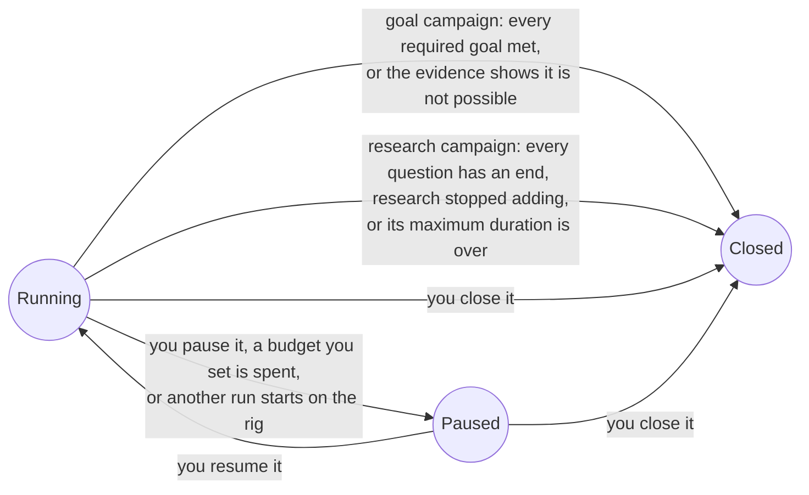

Thermite has no default limit on turns, attempts, failures, money or time. A campaign runs until its job is done, or until you stop it. This page explains why, what keeps a long run orderly without a limit, what ends each kind of campaign, and where to set a limit when you want one.

The words here are in the [glossary](../reference/glossary.md).

## The rule

Thermite follows one rule, a [settled decision](https://github.com/iammrduncan/thermite/blob/main/docs/plan/decisions.md) since 2026-10-15: **research runs until its goals are met. A cap exists only when someone sets it.** Nothing ends or cuts research short by default.

There are three reasons:

- **Good results come after long dry spells.** A search for a faster program can go many attempts without a win, and then find one. A loop that stops after a fixed number of failures ends the search at the first long dry spell, whether or not the next idea would have worked. [Where Thermite came from](where-thermite-came-from.md) tells how this was learned.
- **Any default would be a guess.** Thermite can't know how long your project needs, how noisy your hardware is, or what your time is worth. A wrong guess fails quietly: you come back in the morning to a campaign that stopped at midnight.
- **A limit is your decision.** How much money and time to spend is yours to decide, so Thermite asks you rather than deciding for you.

Without a limit, nothing runs wild either. Code, not an agent, decides when a campaign is done, and the rest of this page is about what keeps it in order meanwhile.

No code closes a hill climb: a faster program can always be tried, so it runs until you pause it, or until you close it yourself. The dashboard labels a closed goal run that met its goals, and a closed research run whose questions the review panel found answered, **Completed**, and any other closed run **Finished**. With no run of a campaign at work, the campaign shows its newest run's label, so a campaign whose newest run completed reads **Completed** even when an older run of it is paused. It labels a paused run **Paused**, even while a decision waits in it: that decision still shows under **Needs you**. A closed run is finished for good, so nothing in it waits for you: what waited when it closed leaves **Needs you**, and the rig refuses a decision on it.

## What keeps a long run in order

Thermite uses three kinds of limits that never end a campaign:

- **Pacing** spaces work out. It makes the agents wait for a while, and then the work goes on.
- **Back-pressure** holds new work until earlier work settles. Work waits; nothing ends.
- **Per-process limits** bound one build, run or command, so that one runaway process can't take the rig down. That one process ends; the lane goes on.

| Example | Kind | What happens |
| --- | --- | --- |
| Trials keep achieving nothing | Pacing | The lane waits a little longer before each next trial, up to 10 minutes |
| The model provider fails for now, as in an outage or at its rate limit | Pacing | The trial waits (for the time the provider gives, at a rate limit) and goes on in the same conversation |
| The provider has no credits left, or refuses the key | Pacing | No trial starts. The run shows in **Needs you** with the provider's words, and the model is checked again, less and less often; the agents go on once a check passes, or the rig gets another model |
| The provider's outage, or its refusal of a request, never clears: no model call works for 30 minutes | Pacing | The same as no credits, so that you see it rather than trials that wait forever. The trial whose calls kept failing ends; when a check passes, its lane starts afresh |
| A subscription's usage window is full | Pacing | The agents wait for it. Nothing pays for more |
| A lane's last change is still with the judge | Back-pressure | The lane waits for the verdict |
| Too many changes wait for the judge | Back-pressure | New trials wait until fewer are open |
| A build, a timed run or a lane's command uses too much memory or disk, or a judge's step runs past the kit's time limit | Per-process | That one process ends |
| A model call's stream sends no data for 10 minutes: the connection is open, and nothing comes | Per-process | That one call is broken off as the provider's passing fault, and the trial goes on in the same conversation. A call that keeps sending data is never cut, however long it lasts ([`THERMITE_MODEL_STALL_SECONDS`](../reference/settings.md#the-rigs-own-model)) |

A trial has no time limit, no turn limit and no limit on failures in a row unless someone sets one: those are caps, listed with the others. A trial "achieves nothing" when it ends in an error, without a change, with a change refused before it is built, or with a change identical to an earlier one. The [limits and pacing reference](../reference/limits-and-pacing.md) lists every value and where it is set.

Long runs also take care of their own measurement: once a day, when it has nothing else to do, a hill climb's judge times the champion against itself to learn how noisy the device is ([Campaign modes](campaign-modes.md)).

## What ends each mode

No agent can end a campaign. What ends one is written in code, the same for every campaign of a mode:

| Mode | Ends when | Without that |
| --- | --- | --- |
| **Hill climb** | Never on its own | It runs until you pause it, a budget you set pauses it, or another run starts on its rig |
| **Goal** | Every required goal is met (or, if the contract says so, enough of them), confirmed by two independent checks of the champion. Or a "not possible" proposal is taken: at once, or when you accept it if the run asks you | It has no time limit of its own |
| **Research** | After its minimum duration, the review panel's decisions give every question an end (answered, or the best that sources allow) and every hypothesis that needs a verdict (the author's and promoted ones) a verdict (`undecided` only with claims behind it), each item decided by the majority of the reviewers' answers that pass code's check. The pass is taken at once, or when you accept it if the run asks you about reviews. Or its open questions all stop adding and nothing improves for a quarter of its running time: the progress rule. Either way the run's final writer writes its research paper, which code checks, and the run ends with the paper leading its final report; a rig with no final writer ends it with the review panel's decisions. Or its running time reaches the contract's maximum duration. Only time the agents could work counts | Without such an end, it runs to its maximum; without a maximum either, until you close it. The minimum is a floor, never a stop. A paper the checks refuse is written again, with no limit on tries |

You can also end a run of any mode yourself, for good, with **Close run** on its page: for example a paused run whose work another run finished ([Steer a run](../how-to/campaigns/steer-a-run.md#close-a-run)). That is your decision, never code's or an agent's.

A run that has stopped is **paused**, not closed, and keeps everything it found, including its experiment queue: the experiments its lanes were on go back to the top. A **closed** run is finished. Either way, its champion and its results stay, ready to take. [Campaign modes](campaign-modes.md) explains each ending in full.

## Setting a limit

When you want a limit, you set it. Each one does exactly what it says, and nothing else:

| Limit | Where | What it does |
| --- | --- | --- |
| Hours since the run started | `budget.wall_hours` in the contract, or **Stop after (hours)** on the **New campaign** page | Agents stop starting trials, and the run is paused once its trials end. Paused time counts too |
| Hours of judging on the device | `budget.device_hours` in the contract | The same |
| Money spent on the agents' model | `budget.llm_usd` in the contract, with the model's prices set on the rig (`THERMITE_LLM_USD_PER_MTOK_IN` and `THERMITE_LLM_USD_PER_MTOK_OUT`). It counts the workers' calls only, not the planner's, and rigs that control sets up can't be given the prices yet ([goal 061](https://github.com/iammrduncan/thermite/blob/main/docs/plan/goals/061-gaps-found-by-the-docs.goal)) | The same |
| Turns in one trial | **Turns per trial** on the rig's **Edit rig** page | That one trial ends at the limit; the next one starts |
| A quiet trial | **Ask me after a quiet spell of (minutes)** on the rig's **Edit rig** page | Nothing ends: the trial asks you under **Needs you**, and you stop it or leave it running |
| A lane command's time | `lanes.limits.run_timeout_s` in the contract | That one command ends |
| Advisors' spending per day | `max_usd_per_day` in the advisors file | The advisors skip their work until the next day ([Supervision](supervision.md)) |
| Size of a run's archive of fetched pages, in any mode | `THERMITE_RESEARCH_MAX_MB` on the rig | Further fetches are refused |

A spent budget **pauses** the run. It never closes it, so nothing is lost. While a run is paused, its judge jobs wait in the queue too. The budget belongs to the run's contract, which does not change while the run lives: a new budget means a new contract version and a new run.

:::caution[Paid keys]
With a paid API key, the agents spend money for as long as the campaign runs. Set a stop time or a device-hours budget before you start: they work on every rig, while a money budget works only where the rig knows the model's prices. [Set a budget or a stop time](../how-to/campaigns/budget-and-stop-time.md) shows how.
:::
