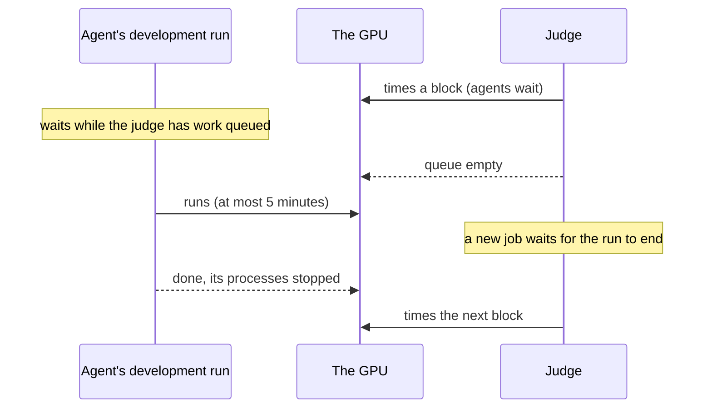

The judge needs a quiet device to time changes on. The agents want the same device, to test and profile their changes before they submit them. This page explains how a rig shares one device between the two, what changes when a rig has GPUs to spare, and what each choice costs. Whether the judge and the agents share a device or have their own is your choice, made for each rig.

The words here are in the [glossary](../reference/glossary.md). [Give a rig several GPUs](../how-to/install/several-gpus.md) shows how to set the split.

## What the judge needs

The judge measures through a **target driver**: code that knows the device, checks that it is ready before each block of timing, and records its state with each result. Thermite has drivers for CUDA GPUs and for CPUs.

Before every block, the driver checks that nothing else is using the device. A GPU must be nearly idle: low use and little memory in use, no other program computing on it, not too hot, and not slowed down for heat or power. If it is not ready, the judge waits a little and checks again. If it stays busy, the attempt is marked as an infrastructure failure and tried again, and it never counts against the research. The judge also throws a block away and runs it again when the harness's CPU quota held it back during the block. The [limits and pacing reference](../reference/limits-and-pacing.md#the-judge) gives the thresholds.

So the judge's need is simple: while it times, nothing else may touch its device. Everything below is how Thermite gives it that.

## One device, taking turns

On a rig with one GPU, the judge and the agents share it, and **the judge goes first.**

An agent tests on the device with a **development run**: one command, run on the device while the judge is not using it. A development run waits while the judge has any job queued or running. Then it holds the device, and the judge does not start a new job until it ends.

Three rules keep the turns short and fair:

- **A development run on a shared device is limited to 5 minutes**, unless the contract sets another limit, so the judge gets the device back.
- **One development run at a time.** The runs of all lanes queue for the one device, and a lane has one at a time.
- **No waiting past the trial.** A development run waits until the device is free, with no time limit of its own. When its trial ends first, it gives up with `the trial ended before a device was free`.

On a GPU, nothing a development run starts outlives it. Its output is marked `diagnostic only: this number never counts`: only the judge's measurements decide a verdict.

The judge's queue counts every run's jobs, including the jobs of a paused run, which wait in the queue until the run is resumed. While those jobs wait, agents of the running run cannot make development runs on a shared device.

## Dedicated GPUs

On a rig with two or more GPUs, you can split them: some for the judge, the rest for the agents. Then **neither side waits for the other.** Development runs use the agents' cards, and the [isolation](isolation.md) between them keeps every development run off the judge's cards.

Both sides are **pools**:

- **The judge's pool.** Each judge card has its own executor, its own timing user, its own set of CPUs close to the card, and its own measure of noise. A comparison always times the change and the champion on the same card, in the same job, so cards are never compared with each other. A change that wins its first screening on one card is confirmed on another. Builds run one at a time for the whole rig. All judge cards must be the same GPU model; if they differ, only the first one judges, and the rig says so.
- **The agents' pool.** A development run takes any free card, and waits only when all of them are busy. A lane still has one development run at a time. There is no time limit unless the contract sets one, because no judge is waiting for the card.

By default the judge gets half the cards, rounded up, and on a machine control sets up, the lowest-numbered ones. For a rig set up with its set of GPUs, **GPUs for the judge** changes the split: on the rig's **Edit rig** page, on the **New campaign** page, or under **More options** when you **Start a run** from a campaign's page. A new split restarts the rig's harness: running trials end, and the judge's jobs in progress start over. A rig takes up to 8 cards of each kind.

## What each choice costs

| | One shared device | Dedicated devices |
| --- | --- | --- |
| Hardware | One GPU does everything | You give up the agents' GPUs for measurement |
| The judge | Waits only for a development run already on the device | Never waits for the agents |
| The agents | Wait while the judge has work, until it is done or their trial ends | Never wait for the judge; wait only when all their cards are busy |
| Development runs | At most 5 minutes each, unless the contract changes it | No time limit unless the contract sets one |
| Throughput | One job at a time on the one device | One job at a time on each judge card |

More judge cards check more changes at once. More cards for the agents let more lanes test at once. On a shared device, a busy judge means the agents test less. With two GPUs, the default split gives one to each: the agents test whenever they need to, and the judge has its card to itself.

The fairness of a verdict is the same either way. The judge always times the change and the champion on one device, block by block, and decides on the difference.

## CPU rigs

On a CPU rig, the device is the rig's CPUs. There are no device files to hand out, so the sharing works differently:

- **A development run** waits while the judge has work, as on a shared GPU, and then runs as an ordinary lane command.
- **The agents' other commands**, such as builds and tests, are not held back. They run on the same CPUs as the judge. So before each block, the CPU driver checks the load: the one-minute load average must be at most 75% of the cores. A busy rig makes the judge wait, and if it stays busy the attempt is retried as an infrastructure failure.

The trade-off on a CPU rig is between agents and the judge: more agents working at once means more load on the CPUs, and a judge that waits longer for a quiet moment. A research campaign has no judge and no device, so it doesn't share anything.
