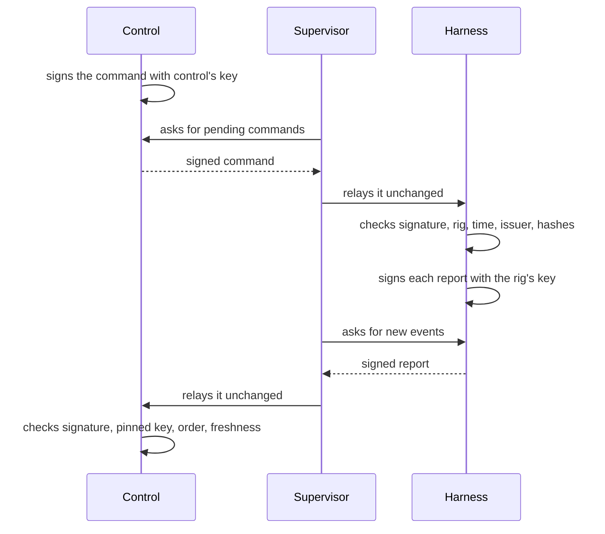

Control and its rigs often run on different machines, and everything between them passes through each rig's **supervisor**, which also talks to git hosts, model providers and web pages all day. Thermite is built so that the supervisor does not have to be trusted with what matters most: control signs every command, the harness signs every report, and each side checks the other's signature. This page explains those checks and how keys are first trusted.

The words here are in the [glossary](../reference/glossary.md). A rig is two containers: the **harness**, which holds the judge, the agents and the record of the research, and the supervisor, which connects it to everything else ([How the parts fit together](how-it-fits-together.md)).

## Two keys

There are two signing keys, one in each direction. Both are Ed25519 keys.

- **Control's key** signs commands. Control makes it the first time it starts and keeps it in its own directory. Its public half goes to every rig when the rig is set up.
- **The rig's key** signs reports. The harness makes it the first time it starts and keeps it in its private state. It survives a full reset, so control's trust in the rig survives too.

The supervisor holds neither key. It can carry signed messages, but it cannot make one.

## Signed commands

Control steers a rig with **signed commands**, such as assign a campaign, pause a run or approve a promotion. One path in control issues them all, whether they start on the dashboard, the REST API or MCP.

Each command is an envelope that names its own id, the rig it is for, its kind, who issued it, when it was issued, when it expires, and what it asks. Control signs the whole envelope. The harness then checks:

- that the signature is control's;
- that the command is for this rig, so a command can't be replayed on another rig;
- that it has not expired, and was not issued in the future (beyond a small clock difference);
- that its content matches what its kind allows;
- that it was not issued before the rig's state was last wiped;
- that its id has not been applied already. A command seen twice gets its first outcome again and runs only once.

Commands expire after an hour by default, so an old command that was never delivered can't take effect much later, and control never delivers one that has expired. The [signed commands reference](../reference/signed-commands.md) lists every kind and every check.

### Who issued it

The issuer is inside the signature: the owner through the dashboard, the REST API or MCP, an operator acting for the owner, or an agent. Some kinds are the owner's alone, such as approving a promotion, accepting a review, wiping the rig, changing its settings, messaging the run's agents and advisors, and changing a run's experiment queue or removing a rule for its plan. The harness accepts those kinds only from an issuer in the owner's name, and control decides which kinds each token may ask for. So an agent's token can't get an owner's command through, even though it reaches control. An operator's token, which the owner gives an agent that runs campaigns for them, may send messages and change the queue, in the owner's name.

This is how only the owner can write to the agents and the advisors. The advisors can answer the owner's messages, through the supervisor, but they can't send one, and the judge takes no messages at all: it is code, and no message can change a measurement. A run's **Live** view shows a line as the owner's message, a read receipt or an advisor's answer only when the harness signed it; a line that isn't signed shows as a plain log line, whatever it claims. A worker can't make one up either: a trial may post only its own session's text, thinking, tool calls and results. [Tokens and roles](../reference/tokens.md) says what each token may do.

### Content checked by hash

Some commands bring content that the supervisor fetches: the project and the kit, a model file, or another rig's champion. The command does not carry the content, only what it must be: a git commit for a project or a kit, a SHA-256 for a model file, and for a champion, the patch's SHA-256 and the git tree that must result. The contract travels inside the command, with its own hash.

The supervisor fetches the bytes into the rig's inbox, and the harness checks them against the signed values before it uses anything. So neither the supervisor nor a git host in between can swap one project, kit, model or champion for another.

### The harness's record decides

The supervisor tells control quickly whether a command was delivered, but that is only the fast path. The harness records each command it applied in its signed report, and that record replaces whatever the supervisor said.

## Signed reports

The harness signs every report it gives the supervisor: each page of new events, with the rig's name, the record's id, where the page starts and ends, and when it was made. Control takes a report only when:

1. it names the rig it arrived for;
2. its signature is good, made with the key control pinned for that rig;
3. it continues the stream control already has, with no gap;
4. it does not come from a record the rig has left behind, such as one from before a full reset;
5. it is not older than the newest report control has taken, and not dated in the future.

So the supervisor cannot forge a report, replay an old one, or drop events from the middle of the stream. Only the harness's signed reports make a rig show **Live** on the dashboard's **Rigs** page. A champion patch that the supervisor uploads is kept only if its SHA-256 matches the one in the rig's signed record of that champion. A run's **Live** view is for watching the work as it happens; the record of what happened is these signed events. The same goes for a run's experiment queue: control builds the **Experiments** and **Planner** tabs from the signed events alone. When a new run copies another run's untried experiments, from **Start a run** or over MCP, control takes each one's author from its record of the experiment it was copied from, not from what an MCP caller wrote.

## Pinning the rig's key

The first time control sees a rig's report, it must decide whether to trust the key that signed it.

- **By default, the first key is pinned** when its report verifies: trust on first use. The dashboard shows the pinned key.
- **With `THERMITE_CONTROL_REQUIRE_KEY_ACCEPT=1`** on control, even the first key waits for the owner.
- **A changed key always waits.** Control holds it and shows a **New key** item in **Needs you**, on the **Overview** page. Until the owner accepts it, reports signed with it are refused.

The owner accepts a key by its **fingerprint**: the first 16 hexadecimal characters of the SHA-256 of the public key. Nothing prints it when a rig is set up; the owner works it out on the rig itself, from the public key in the harness's state, and compares it with the one control shows. Control accepts only the key with the fingerprint the owner saw. A full reset keeps the rig's key. A rig whose harness state was lost makes a new key, which waits for the owner. [Accept a rig's key](../how-to/operate/accept-a-rig-key.md) shows how.

## Rigs dial out

Control never connects to a running rig. The supervisor makes every connection, out to control. It asks for pending commands every few seconds, and fetches the agents' model route and sends live lines, reports and its own figures, each on its own schedule ([How often it talks to control](../reference/settings.md#how-often-it-talks-to-control)).

The supervisor listens on no port. The harness publishes no port to the outside, and every part of its API except a health check needs a token. The supervisor uses a **rig token** with control, which works only on its own rig's routes, and a retired rig is refused whatever token it holds.

So a rig can run where nothing can reach it, such as behind a home router or a firewall, as long as it can reach control. And **rigs keep researching when control is down**: commands wait at control, and reports catch up when it is back.

Control does connect to machines and clusters, over SSH or with kubectl, to set a rig up, start it, stop it and remove it, and to move a rig on a cluster onto new images, reading its deployments' status while it waits for them. It never uses those connections to talk to the running rig. What control did there, step by step, is for the people who run control: over MCP, `rig_setup` shows it to the owner's, operators' and readers' tokens, never to an agent's token, and only the owner and operators see each step's details. Rigs on RunPod, which control would reach through RunPod's proxy, are being built in [goal 019](https://github.com/iammrduncan/thermite/blob/main/docs/plan/goals/019-rig-only-entry.goal).

Some things reach a rig without a command: the agents' model route, the advisors' models, and the Git access for a private repository. The supervisor fetches each from control with its rig token when it needs it ([Who holds your keys](who-holds-your-keys.md)).

## Decisions that stay with people

Some steps wait for a person. A full reset, for one, wipes a rig only after its final export has reached the results repository and the owner has looked at the pushed commit there and confirmed the wipe.

## What the supervisor cannot do

| It cannot… | Because… |
| --- | --- |
| Make or change a command | It has no signing key, and the harness checks control's signature |
| Forge or replay a report, or drop events from it | The harness signs reports, and control checks the key, the order and the freshness |
| Swap a project, kit, model or champion | The harness checks each against the hashes in the signed command |
| Submit an attempt | Only a trial's token or the proposer token may submit |
| Set a verdict, a champion or a contract | Its connection to the harness has no way to |
| Pass an audit or accept a goal | An audit can only block, and only the owner accepts a goal ([Supervision](supervision.md)) |
| Drop an experiment, give a lane its work or remove a rule | Its one route to a run's queue only adds and moves experiments for the advisors, recorded as theirs. What it adds is work to try, which the judge measures like any other change |
| Pass a line in Live off as the owner's message, a read receipt or an advisor's answer | Its own lines reach control unsigned, and Live shows an unsigned line as a plain log line |
