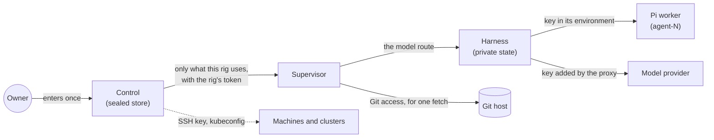

Thermite needs secrets to work: API keys for model providers, logins for subscriptions, SSH keys and kubeconfigs for the places rigs run, access to private repositories, tokens for outside knowledge bases, and tokens for people, programs and rigs. This page follows each kind of secret: where it is kept, where it travels, and who can read it.

The design follows a few rules:

- **Enter each secret once, on control.** Control seals it, and never shows it again.
- **A rig gets only what it uses.**
- **The code the agents run holds no key it does not need.**
- **Keep a hash where a hash will do.**

The words here are in the [glossary](../reference/glossary.md).

## Control's sealed store

Everything you add on the dashboard's **Settings › Providers** page is **sealed**: model provider keys, subscription logins, Git access, SSH keys, kubeconfigs, RunPod keys and the tokens of outside knowledge bases. Control encrypts each one with AES-256-GCM, under a key kept in a separate file, outside its database. A copy of the database alone reveals no secret, and a sealed value that was changed fails to open. The [ports, volumes and secret files reference](../reference/ports-volumes-secrets.md#secret-files) says where each file lives.

The dashboard shows only a hint of each key: its last four characters, such as `key …abcd`. No page, REST route or MCP tool shows you a key again. The MCP tool `providers` lists what control holds without any key, token or kubeconfig.

## Model provider keys

A rig receives a provider's key only when you give one of its agents a model from that provider. Its supervisor fetches the rig's **model route** (the provider's address, the model and its key) from control, with the rig's own token. It hands the route to the harness when it changes, and never logs or keeps the key. The harness keeps the route in its private state, where no agent's or lane's user can read it, and the isolation self-test checks that. The key is never in a command, an event, an export or a log.

Who then uses the key depends on the worker harness:

- **Pi**, the built-in worker harness, runs each worker as its own user, `agent-N`, with the key in its environment. The lane's commands run as another user, which can't read that environment.
- **OpenCode v2** never gets the key. It reaches the provider through a proxy in the harness, with its trial's token. The proxy adds the key on the way out, and the trial's token stops working when the trial ends.
- **The planner and the model check** use short-lived tokens for the same proxy, or the route itself inside the harness.
- **Advisors** with a model from **Edit rig** get their key from control in the supervisor's memory, each round.

[Connect a model provider](../how-to/models/connect-a-provider.md) shows how to add one.

## Subscriptions

A subscription serves one person's own Thermite. A Thermite that several people use takes API keys.

**A Claude subscription.** You get a token with `claude setup-token` on your own computer and paste it on **Providers**. Control seals it and makes no call to Anthropic with it, because Anthropic allows a subscription only in its own program, Claude Code. A rig gets the token only while one of its agents uses a Claude model. The harness keeps it with the model route in its private state, and passes it only to Claude Code. Claude Code starts with a home of its own, no setting sources and no MCP servers. An advisor on a Claude subscription runs in Claude Code with no tools at all.

**A ChatGPT subscription.** Control runs the sign-in with OpenAI and seals the login. It is the only one that renews it, because OpenAI replaces the refresh token at each renewal: the refresh token never leaves control. A rig gets a one-hour access token with its route, renewed while it uses it. Workers reach OpenAI through the harness's proxy with their trial's token, so the hourly token itself stays in the harness, and the proxy lets it reach only OpenAI's `POST /responses` and `GET /models`. Deleting the provider signs Thermite out at OpenAI.

[Use a Claude subscription](../how-to/models/claude-subscription.md) and [Use a ChatGPT subscription](../how-to/models/chatgpt-subscription.md) show the steps.

## Machines and clusters

These secrets let control set rigs up. They never go to a rig.

- **An SSH key** for a machine is pasted, or made by control for you to add to the machine. Control uses it with the OpenSSH client in its own image, from a file that exists only for the call. You compare and trust the machine's host key once, and control refuses a machine that later presents another one.
- **A kubeconfig** for a cluster is given to kubectl the same way, in a file that exists only for the call. Control takes only a kubeconfig that holds everything inline: no login plugins and no references to other files.
- **The rig's own tokens** reach a machine inside the setup script, on standard input, never on a command line. On the machine they sit in a folder that only its user can open. On a cluster they are a Kubernetes secret in the rig's namespace, which moving the rig onto new images leaves as it is.

A **RunPod key** is sealed too. Control uses it to read the account and to start and stop the test pods you ask for. It never goes to a pod. RunPod puts a key of its own in every pod's environment; a rig in [pull mode](trust.md#rigs-in-pull-mode) takes it out of its supervisor's environment at start and never uses it.

A rig in pull mode holds no token for control. Its pod makes its own keys at its first start and keeps them where only the supervisor's user can read them; control pins their public halves when the pod enrolls with its one-time code. Everything with a secret in it, such as a model route with its key or a Git access, reaches the pod sealed to the pod's key, so RunPod's proxy never sees it in plain text ([Enrollment](trust.md#enrollment)).

## Git access

A private repository needs **Git access**: a deploy key that control makes (you add its public half to the repository) or an HTTPS token you paste. Both are sealed. Control hands one to a rig only for a campaign assigned to that rig whose sources name it. The supervisor asks for it at the moment it fetches, and control records each hand-over in its audit log. An SSH key goes into a file in a fresh folder that is removed after the fetch, and a token into an HTTPS header, never into the address or a command line. The host's key is pinned the first time. The access never travels in a signed command, and the harness never sees it: it receives only a git bundle, which it checks against the signed commit.

The **results repository**, where rigs push their exports, uses a deploy key of its own that can write, mounted into the supervisor ([settings](../reference/settings.md#the-results-repository)). The supervisor also uses it to fetch a project or kit whose source names no Git access. [Set up the results repository](../how-to/operate/results-repository.md) shows how.

## Outside knowledge bases

An **outside knowledge base**, such as a GBrain-style brain, is an MCP server that control can copy a campaign's folder to, and that a campaign's teachers can search ([Journals and the knowledge base](journals-and-knowledge.md#what-an-outside-knowledge-base-adds)). It takes a token, which you paste once on **Settings › Providers**. Control seals it like every other secret, and the dashboard shows only its hint, such as `token …abcd`.

- **Control** opens the token to read the server's tool list when you add or check the knowledge base, and to write pages when a campaign's folder is copied there.
- **A rig** gets the token only when control assigned it a campaign that the owner let search that knowledge base. Control hands it to the supervisor with the advisors' models, and its audit log records each change in what a rig is handed, also when that drops to nothing (`outside_kb_handed`). The supervisor keeps it in memory and gives the search only to the teachers of that campaign's runs. The harness and the workers never get it.
- **On the wire**, the token goes in each request's `Authorization` header, never in the address: control refuses an address with credentials, a query or a fragment in it, and one that is not https, except for localhost.
- **It stays with its server.** A new address on another server needs the token again, so a sealed token never goes to a server it was not given for. Control takes the token out of the error texts it shows. Deleting the knowledge base deletes its token.

[Connect an outside knowledge base](../how-to/operate/outside-knowledge-base.md) shows the steps.

## Tokens

When you deploy control, you make the owner's token on your own computer with `thermite token new`, and give control only its SHA-256, so control's machine holds nothing that signs in as you. The operator, agent and reader tokens work the same way. Control keeps the tokens of rigs it enrolled, join commands and dashboard sessions as hashes too. A join command's token works once, within an hour.

Control keeps no copy of two tokens: the supervisor's token for its own harness, which the rig's two containers share, and a trial's token, which one worker holds for one trial and which stops working when the trial ends. [Tokens and roles](../reference/tokens.md) lists every token and what it may do.

Inside the harness, the broker reads the rig's secret files when it starts. It hands their values to the harness's controller alone, closes their folders, and refuses to start if a secret file can still be read by other users ([Isolation inside a rig](isolation.md)).

## Signing keys

- **Control's signing key** signs every command. It is in control's own folder, readable by control alone. Rigs get only its public half.
- **A rig's signing key** signs its reports. It is in the harness's private state, and it survives a full reset.

[Trust between control and rigs](trust.md) explains what each key proves.

## The advisors file

Advisors you configure in the supervisor's advisors file read their API keys from the files it names, at each call, so a new key takes effect without a restart. A role you give a model on **Edit rig** instead keeps its key or token sealed in control, which hands it to the supervisor in memory. The [advisors file reference](../reference/advisors-file.md) lists every field.
