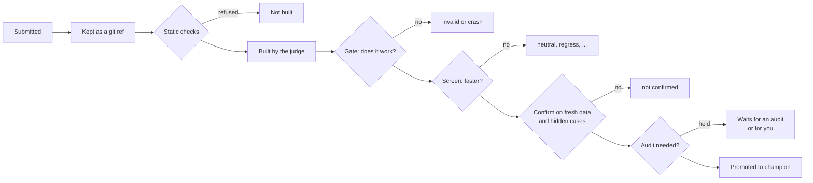

Thermite's central rule is that **an agent never grades its own work.** An agent that can see or edit the thing that scores it will, sooner or later, find a way to make the score look better without the work getting better. Published work on AI research agents shows it again and again. Agents have:

- run an evaluator thousands of times until it gave a lucky number;
- marked work "done" that wasn't;
- written their own verdicts;
- shipped a result while naming a fatal flaw in it;
- found evaluators that rewarded wrong answers.

So in Thermite, agents only propose. A **judge**, which is ordinary code that the agents can neither read nor change, decides what counts.

## What agents can and cannot do

| Agents can | Agents cannot |
| --- | --- |
| Read and edit the project in their own workspace, build it and test their changes | Read or change the judge, the project's [kit](kits.md) or its hidden test cases |
| Use the measuring device for their own test runs while the judge is not using it, or a device of their own on a rig that has one | Run anything on the judge's device while it is timing |
| Submit a change, with what they expect from it and any flaws they know of | Submit a number that counts |
| See the verdict and the judge's reasons for their own lane's attempts, and the state, verdict and refusals of any attempt of their campaign | See hidden test results, other agents' workspaces or any credentials |
| Work on the experiment the planner gives them, and propose ideas for the run's queue | Decide that a campaign is finished |

The [isolation](isolation.md) page explains how a rig enforces this: each agent works as its own operating-system user, with no way into the judge's files.

## How a change becomes the champion

The **champion** is a run's best confirmed result so far. Every change an agent submits takes the same path, and most stop somewhere along it.

1. **Kept.** Before anything else, the change is saved as a git ref with a record of where it came from. Thermite never deletes an attempt, even one that loses: an idea can lose on the main number and still be worth reading later.
2. **Static checks.** The change may touch only the files the [contract](../reference/contract.md) allows, and may not add lines that match its forbidden patterns, such as calls to a timer. A change that breaks these rules is refused before it is built.
3. **Built.** The judge builds the change itself, as a separate user, within the kit's time, memory and disk limits. It stores what the build produced, read-only, and checks it again before every run.
4. **Gate.** The judge runs each test case (a **cell** of the kit; the dashboard says **case**) once for the change and once for the current champion. The kit's check must pass: correct output, plus whatever else the kit checks. A failure here gives the verdict `invalid` or `crash_candidate`.
5. **Screen.** The change and the champion are timed together, in blocks that alternate between the two in a random order, on the same device. The statistics are set in the contract before the run starts: how big a gain must be to count, and what counts as "no different". A block is thrown away and run again when the machine was slowed down by something else during it.
6. **Confirm.** A change that looks better is measured again in fresh blocks, and decided on that new data alone. Now the judge also runs the **hidden test cases**: cases it uses only here, never while screening, so no agent can tune a change to them. When one fails, the agents learn only that a hidden check failed, and how (it timed out, crashed, failed the check, gave no number, or missed its threshold); you see which case, and its value against its threshold ([Held-out failures](../reference/verdicts.md#held-out-failures)).
7. **Audit, sometimes.** On a rig with an auditor, a surprisingly large gain, or a change whose agent declared known flaws, goes to the auditor first. Its block holds the result back; its clear is the last step before the result becomes the champion. The auditor never sets a verdict. Some results then wait for your decision.
8. **Promoted.** The champion moves only if no other change replaced it in the meantime. If one did, the change is screened again against the new champion.

The [verdicts reference](../reference/verdicts.md) lists every verdict and what it means.

## The number that counts

The number that decides a verdict comes from Thermite, never from the agent's change. Either the judge times the run itself, from outside the change's process, or the kit's own check reports it, and agents can't see or edit the kit. Anything the change prints about itself is ignored.

Agents' own test runs also report times, so they can see whether an idea is promising. Those numbers are marked "diagnostic only" and never count.

## Two labels on every attempt

Every attempt records two separate things: **how far it got** (built, screened, confirmed, promoted) and **what the verdict was** (a win, no difference, worse, broken).

So "the idea failed" and "the machine failed" are never mixed up. When something breaks that isn't the change's fault, such as a crashed process of the judge's own or a device that wasn't ready, the attempt is marked as an infrastructure failure, tried once more, and never counted against the research.

## Across several rigs

A campaign can run on several [rigs](../reference/glossary.md) at once. Two devices of the same model can differ by several percent, so Thermite never compares raw numbers from different machines:

- Each rig measures gains against its own starting point, on its own device.
- A rig's champion can be sent to another rig, whose own judge measures it again against that rig's champion. If it wins there too, the result is shown as **cross-verified**.
- Code moving between rigs is checked against hashes in a command that control signs, so nothing in between can swap it.

[Run a campaign on several rigs](../how-to/campaigns/several-rigs.md) shows how.

## Steering without judging

People and advisors can steer the search. The teachers, one of the advisors, point lanes towards or away from directions and change priorities, through directives to the planner, and add experiments to the run's queue. The owner can do the same, and can also pause a run and message its agents and advisors. Only the owner can send a message (an operator's token sends it in the owner's name). The advisors only answer the owner's messages: they never message the agents. An experiment that an advisor adds reaches a lane only as work to try, and the judge measures what comes of it like any other change. Every instruction is recorded with who gave it and why. None of them can set a verdict, change a running contract or write a measurement.

The judge takes no messages at all. It is code, not an agent, so there is nothing in it to persuade, and no message can change a measurement.

The [supervision](supervision.md) page explains the advisors: the teachers, the auditor and the review panel.
