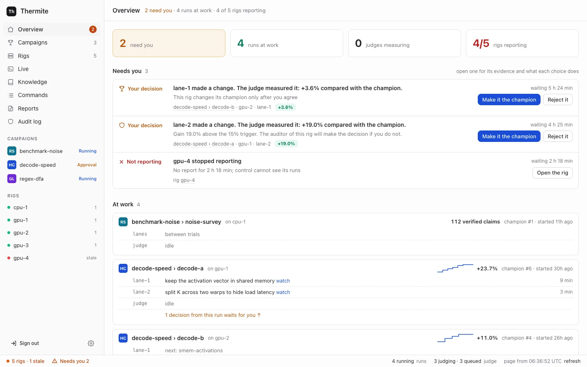

Some things wait for the owner's word: a change that would become the new best, an audit, a subjective goal, a proposal to end a campaign, a rig's new key and a full reset. This page shows where they wait and what each button does. Campaigns go on while a decision waits: agents keep working from the current [champion](../../reference/glossary.md).



## Find what waits

Open **Overview**, the first page in the sidebar on the left. Its **Needs you** block lists every decision across every rig, grouped by kind, oldest first. When nothing waits, it says `Nothing waits for you. The campaigns go on by themselves.`

The count also shows beside **Overview** in the sidebar, and as **Needs you** in the status bar, the line along the bottom of every page. A run's own **Overview** view, on its campaign's page, lists that run's decisions, and a change's own page has a **Your decision** box.

## Decide

1. Open a row. It says what is asked, why it waits, and where: the campaign, run, rig and lane. For a change, **What the judge found** has the judge's evidence and **Problems that the agent wrote** lists flaws the agent declared.
2. Read what each choice does, then press its button.

   The row says `You selected …` and `Control sent it to the rig. The rig does it in less than 10 seconds.`
3. Press **refresh** in the status bar. Once the rig has done it, the row says what happened and `This item goes away after the next report from the rig, in about one minute.` If the rig refused, the row gives the cause, and the buttons come back.

## What each decision asks

| Label | The question | It appears when | Buttons |
| --- | --- | --- | --- |
| **Your decision** | Make this change the new champion? | The run promotes only with your approval, an audit holds the change, or the auditor sent it to you | **Make it the champion**, **Reject it** |
| **Blocked** | Overrule the auditor and make this change the champion? | The rig's auditor blocked the change | **Overrule the auditor**, **Reject it** |
| **Review** | Accept the goal "…" as met? | The rig's review panel passed a subjective goal | **Accept**, **Reject** |
| **Not possible?** | End this campaign as not possible? | The [harness](../../reference/glossary.md), the rig's container that holds the judge, proposes that a goal campaign's goals can't be reached | **End it: not possible**, **Keep going** |
| **New key** | Accept this rig's new report key? | A rig reports with a key control has not pinned | **Accept this key** |
| **Wipe** | Wipe this rig's state? | A full reset you started is ready for its last step | **Confirm the wipe**, **Cancel the reset** |
| **Not reporting** | This rig stopped reporting | A rig has sent no report for a while | **Open the rig** |

### Promotions

When the judge confirms that a change is better, the run's rule decides what happens:

- **always keep it** (`auto`): it becomes the champion at once, unless an audit holds it.
- **ask me every time** (`owner_approval`): it waits for you as **Your decision**.
- **the rig's default**: the rule on the rig's **Edit rig** page, under **3 · When a change becomes the champion**: **Automatically** unless changed, or **Ask me for each change**.

You choose a run's rule with **When a change is confirmed better** on the **New campaign** page, or `--promotion` on `thermite assign`. The run's **Steering** view shows the rule in force.

**Make it the champion** makes the change the next champion: agents start their next work from it. If the champion changed while the change waited, the judge first tests it again against the new champion. If the agent declared flaws, approving accepts them, and the record shows your name. **Reject it** keeps the change from becoming the champion, and the record shows that you rejected it.

### Audits

An audit holds a confirmed change before it becomes the champion when:

- the agent declared flaws in it;
- in a hill climb, its gain is above the contract's `acceptance.audit.absolute` (0.15, that is 15%), or above `acceptance.audit.ratio_to_median` (3) times the median of the run's earlier wins, once it has three;
- in a goal campaign, the contract has an `adversarial_checklist`: then every change is audited.

The rig's auditor, one of its [advisors](../operate/advisors.md), answers each audit: it clears the change, blocks it, or sends it to you. Who decides then:

| Why the change is audited | The auditor clears it | The auditor blocks it |
| --- | --- | --- |
| The agent declared flaws | It waits for you | **Blocked**: you may overrule |
| A gain above `absolute` | It waits for you | **Blocked**: you may overrule |
| A gain above `ratio_to_median` times the median | It becomes the champion, or waits for you if the run asks you every time | **Blocked**: you may overrule |
| A goal campaign's `adversarial_checklist` | The same | **Blocked**: you may overrule |

The row says either `The auditor of this rig will make the decision if you do not.` or `This rig has no auditor, thus you must make the decision.`

**Make it the champion** decides in place of the auditor. **Overrule the auditor**, on a **Blocked** row, makes a blocked change the champion anyway.

### Reviews

A goal checked by `review` counts as met only with your word. It reaches you only after the rig's review panel passes it. A panel chosen on **Edit rig** is three reviewers with the same model; one in the rig's advisors file has two to five. A rig with no review panel leaves such goals unmet.

:::note[A switch that is on is not an advisor]
On **Edit rig**, the **Auditor**, **Teacher pair** and **Review panel** switches are on by default, also on a rig that has no such advisor. A switch only lets an advisor work once it has a model. The rig's page shows what it has: its **Advisors** row says `none configured` when it has none. See [Configure advisors](../operate/advisors.md).
:::

**Accept** makes the goal met; the judge then checks the champion's goals again, and if every required goal is met, the campaign completes. **Reject** keeps the goal unmet.

### "Not possible" endings

The harness proposes ending a goal campaign as not possible only when its contract allows it (`infeasibility.allowed`), and once `min_refuted_approaches` approaches have each had at least three changes judged with no progress. Campaigns made on the **New campaign** page don't allow it. No agent can end a campaign.

**End it: not possible** closes the run: its agents stop, and nothing more is judged. **Keep going** dismisses the proposal. A later proposal needs a newly refuted approach.

### Keys, resets and silent rigs

- **New key**: work out the rig's own fingerprint on the rig, as [Accept a rig's key](../operate/accept-a-rig-key.md#2-work-out-the-rigs-own-fingerprint) shows: the first 16 hexadecimal characters of the SHA-256 of its public key. Nothing prints it when a rig is set up. If it matches the one on the row, press **Accept this key**. Until you do, control refuses the rig's reports.
- **Wipe**: check that the export it names is in the results repository, then press **Confirm the wipe**, which deletes the rig's ledger, builds and workspaces for good. **Cancel the reset** wipes nothing; the rig stays paused until you resume its run. Only a rig with a results repository can be fully reset, and rigs that control sets up have none yet ([goal 061](https://github.com/iammrduncan/thermite/blob/main/docs/plan/goals/061-gaps-found-by-the-docs.goal)). See [Stop, restart, remove and fully reset a rig](../operate/rig-lifecycle.md).
- **Not reporting**: **Open the rig** shows its last known state and what you can do.

## Decide without the dashboard

All of these take the owner's token. The examples use the owner's token file of the local stack, `.dev/secrets/control-admin-token`. If you made an owner's token of your own, use its file instead.

| Decision | REST API | MCP |
| --- | --- | --- |
| Make a change the champion, or reject it | `POST /v1/commands`, kind `approve_promotion` or `decline_promotion`, payload `{"run": …, "attempt": …}` | `issue_command`, with the owner's token |
| Accept or reject a review | kind `accept_review`, payload `{"run": …, "review": <n>, "accept": true}` | no |
| End a campaign as not possible, or keep going | kind `conclude`, payload `{"run": …, "proposal": <n>, "accept": true}` | no |
| Accept a rig's key | `POST /v1/rigs/<rig>/key/accept?fingerprint=<fingerprint>` | no |

The `review` and `proposal` numbers are on the run, in `GET /v1/rigs/<rig>/view` or the MCP tool `get_run`: each item of its `reviews` has a `review`, and each item of its `conclusions` a `proposal`. An attempt's id shows at the top of its page on the dashboard, after **attempt**, such as `a-0123456789abcdef`.

`thermite command` sends the same kinds. Run `npx thermite` in your Thermite folder, after `npm ci` and `npm run build` (see [the command line](../../reference/command-line.md)):

```sh
npx thermite command --control http://127.0.0.1:8800 --token-file .dev/secrets/control-admin-token \
  --rig local-1 --kind approve_promotion --payload '{"run":"sort-speed-1","attempt":"a-0123456789abcdef"}'
```

The operator's and agent's MCP tokens can't issue any of these kinds.
