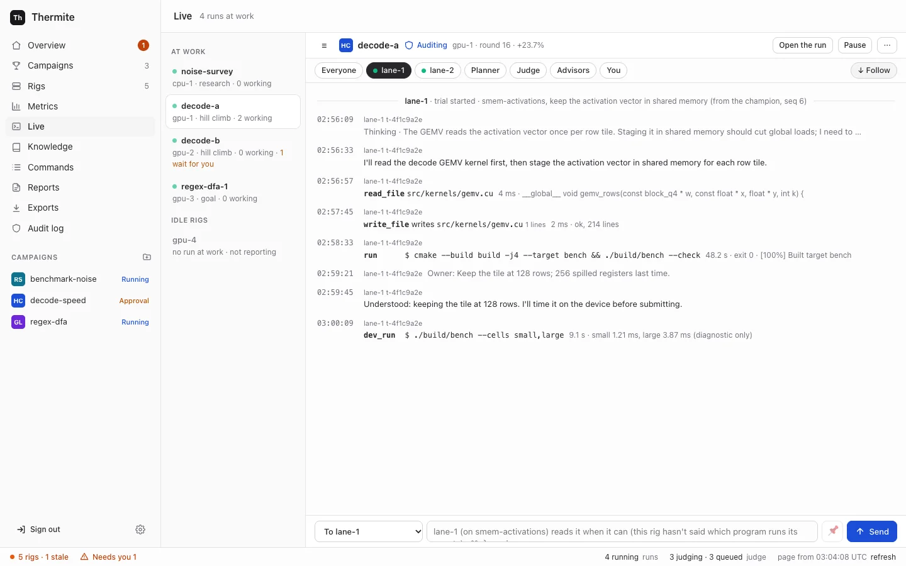

You can steer a running campaign without touching its judge: pause or resume it, start its lanes afresh, give its planner rules about which directions to try or avoid, and send its agents a message. Nothing you do here changes a verdict.

| Action | Where on the dashboard | What it does |
| --- | --- | --- |
| **Pause** | The run's header, Live's header, or the run's card under **At work now** | The agents' running [trials](../../reference/glossary.md) stop, and no new ones start. A stopped trial's work that it had not submitted is thrown away; changes already submitted stay. The judge finishes the job it is on; the run's other queued jobs wait until you resume |
| **Resume** | The run's header, Live's header, or the run's row under **Earlier runs** | New trials start again, and the planner plans the next round. Agents resting after six failed trials in a row ([limits and pacing](../../reference/limits-and-pacing.md#trials-and-lanes)) start again at once. Any other running run on that rig is paused: a rig runs one run at a time |
| **Restart the lanes** | **⋯** in the run's header, while the run is running | Ends the running trials and the current round. The planner plans afresh, and every lane starts again from the champion. Nothing the judge decided is lost |
| A rule | The run's **Planner** tab | Tells the planner, from its next plan on, to avoid a direction, to try it, or to always give it a lane |
| A message | The message box in **Live**, or **Tell the planner** on the **Planner** tab | Text for everyone working, one lane, the planner or the [advisors](../../reference/glossary.md). A message to everyone or to a lane can stay in force for every new trial |

A trial is one worker's session in a [lane](../../reference/glossary.md): it ends when it submits a change, when its time runs out, or when it stops. [Agents, lanes and the planner](../../explanation/agents-lanes-planner.md) explains lanes, trials and the planner.

## Before you start

- A run that is running or paused. A closed run can't be resumed: `run <id> is closed`.
- The owner's sign-in on the dashboard, the owner's token for the command line, or an MCP token that may steer: see [Who may do what](#who-may-do-what).

## Pause, resume or restart the lanes

1. Open **Campaigns** in the sidebar, then the campaign. Press the run's name: on its card under **At work now**, shown as `<campaign> › <run>`, or, for a paused run, in its row under **Earlier runs**. The run's page opens.
2. In the run's header, press **Pause** or **Resume**. To restart the lanes, press **⋯**, then **Restart the lanes**. **⋯** shows only while the run is running.

   The page says `Control sent the command to rig-1. The rig does it in less than 10 seconds. This page shows the result.`, with your rig's name.
3. A little later, press **refresh** in the status bar, the line along the bottom of the page. Once the rig has reported, within a minute, the run's **History** tab shows `Run sort-speed-1 paused: paused from the dashboard.` or `Run sort-speed-1 resumed.` After **Restart the lanes**, the running trial shows as `ended without a submission (interrupted)`, and a new plan follows.

A pause from the dashboard always gives the reason `paused from the dashboard`. To give your own reason, pause from the [command line](#steer-from-the-command-line).

## Give the planner a rule

The dashboard calls the planner's directives **rules**. A rule names a direction, an approach the lanes work on such as `loop-tiling`, and changes which directions the lanes get, never a verdict.

1. Open the run's page, then its **Planner** tab. **Rules** lists the rules in force, each with who set it (you, the teachers, …), when, and why.
2. Open **Add a rule**. It is already open when the run has no rules.
3. In **Rule**, choose **Avoid** (no lane is given that direction), **Try** (the planner should try it) or **Always** (every plan gives that direction a lane).
4. In **Direction**, write a direction's name: 2 to 41 lowercase letters, digits and dashes, such as `loop-tiling`. To name a direction the planner already uses, copy it from a plan in **History**, such as `The planner planned round 4: lane-1 on loop-tiling; lane-2 on vectorize.` **Avoid** matches that exact name. For a new direction, make up a name.
5. In **Why**, say why, and for a new direction what you mean. The planner reads it; the workers never do.
6. Press **Add the rule**.

The page says that control sent the command. Once the rig has reported, the rule shows under **Rules**, and **History** says `A steering directive took effect.` Each rule you add here adds to your earlier ones. To replace your rules with a new set, send a `redirect` from the [command line](#steer-from-the-command-line).

:::caution[Only a direction's name works today]
The **Direction** field's help suggests your own words, such as `anything that uses shared memory`. Control refuses those today: `refused: bad redirect payload: directives.0: Unrecognized key: "match"`. **Remove** beside a rule is refused too, with `unknown command`, and the **Experiments** tab's buttons don't work yet. All three come with the experiment queue ([goal 064](https://github.com/iammrduncan/thermite/blob/main/docs/plan/goals/064-experiment-queue.goal)).
:::

- When the planner can't make a plan, it uses its fallback plan, and **History** says `its fallback plan`. That plan keeps to **Avoid** and **Always**, but follows **Try** only for a direction already in use. To have a new direction worked on, use **Always**.
- A research run has no planner model: a fixed method sets its rounds, and **History** says `The research plan set round 2: lane-1 on explore; …`. Its directions are its task kinds, `explore`, `primary`, `contradict` and `consolidate`: **Avoid** drops one, and **Try** or **Always** puts it first.

## Send the agents a message



1. Press **Message** in the run's header, or on the run's card under **At work now**. **Live** opens on that run, with the cursor in the message box at the foot of the page. (**Live** in the sidebar opens the first run at work; the list on its left holds the others.)
2. In the **To** list, choose who gets it:
   - **To everyone working**, the default: every lane, and the planner of a hill climb or goal run;
   - **To lane-1**, **To lane-2** and so on: that lane's running trial, or its next one;
   - **To the planner**: at its next plan;
   - under **Advisors**: **To all advisors**, **To the teachers**, **To the auditor** or **To the review panel**.

   A recipient that would never read it is greyed out: the planner, the auditor and the review panel of a research run, and any role that is switched off on the rig's **Edit rig** page. Choosing a lane's chip above the stream, or **Planner** or **Advisors**, also chooses that recipient.
3. Write the message, up to 4,000 characters. The box's placeholder says when they will read it, such as `lane-1 (on loop-tiling) reads it at its next step`. To keep it in force for every new trial, tick 📌 (see [Keep a message in force](#keep-a-message-in-force)).
4. Press **Send**, or Ctrl+Enter (⌘+Enter on a Mac).

Within seconds, the stream shows your message, such as **To lane-1:** `Look at the cache misses first.` When an agent reads it, a receipt follows: `✓ lane-1 read your message: “Look at the cache misses first.”` An advisor also answers, such as **the teacher pair (teacher-a) answered you:** and its answer. The filter **You**, above the stream, shows only your messages, their receipts and the answers. The judge takes no messages: it is code, and nothing anyone writes may change a measurement.

You can also write to the planner of a hill climb or goal run from its run's **Planner** tab: write in **Tell the planner** and press **Send to the planner**. The tab says `Sent. The planner reads it when it next gives out work.` The card also says that the planner can change the experiment queue and the rules from what you say: that comes with [goal 064](https://github.com/iammrduncan/thermite/blob/main/docs/plan/goals/064-experiment-queue.goal). Today the planner reads your message as it plans the next round.

### When each agent reads it

A receipt means the text was given to the agent. Each reader reads a message once, except a message kept in force, which each new trial reads again.

| Reader | When it reads your message |
| --- | --- |
| A worker in Pi | At its next step, before its next model call |
| A worker in OpenCode or Claude Code | When its current run ends without a submission: the rig then continues the session with your message. A run ends when the model stops by itself, which can take many minutes. If the trial ends first, the lane's next trial reads it |
| A worker that has submitted, or a lane with no trial running | In the brief of the lane's next trial |
| The planner | At its next plan, once its model answers. If its model can't be reached, the message waits for the next plan |
| The teacher pair | While the run is running, in a round that starts at once, after any round already under way. For a paused run, the message waits until it runs again |
| The auditor, the review panel | With their next audit or review. One comes only when the judge holds a change for audit, or a goal waits for review |

[Supervision](../../explanation/supervision.md#the-owners-messages) says how the advisors read and answer your messages.

### Keep a message in force

A message kept in force goes into the brief of every new trial until you remove it: every lane's new trials, for a message to everyone working, or one lane's, for a message to that lane. Only those two can be kept: for the others, 📌 does nothing.

- In the stream, a kept message shows `📌 kept in force`, and each trial that reads it shows `✓ lane-1 read your message (in force): …`.
- **📌 2 kept**, above the stream, lists your kept messages: `Every new trial gets these, until you remove them.` To end one, press **Remove** beside it. Once the rig has done it, the stream says `the owner's message #3 is no longer in force`.

### Write to one trial

Live writes to a lane, not to one trial. To write to one trial, open the rig's page and press **Live**: this view shows every session on the rig. Choose the trial under **Sessions**, such as **Worker · lane-1**, keep **this worker (t-…)** in the box's first list, and send. If the trial ends before it reads the message, the lane's next trial reads it, and is told so.

### If a message doesn't arrive

The rig refuses a message that nothing would read, and says why. Live doesn't show the refusal: open **Commands** in the sidebar, where the newest **message agent** row is **failed**, with the reason under **Outcome**, such as:

- `run sort-speed-1 has 2 lanes`: the lane is not one of the run's;
- `run sort-speed-1 is closed: nothing will read this message`;
- `the planner is off on this rig (Edit rig), so nothing would read this message`, and the same for the teacher pair, the auditor and the review panel;
- `this run has no goal the review panel reviews, so the panel would never read this message`.

A message to an advisor that has no model is accepted, but nothing reads it until the advisor has one: its switch on **Edit rig** is on by default. See [Configure advisors](../operate/advisors.md).

## Steer from the command line

`thermite command` sends the same commands, with the owner's token. Run `npx thermite` in your Thermite folder, after `npm ci` and `npm run build` (see [the command line](../../reference/command-line.md)). The examples use the owner's token file of the local stack, `.dev/secrets/control-admin-token`. If you made an owner's token of your own, use its file instead.

```sh
npx thermite command --control http://127.0.0.1:8800 --token-file .dev/secrets/control-admin-token \
  --rig local-1 --kind pause_run --payload '{"run":"sort-speed-1","reason":"checking the kit"}'
```

It prints the command's id and `"status":"pending"`. The payloads:

| Kind | Payload |
| --- | --- |
| `pause_run` | `{"run":"sort-speed-1","reason":"checking the kit"}` |
| `resume_run` | `{"run":"sort-speed-1"}` |
| `reset_workers` (**Restart the lanes**) | `{"run":"sort-speed-1"}` |
| `redirect` | `{"run":"sort-speed-1","directives":[{"kind":"avoid","family":"loop-tiling","rationale":"three trials regressed"}]}` |
| `message_agent` | `{"run":"sort-speed-1","to":"lane-2","text":"Look at the cache misses first."}` |
| `message_agent`, kept in force | `{"run":"sort-speed-1","to":"all","text":"Keep the public API unchanged.","keep":true}` |
| `unkeep_message` | `{"run":"sort-speed-1","message":3}` |

A `redirect` takes up to 40 directives, each with a `kind`, a `rationale`, and a `family` or `value` where the kind needs one:

| `kind` | What it does |
| --- | --- |
| `avoid` | No lane is given that direction |
| `try` | The planner should try it |
| `mandate` | Every plan gives that direction a lane (**Always** on the dashboard) |
| `priority` | Ranks a direction for the planner |
| `lane_count` | `value`: how many lanes to plan, up to the contract's `lanes.count` |
| `note` | Free text for the planner |

- A set replaces your earlier set unless it has `"replace": false`.
- A set that both avoids a direction and asks for it is refused: `the set both avoids and asks for <direction>`.
- Only the planner sees rationales and notes; workers never do.
- Your directives come before any that the rig's advisors send about the same direction.

A `message_agent`'s `to` is `all` (everyone working), `planner`, `advisors` (all of them), `teachers`, `auditor`, `panel`, `lane-1` to `lane-16`, or `trial:` and a trial's id. The text may be up to 4000 characters. `"keep": true` works only with `all` or a lane; with another `to`, control refuses it: `bad message_agent payload: keep: only a message to everyone working (all) or to a lane can be kept in force`.

The rig numbers each message, and `unkeep_message` takes that number as `message`. Find it in the rig's answer to the `message_agent` command, such as `{"status":"applied","accepted":true,"result":{"message":3,…}}`: in the **Outcome** column on **Commands**, or in `outcome` from `GET /v1/commands/<id>`.

Over MCP, an agent sends the same kinds and payloads with the `issue_command` tool, then follows them with `command_status`. The tool `run_queue` reads a run's rules, and your messages with who read each one and the advisors' answers. See [Let an agent run Thermite over MCP](../automate/agent-over-mcp.md).

## Who may do what

| | Pause, resume, restart the lanes, add rules | Message the agents, remove a kept message |
| --- | --- | --- |
| The owner: dashboard, REST API, command line, MCP | yes | yes |
| The operator's token over MCP | yes | yes |
| The agent's token over MCP | yes | no |
| The reader's token | no | no |

Approving and rejecting changes is the owner's alone: see [Decide what waits for you](decide-what-waits.md). [Tokens and roles](../../reference/tokens.md#people-and-agents) has every role.
