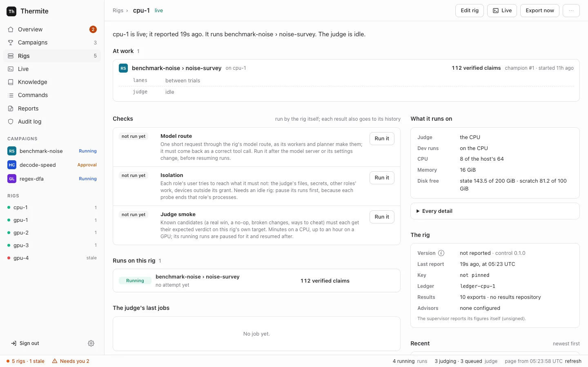

A rig can check itself in three ways: that its model answers, that its agents are kept away from the judge, and that its judge gives known changes the verdicts they should get. Run the checks after you set a rig up, after a new version, and after you change its model. Giving a rig a model runs its **Model route** check by itself.



| Check | On the dashboard | What it tells you | How long |
| --- | --- | --- | --- |
| Model route | **Model route** | The rig's model answers a request with a correct tool call, the way its agents use it | Seconds; at most 2 minutes |
| Isolation | **Isolation** | Each agent's user is refused what it must not reach: the judge's files, secrets, other agents' work, devices outside its share | Seconds |
| Smoke | **Judge smoke** | The judge gives each change in a known set its expected verdict, on this rig's own device | A few minutes on a CPU, up to an hour on a GPU |

A result reaches the dashboard with the rig's next report, which comes every minute. The [rig checks reference](../../reference/rig-checks.md) describes each check in full.

## Before you start

- The rig reports to control: on **Rigs**, in the dashboard's sidebar on the left, it has the green chip **Live**.
- For **Isolation** and **Judge smoke**, the rig must be idle: no [trial](../../reference/glossary.md) open, and no judge job queued or running. Otherwise both refuse with `not now:`. To get there, open the rig's page, press **Edit rig**, switch **Workers** off and press **Save changes**. Running trials end on their own, and the judge works through its queue; the rig's page then says "The judge is idle." Turn the workers on again after the check. **Judge smoke** pauses the rig's running runs while it works, and resumes them afterwards.

  A paused run's queued judge jobs wait until it resumes, and they keep the rig busy ([goal 061](https://github.com/iammrduncan/thermite/blob/main/docs/plan/goals/061-gaps-found-by-the-docs.goal)). Resume such a run while the workers are off, so that the judge can finish its jobs.
- For **Model route**, the rig needs a model. See [Connect a model provider](../models/connect-a-provider.md).

## Run a check on the dashboard

1. Open **Rigs** and choose the rig.
2. Find the **Checks** block. Each check shows **not run yet**, **running**, **passed** or **failed**, with when it ran.
3. Press **Run it** beside the check.

   The page says that control sent the command, and that the rig does it in less than 10 seconds.

4. Wait, then press **refresh** in the status bar, the line along the bottom of every dashboard page. Dashboard pages do not reload by themselves.

The check shows **passed** or **failed** and one sentence about what it found. The same sentence goes to the rig's history.

While **Judge smoke** runs, a campaign named `rig-check-smoke-cpu-` and eight letters and digits appears under **Campaigns** in the sidebar, with a run named `check-smoke-` and eight more. You can open it and watch the judge work. The run closes when the check is done. Later, the **Campaigns** page lists it under its **Rig checks** filter: it hides rig checks unless you ask for them.

## Run a check from the command line or an agent

The dashboard sends a signed `rig_check` command. You can send the same command yourself.

From the command line, it needs the owner's token. Run `npx thermite` in your Thermite folder, after `npm ci` and `npm run build` (see [the command line](../../reference/command-line.md)). The examples use the owner's token file of the local stack, `.dev/secrets/control-admin-token`. If you made an owner's token of your own, use its file instead.

```sh
npx thermite command --control http://127.0.0.1:8800 --token-file .dev/secrets/control-admin-token \
  --rig local-1 --kind rig_check --payload '{"check":"smoke"}'
```

Use `"model"`, `"isolation"` or `"smoke"` for `check`. The command prints the command's id and `"status":"pending"`. The result appears on the rig's page and in its history, as above.

Over MCP, an agent, operator or owner token can send it with the `issue_command` tool, kind `rig_check`. See [Let an agent run Thermite over MCP](../automate/agent-over-mcp.md).

:::caution[Forcing a check]
A busy rig refuses a check with `not now:` and the reason. The command accepts `"force": true` to run it anyway, which ends whatever the check's probes touch. Use it only when you know what is running. The dashboard never forces a check.
:::

## Read the result

| You see | It means | What to do |
| --- | --- | --- |
| Model route **passed**: "*model* answered with a correct tool call in *n* s" | The model works for the agents | Nothing |
| Model route **failed**: "*model* failed the tool-call check: no answer in 120 s (is the model up?)" | The model server did not answer | Check the server and the provider's base URL |
| Model route **failed**: "… no tool call" | The model answered but did not call the tool | Choose a model that supports tool calling |
| Model route **failed**: "*model* failed the tool-call check in OpenCode:" (or "in Claude Code:" or "in Codex:") and an error, such as "Rate limit exceeded. Please try again later." | The error comes from the model's provider. OpenCode's free models are sometimes busy | Run the check again later, or choose another model |
| Model route **failed**: "no model route: …" | The rig has no model | [Connect a model provider](../models/connect-a-provider.md) |
| Smoke **passed**: "smoke on smoke-cpu: all 12 candidates were judged as expected" | The judge works on this device | Nothing |
| Smoke **passed**: "smoke on smoke-cpu: 11 of 12 candidates were judged as expected; the no-op came out inconclusive, not neutral", then "Note: The timing on this machine is noisy. Results here need more repeats." | The judge works, but timing on this device varies too much to call a change that does nothing `neutral` | Give campaigns on this rig more repeats: raise **Runs per case** (`acceptance.runs_per_cell`). See [Judge smoke passed with a note](troubleshoot.md#judge-smoke-passed-with-a-note) |
| Smoke **failed**: "*k* of *n* candidates were judged otherwise" | Some known change got the wrong verdict | Read the names it lists, then see [Troubleshoot](troubleshoot.md) |
| Isolation **passed**: "isolation holds: every probe of *n* roles came out as it must (devices: …)" | Each agent's user is kept from what it must not reach | Nothing |
| Isolation **failed**: "isolation does NOT hold (devices: …): *role* *probe*: ALLOWED; …" | A role reached something it must not (`ALLOWED`), or was refused something it needs (`UNREADABLE`, `UNREACHABLE`, `WRONG GPUS`) | Pause the rig's runs and start none on it until the check passes. Look up each probe in the [rig checks reference](../../reference/rig-checks.md#isolation-check), then see [Troubleshoot](troubleshoot.md#the-isolation-check-failed) |
| Isolation **failed**: "… the device setup failed" | The rig's split of GPUs between the judge and the agents could not be set up | Pause the rig's runs, and check its GPU settings: see [Troubleshoot](troubleshoot.md#the-isolation-check-failed) |
| "the *check* check is still running" | A check is still running on the rig, this one or another: a rig runs one check at a time | Wait for it, then run yours |
| "not now: …" | The rig is busy: it names the open trials and judge jobs, or a planner call that is running | Make the rig idle as in [Before you start](#before-you-start), or wait a few minutes for the planner call to end, then run the check again |

The rig's harness container also runs the isolation check on its own each time it starts, before it does anything else, so a rig's page usually already shows a recent result.
