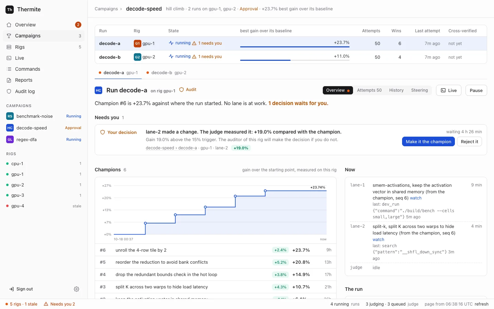

import { Card, CardGrid, LinkCard } from "@astrojs/starlight/components";

New to Thermite? [Start here](start-here.md). It says what you need, which pages to read first, and what words such as rig, lane and champion mean.

## What Thermite does

You give Thermite a project and a way to measure it: make this program faster, make these tests pass, or find out what is known about a question. AI agents then work on it for as long as it takes. Each agent proposes a change. Thermite's judge, which the agents can neither see nor edit, builds the change, measures it and decides whether it counts.

<CardGrid>
  <Card title="Agents propose, code judges" icon="approve-check">
    An agent never grades its own work. The judge measures every change on the same machine,
    against the same reference, and keeps a record of why each one won or lost.
  </Card>
  <Card title="It keeps going" icon="rocket">
    Nothing stops a campaign by default: no limit on turns, attempts, failures or time. A goal
    campaign ends when its goals are met. A hill climb runs until you pause it, or until a
    [budget or stop time](how-to/campaigns/budget-and-stop-time.md) that you set.
  </Card>
  <Card title="Three kinds of research" icon="puzzle">
    Push a number up without breaking anything else. Work until a list of goals is met. Or research
    a question for a set time and get a sourced report.
  </Card>
  <Card title="One place to watch and steer" icon="laptop">
    A dashboard, a REST API and MCP show every campaign on every rig. People and their agents can
    pause, redirect and message the work. Only you approve what matters.
  </Card>
</CardGrid>

## Find your way

There are four kinds of pages, and each one does one job:

<CardGrid>
  <LinkCard
    title="Tutorials"
    description="Learn by doing. Start with your first run on your own computer."
    href="tutorials/first-run/"
  />
  <LinkCard
    title="How-to guides"
    description="Steps for one task: add a rig, connect a model, start a campaign, take the result."
    href="how-to/install/one-machine/"
  />
  <LinkCard
    title="Reference"
    description="Every setting, file, command, API route and MCP tool, described completely."
    href="reference/settings/"
  />
  <LinkCard
    title="Explanation"
    description="How Thermite works and why it is built this way."
    href="explanation/what-thermite-is/"
  />
</CardGrid>

## For agents

The whole site is available to AI agents as plain text: [`llms.txt`](/thermite/llms.txt) lists every page, and [`llms-full.txt`](/thermite/llms-full.txt) holds all of them in one file. Every page is also published as Markdown at its own address with `.md` added.

Thermite is open source under the MIT license.
