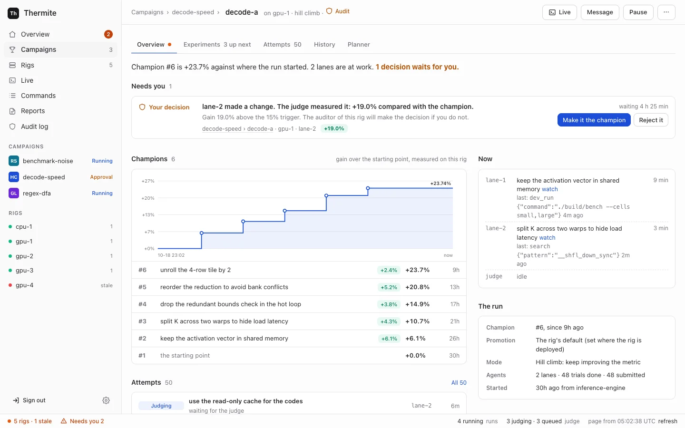

import { Card, CardGrid, LinkCard } from "@astrojs/starlight/components";
import HowItWorks from "../../components/HowItWorks.astro";

New to Thermite? [Start here](start-here.md). It says what you need, which pages to read first, and what words such as rig, lane and champion mean.

## What Thermite does

You give Thermite a project and a way to measure it: make this program faster, make these tests pass, or find out what is known about a question. AI agents then work on it for as long as it takes. Each agent proposes a change. Thermite's judge, which the agents can neither see nor edit, builds the change, measures it and decides whether it counts.

<CardGrid>
  <Card title="Agents propose, code judges" icon="approve-check">
    An agent never grades its own work. The judge measures every change on the same machine,
    against the same reference, and keeps a record of why each one won or lost.
  </Card>
  <Card title="It keeps going" icon="rocket">
    Nothing stops a campaign by default: no limit on turns, attempts, failures or time. A goal
    campaign ends when its goals are met. A hill climb runs until you pause it, or until a
    [budget or stop time](how-to/campaigns/budget-and-stop-time.md) that you set.
  </Card>
  <Card title="Three campaign modes" icon="puzzle">
    A **hill climb** pushes a number up without breaking anything else. A **goal** campaign works
    until a list of goals is met. A **research** campaign studies a question for a set time and
    writes a sourced report. [Campaign modes](explanation/campaign-modes.md) compares them. In every
    mode, agents keep field notes as they work, and each campaign's research goes into a
    [knowledge base](explanation/journals-and-knowledge.md) that later runs can read.
  </Card>
  <Card title="One place to watch and steer" icon="laptop">
    A dashboard, a REST API and MCP show every campaign on every rig. People and their agents can
    pause, redirect and message the work, and choose what the agents try next. Only you approve
    what matters.
  </Card>
</CardGrid>

## How it works

Thermite has two kinds of part. **Control** is the one place you watch and steer from. **Rigs** do the research, each on its own machine, cluster node or cloud pod, and each rig is two containers: a **harness**, where the agents and the judge work, and a **supervisor**, which links the rig to control and runs its advisors.

<HowItWorks />

### A run, step by step

1. **You start a campaign** on control: from **New campaign** on the dashboard, over the REST API or MCP, or with the `thermite` command line. Its **contract** says what counts: a number to push up in a **hill climb**, or a list of goals to meet in a **goal** campaign (see [Campaign modes](explanation/campaign-modes.md)). Its **kit** says how to build and measure your project. Control sends the rig you choose a signed command to start the run.
2. **The rig takes it.** The supervisor fetches the project, the kit and any model files the command names, each by its commit or its hash, and hands the command to the harness. The harness checks the signature, and that what was fetched is what the command named.
3. **The planner hands out the work.** The run has one **experiment queue**, a list of what to try. At the start of each round, the planner gives each **lane** its next experiment, and a starting point: the champion, or the lane's own best result. No two lanes get the same experiment.
4. **A worker tries it.** Each **trial** is a fresh agent session, which the harness builds from its records: the experiment, the lane's recent results with the judge's reasons, and the campaign's brief. The worker changes its own copy of the code, may test it in runs that never count, and submits one change with what it expects it to do.
5. **The judge decides.** It builds the change and runs the kit's check on it. In a hill climb, it then times the change against the champion on the same device, in alternating blocks; in a goal campaign, it checks each goal. A change that looks better is measured again on fresh runs, and on hidden test cases when the contract has them, before it counts. No agent can read or change the judge.
6. **A confirmed win becomes the champion,** the code that the next trials build on. When the campaign calls for an audit, the auditor's clear is the last step. When you asked to decide yourself, the win waits for you under **Needs you**.
7. **The advisors steer.** The teachers read the results and the champion's code, add ideas to the queue and give the planner rules, each with its reasons. The review panel scores goals that code can't measure. The advisors never set a verdict.
8. **Everything is recorded, and reaches you.** The rig's **ledger** keeps every experiment, attempt, measurement and verdict. The supervisor sends it all to control, where you follow the run on **Live** and its page, and steer it with signed commands: pause it, message its agents, add experiments. It pushes the results to git, and control files each campaign's records in its folder of the knowledge base, for later runs to read.
9. **Round after round,** until the goals are met, a budget or stop time you set runs out, or you stop it. Nothing stops a campaign by default.

The third mode, **research**, has no project to change and no kit. Its workers read sources through the rig's archiving fetcher and record claims with exact quotes. Code finds every quote, word for word, in the archived page before a claim counts, and the run ends with a report when its time is up or you close it.

[How the parts fit together](explanation/how-it-fits-together.md) explains each part, [Agents, lanes and the planner](explanation/agents-lanes-planner.md) a trial, [Why agents never judge](explanation/why-agents-never-judge.md) the judge, and [Supervision](explanation/supervision.md) the advisors.

## Find your way

There are four kinds of pages, and each one does one job:

<CardGrid>
  <LinkCard
    title="Tutorials"
    description="Learn by doing. Start with your first run on your own computer."
    href="tutorials/first-run/"
  />
  <LinkCard
    title="How-to guides"
    description="Steps for one task: add a rig, connect a model, start a campaign, take the result."
    href="how-to/install/one-machine/"
  />
  <LinkCard
    title="Reference"
    description="Every setting, file, command, API route and MCP tool, described completely."
    href="reference/settings/"
  />
  <LinkCard
    title="Explanation"
    description="How Thermite works and why it is built this way."
    href="explanation/what-thermite-is/"
  />
</CardGrid>

## For agents

The whole site is available to AI agents as plain text: [`llms.txt`](/llms.txt) lists every page, and [`llms-full.txt`](/llms-full.txt) holds all of them in one file. Every page is also published as Markdown at its own address with `.md` added.

Thermite is open source under the MIT license.
