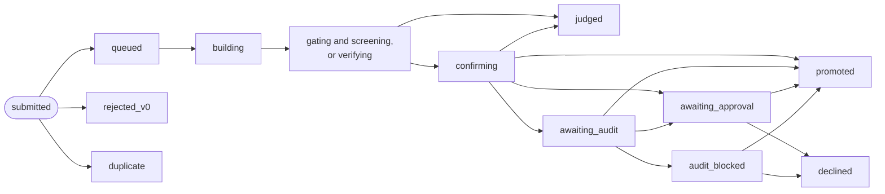

The **judge** gives each **attempt** (one submitted change) a **verdict**. The attempt also moves through a series of states while the judge works on it. This page lists every verdict and every state, with the words the dashboard shows for each. [Why agents never judge](../explanation/why-agents-never-judge.md) explains the steps in order. The [glossary](glossary.md) explains the other terms.

## An attempt's path

The diagram leaves out three returns to `queued`: after one infrastructure failure, when the champion changed before confirmation, and when another change became the champion first. After a second infrastructure failure the attempt is `errored`. The owner can also decline an attempt in `awaiting_audit`. A patch that does not apply to its parent never becomes an attempt: the submission is refused and counted as a `submission_refused` event.

## Verdicts

A verdict is written once and never changed. A later verdict on the same attempt, such as the confirmation after a screen, is added after it. The dashboard shows the newest one.

Only two verdicts can make an attempt the champion: `win_confirmed` and `goal_progress`.

### Hill climb

The judge times the change against the champion in **blocks**: each block runs every case (a **cell** of the kit) that the contract names, for both, in a random order. It looks at the result after the block counts in `acceptance.looks`. The [contract reference](contract.md) describes each setting named here.

| Verdict | Given at | Meaning | Dashboard says |
| --- | --- | --- | --- |
| `win_screened` | Screen | The gain's interval is above zero, its estimate is at least `min_effect`, and no guard is broken or unclear. A confirmation follows | "looked faster in screening; being confirmed on fresh runs" |
| `neutral` | Screen | The interval lies inside ± `equivalence_band` (reason `equivalent`), or it is above zero but wholly below `min_effect` (reason `gain below min_effect`) | "no measurable difference" |
| `regress` | Screen | The interval lies wholly below zero (reason `worse`) | "worse than the champion" |
| `tradeoff` | Screen or confirmation | At the screen: the change would be a win, but a guard metric got worse by more than its step allowance. At confirmation: a guard got worse by more than its step allowance, or a guard's total allowance since the seed is spent | (the verdict's name) |
| `infeasible` | Screen or confirmation | A `min` or `max` hard constraint failed | (the verdict's name) |
| `inconclusive` | Screen | No decision by the last look, or a guard still unclear at the last look | "too noisy, or not checkable, to tell" |
| `win_confirmed` | Confirmation | On fresh blocks alone, the gain's interval is above zero, no guard is broken or unclear, and the held-out cases pass | "confirmed faster on fresh runs" |
| `not_confirmed` | Confirmation | The gain did not hold on fresh blocks, a guard stayed unclear, or a held-out case failed | "did not hold up on fresh runs" |

Reasons name the metric with its estimate and interval, for example `flops_per_s 12.40% [8.10%, 16.90%] n=6`, and end with `; vs champion seq <n>`. When the contract has held-out cases, a failed confirmation shows only `confirmation failed`, with no figures, so the agents learn nothing about those cases.

### Goal campaigns

The judge checks the change against each goal and compares the result with what the champion meets. Goals checked by a review panel are left out here: the panel reviews only champions.

| Verdict | Given at | Meaning | Dashboard says |
| --- | --- | --- | --- |
| `goal_screened` | Screen | It meets a goal the champion does not, and loses none. A confirmation follows | "looked like goal progress; being confirmed on fresh runs" |
| `no_progress` | Screen | No new goal met, none lost | "met no new goal" |
| `regress` | Screen | It fails a goal the champion meets | "worse than the champion" |
| `inconclusive` | Screen | It could not be checked on a goal the champion meets | "too noisy, or not checkable, to tell" |
| `goal_progress` | Confirmation | In fresh runs the new goals still hold, none is lost or unclear, and the held-out cases pass | "confirmed: it meets more goals and loses none" |
| `not_confirmed` | Confirmation | Anything else | "did not hold up on fresh runs" |

### Any mode

| Verdict | Meaning | Dashboard says |
| --- | --- | --- |
| `invalid` | The change's build failed, or its build or run left files the judge refuses, or the kit's check failed, or a measured value was impossible (for example not a number) | "broken: it failed a correctness check or did not build" |
| `crash_candidate` | The change's run exited with an error or was stopped at a kit limit, or its build was stopped at a kit limit | "crashed when run" |
| `crash_infra` | Something failed that was not the change's fault, such as the champion's own run or a busy device. The judge tries once more. It never counts against the research | "the rig failed while measuring it (not the change's fault)" |

The [kit manifest reference](kit-manifest.md) lists which kit failure gives which verdict.

The ledger also has two verdicts that nothing in this version records: `invalidated`, which would replace a verdict whose evidence was withdrawn, and `neutral_simplify`.

## Attempt states

| State | Meaning | Dashboard says |
| --- | --- | --- |
| `queued` | Waiting for the judge. Also after a screen again or a retry | "waiting for the judge" |
| `rejected_v0` | Refused by the static checks before any build: a file outside the editable paths, a forbidden pattern in an added line, a binary file, a link or a submodule, or no change at all. Kept, never built, no verdict | "rejected v0" |
| `duplicate` | The same change as an earlier attempt of the run. Not judged again | "the same change as an earlier attempt" |
| `building` | The judge is building the change and the champion | "being built" |
| `gating` | Hill climb: each case runs once for both; the change must pass the kit's check | "gating" |
| `screening` | Hill climb: timed against the champion in blocks | "being measured" |
| `verifying` | Goal campaign: the goals are being checked | "being checked" |
| `confirming` | A screened win, waiting for its confirmation or, in a hill climb, in it. A goal campaign's confirmation shows `verifying` | "being confirmed on fresh runs" |
| `judged` | The judge is done, and the verdict does not make it the champion | "judged" |
| `awaiting_audit` | A promotable result held for the auditor | "held for an audit" |
| `awaiting_approval` | A promotable result waiting for the owner | "waiting for your approval" |
| `audit_blocked` | The auditor blocked it. Only the owner can overrule | "blocked by the auditor" |
| `promoted` | It became the champion | "became the champion" |
| `declined` | The owner said no. It never becomes the champion | "declined by you" |
| `errored` | Infrastructure failed twice. Not counted against the research | "failed in the judge" |

A lane's next trial starts only once its last attempt is **settled**: `judged`, `promoted`, `rejected_v0`, `duplicate`, `errored`, `awaiting_approval`, `awaiting_audit` or `audit_blocked`. Attempts in `queued`, `building`, `screening`, `confirming`, `verifying`, `awaiting_audit` or `awaiting_approval` count as **open** against the contract's `budget.max_open_attempts`.

### Why a result waits

A promotable result goes to the auditor first when:

- the agent declared known flaws (trigger `known_flaws`);
- in a hill climb, the gain is above `acceptance.audit.absolute` (trigger `absolute`), or above `acceptance.audit.ratio_to_median` times the median of the run's earlier confirmed gains, once there are three (trigger `ratio`);
- in a goal campaign, the contract has an `adversarial_checklist` (trigger `adversarial_checklist`).

The auditor answers `clear`, `block` or `needs_owner`. An audit can hold a result back, never pass one: after `clear`, a result with declared flaws, a gain above the absolute trigger, or a rig or run that promotes only with the owner's approval still waits for the owner. Without an audit, the promotion policy decides: `auto` promotes at once, `owner_approval` waits. [Decide what waits for you](../how-to/campaigns/decide-what-waits.md) shows how to answer.

## Outcome words on the dashboard

Attempt lists show one word for each attempt, in this order of precedence:

| Word | When |
| --- | --- |
| **Champion #N** | It became champion number N: the current champion or an earlier one. The run's starting point is champion #1, so the first change to win is #2 |
| **Blocked** | The auditor blocked it |
| **Needs you** | It waits for an audit or for the owner |
| **Declined** | The owner declined it |
| **Promoted** | Its state is `promoted`, but the run's list of champions does not name it |
| **Judging** | It is `queued`, `building`, `screening`, `confirming` or `verifying`, or it has only a screening verdict |
| **Duplicate** | The same change as an earlier attempt |
| **Won** | `win_confirmed` or `goal_progress` |
| **Broken** | `invalid` or `crash_candidate` |
| **Unclear** | `crash_infra` or `inconclusive` |
| **Lost** | Any other verdict: `neutral`, `regress`, `tradeoff`, `infeasible`, `not_confirmed`, `no_progress` |

An attempt with no verdict at all also shows **Judging**. This includes an attempt in `rejected_v0`, which never gets a verdict.

## Run states

A **run** is a campaign at work on one rig. The rig records one of three states for it, with a reason.

| State | Set when | Reason recorded |
| --- | --- | --- |
| `running` | The run is assigned to the rig | none |
| | The owner or an agent resumes it (`resume_run`) | none |
| | The smoke check ends and resumes a run it paused | `resumed after the smoke check` |
| `paused` | Someone pauses it (`pause_run`) | the reason given; the dashboard's **Pause** sends `paused from the dashboard` |
| | Another run is assigned or resumed on the same rig: a rig works on one run at a time | `replaced by <run>` |
| | The contract's `budget.wall_hours` has passed since the run was created | `the wall-time budget is spent` |
| | The judge's time on the run reaches `budget.device_hours` | `the device-hours budget is spent` |
| | The agents' model spending reaches `budget.llm_usd` | `the model budget is spent ($<amount>)` |
| | A full reset is about to wipe the rig | `wiping` |
| `closed` | A goal campaign meets its goals, and a second, independent check agrees | `every required goal is met` |
| | The owner accepts a "not possible" proposal | `not possible: the owner accepted the evidence` |
| | A research campaign's time is over | `the research window is over` |
| | A smoke check finishes its own run | `the smoke check is done` |
| | The harness restarted during a smoke check | `its smoke check was interrupted` |

- **A closed run stays closed.** Resuming it is refused with `run <run> is closed`.
- **A hill climb never closes on its own.** It runs until someone pauses it or a budget the contract sets pauses it. [Why Thermite runs until the job is done](../explanation/runs-until-done.md) says why.
- **Budgets pause; they do not close.** They apply only to runs with agents and a model. When one is spent, no new trial starts, and the run is paused once the running trial ends. `wall_hours` counts from the run's creation, paused time included, so a resumed run is paused again. [Set a budget or a stop time](../how-to/campaigns/budget-and-stop-time.md) and [Limits and pacing](limits-and-pacing.md) say more.
- **Judging waits with the run.** The judge works only on running runs. A paused run's queued judge jobs stay queued until it resumes.

### Run labels on the dashboard

The dashboard shows each run with one label: the first that applies, in this order.

| Label | When |
| --- | --- |
| **Closed** | The run is `closed` |
| **Approval** | A result waits for the owner's approval |
| **Decision** | A "not possible" proposal waits for the owner |
| **Review** | The review panel passed a goal, and the owner has not answered yet |
| **Audit** | An audit is open or has blocked a result |
| **Paused** | The run is `paused` |
| **Running** | Otherwise |

## Campaign states

A **campaign** has no state of its own: its runs do. The dashboard labels a campaign with its most urgent run's label, in this order: **Approval**, **Decision**, **Review**, **Audit**, **Running**, **Paused**, **Closed**. A campaign with no run shows **Idle**.

A campaign appears on the **Campaigns** page (in the sidebar) once a rig reports a run of it. A campaign saved on the **New campaign** page with no run yet shows "Saved, with no run yet." on its own page.

## Other states

| Thing | States | Meaning |
| --- | --- | --- |
| Trial ending | `submitted`, `no_submission`, `finished`, `interrupted`, `turns`, `wall`, `context`, `error` | Why a trial ended: it submitted; it stopped without submitting; a research trial ended on its own; a pause, reset or restart ended it; the turn cap; its time ran out; the model's context was full; an error |
| Judge job | `queued`, `leased`, `done`, `failed`, `blocked` | A job is `blocked` after three lease expiries or harness restarts. The ledger also allows `cancelled`, which nothing sets |
| Judge job kind | `validate`, `confirm`, `evaluate`, `calibrate` | Taken lowest priority number first: `validate` 40 (or 60 for a new champion), `confirm` 50, `evaluate` 100, `calibrate` 200 |
| Goal check | `met`, `unmet`, `inconclusive`, `not_runnable` | One check of one goal. A threshold goal is `met` only when every case's interval is on the passing side |
| Goal (on the champion) | `untouched`, `verified`, `unmet`, `attempted`, `not_runnable` | The champion's goals: not checked yet, met, unmet, unclear, cannot be checked. The dashboard shows each goal's latest check: "met", "unmet", "inconclusive", "not runnable" or "waiting on another goal" |
| Audit decision | `clear`, `block`, `needs_owner` | The auditor's answer. The dashboard shows "waiting for the auditor", "waiting for you (no auditor configured)", "blocked by the auditor", "cleared by the auditor" or "passed to you" |
| Review | panel `review_passed` or `review_failed`; owner `accepted` or `rejected` | A goal checked by a review panel counts as met only when the owner accepts it |
| "Not possible" proposal | `accepted`, `rejected` | Accepting closes the run. Rejecting reopens the approach families it used |
| Approach family | `live`, `exhausted` | A family becomes `exhausted` when a "not possible" proposal counts it as refuted |
| Research claim | verified, draft | Verified when every quote is found word for word in its archived source and every number in the claim is in its quotes. A draft lists its problems |
| Research finding | supported (a finding), draft | A finding counts when every claim it cites is verified and every number in it is in those claims. A draft finding lists its problems. See [Campaign modes](../explanation/campaign-modes.md#research) |
| Epoch source | `planner`, `fallback` | Who planned the epoch: the planner model, or the fixed plan Thermite uses when the planner fails or is off |
| Promotion policy | `auto`, `owner_approval` | Set for the run when it is assigned, or the rig's default |

[Signed commands](signed-commands.md) lists the states of a command, and [Stop, restart, remove or reset a rig](../how-to/operate/rig-lifecycle.md) the steps of a full reset.
