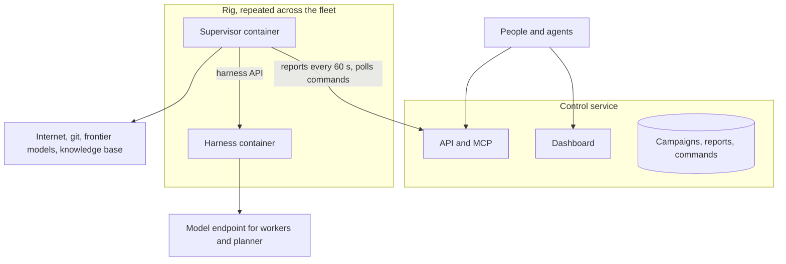

# Architecture

Thermite has three parts. A **rig** does the research, and a rig is two containers. A **control service** sees and steers every rig. **Target drivers** connect the judge to whatever is being measured.

## The rig

### Harness container

The harness does the research. It contains:

- **The ledger:** the authoritative record of campaigns, attempts, measurements, verdicts, champions, directives and budgets.
- **The judge:** gates, statistics, verdicts and promotion. Only the judge decides what counts.
- **Executors and target drivers:** they run official measurements on the rig's target, such as a GPU or a CPU set, with the clock owned by the executor.
- **The planner:** a stateless model call each epoch that assigns directions to lanes from a deterministic summary of the ledger.
- **Workers:** one fresh agent session per trial, each in its own workspace, proposing one change per trial.
  - A lane's commands have no time limit unless the contract sets one. What they start in the background runs on, as in a shell, until the trial ends.
  - Memory and disk limits cover everything a lane runs.
  - A development run on a device the judge shares is time-limited, so the judge gets the device back. Nothing a development run starts on the device outlives it.
- **A small privileged broker:** it starts, stops and isolates the other processes. Each lane's tools and shell commands, builds and candidate runs each run as separate users, and none of them can read the judge's files. A worker's agent session runs as its lane's own agent user, which can read none of the harness's state, kits, secrets or lane files. Its file and shell tools reach its workspace only through the harness API, with a token bound to its own trial that stops working when the trial ends; the harness runs them as the lane's user, in that trial's workspace only.

Network: DNS, the internet and its model endpoint. Nothing else in the network can reach the harness except its own supervisor.

### Supervisor container

The supervisor is the rig's link to everything outside:

- **Reporting.** Every 60 seconds it polls the harness and sends new results, champion changes, worker statistics and costs to control.
- **Commands.** It picks up control's signed commands and relays them to the harness.
- **Git and data.** It handles all git work: it pushes the harness's exports to the results repository, fetches the projects, kits and models an assignment names into the harness's inbox, and stages other rigs' published champions there for propagation. A kit written or uploaded on control's new-campaign page is fetched from control itself, with the rig's token. The harness verifies every commit and hash against a signed command before using anything.
- **Teaching.** Hourly, two frontier models review the rig's progress and research externally. A neutral combiner turns their reviews into structured directives for the planner.
- **Audits.** A fresh-context auditor reviews surprising results. An audit can hold a result back; it can never pass one.

## The control service

- **Dashboard.** It is written for a person deciding things, and follows Campaign ▸ Run ▸ Lane ▸ Trial ▸ Attempt:
  - **Overview:** what needs the owner, what each running run is doing now, and what happened lately, in words.
    - Each decision shows what is decided, the evidence and why it waits, then what each choice does: promotions to approve, audits, reviews, "not possible" proposals, keys to accept and resets to confirm. The evidence is the change, what the judge found and the declared flaws.
    - Each running run shows its judge's job, its planner's latest plan, each lane's direction and last action, its latest verdict and its champion.
  - **Campaigns:** each campaign with its runs on every rig. A campaign's page starts with a summary across its runs, plus a goals-by-run grid for goal campaigns. Below it, one tab per run shows that run alone, in four views:
    - an overview: its decisions, what it is doing now, its goals, the champion chart, what happened and its latest attempts;
    - all its attempts;
    - its history, in words;
    - its steering, where each control says what it does.
  - **Attempts:** each attempt has a page with the change, the judge's findings and its history.
  - **Rigs:** each rig's hardware, what its judge is doing, results export, advisors and signing key, and the runs it holds.
  - **Live:** each rig's agent sessions and judge as they work. The harness signs the lines its workers, planner and judge write, and the supervisor relays them every few seconds with its own lines, which are unsigned. The owner can message a worker's trial, a lane, the planner or the advisors from here, as a signed command. The judge is code and takes no messages.
- **API and MCP.** Every view is available to scripts and agents, with scoped tokens and an audit log.
  - An agent's token can steer: assign, pause, resume, redirect, reset workers, export, propagate.
  - An operator's token, which the owner gives an agent that runs campaigns for them, can do the same and also message the run's agents on the owner's behalf.
  - Only the owner's credential approves or declines a promotion, accepts a subjective goal or a "not possible" ending, or wipes a rig. Control signs who issued each command, and the harness checks it.
  - Control keeps only each token's SHA-256. The owner makes a token on their own machine and deploys control with its hash, so whoever runs control's machine holds nothing that signs in as the owner.
- **Commands.** Control signs every command it sends:
  - assign a campaign to a rig, with a starting point;
  - redirect it;
  - reset its workers;
  - pause or resume it;
  - propagate one rig's best result to another rig, where that rig's own judge re-measures it;
  - check a rig: its model route (one tool-calling request), its isolation selftest (which the harness also runs at every start), or a judge-only smoke campaign on its own target, each reported back as pass or fail;
  - export the rig's results to git.
- **Lifecycle.** Control can restart or fully reset a rig's containers, and the rig exports its results first.
- **Model providers.** The owner adds the agents' model providers on the dashboard's settings page: a name, the type (OpenAI-compatible or Anthropic), the base URL and the API key. Control lists each provider's models from the provider itself, and the owner chooses a model for each rig.
  - Control encrypts each key with a key of its own, kept outside its store, and never shows it again.
  - A rig receives a provider's key only when the owner gives it one of the provider's models. Its supervisor fetches it over its own authenticated channel and hands it to the harness, which keeps it readable by root alone.
  - The key is never in a command, an event, an export or a log. A worker gets it in its environment, which the lane's commands, running as another user, cannot read.
  - Control calls providers over HTTPS to list their models; it needs that much outbound access.
- **Worker harnesses.** Each rig's agents run in Pi (built in) or OpenCode v2, chosen with the model on the settings page.
  - Under OpenCode, a trial runs `opencode run` headless in the lane's workspace, as the lane's own user, with its own tools approved and under the lane's memory, disk and time limits. It has exactly the access the lane's commands have, and none of the judge's. Thermite's tools are the `thermite-trial` command (submit, dev runs, status), which calls the harness API with the trial's token.
  - OpenCode reaches the rig's provider through a proxy in the harness API, which takes the trial's token and adds the provider's key, so the key never reaches the lane. OpenCode's own models need no key.
  - OpenCode's permission rules are not treated as a boundary; the user it runs as is.
- **Reports are signed by the harness.** The supervisor relays them but cannot forge, replay or thin them out:
  - each report carries the harness's time and its latest event;
  - control takes a report only if it continues the stream it has, is newer than the last one, and comes from the rig's current ledger;
  - a rig's signing key is pinned at first contact, or held for the owner to accept by its fingerprint when control is configured to require that.
- **The command queue.** Commands expire, the owner can cancel one that is still pending, and one command that cannot be delivered never holds up the others.

**Rigs keep researching when control is down.** Reports and commands catch up when it returns.

## Where it runs

The same images run three ways:

- on **Kubernetes**, where each rig gets its device through the cluster's device allocation;
- under **docker-compose**;
- under **podman-compose**, for a single machine.

Rigs with GPUs and CPU-only rigs, for example for research campaigns, use the same two-container contract.

## Targets

The judge measures through **target drivers**. A driver identifies the device, checks that it is idle and healthy before timing, records its state with each result, and runs the work. It also opens and closes agents' development access, sanity-checks numbers against physical limits, and recovers after faults.

v1 ships drivers for CUDA GPUs and for CPUs. Others, such as serial-attached boards, use the same interface.

**Sharing a device is configurable.**

- **Shared mode** (one device per rig). The judge takes the device whenever it has work waiting, and agents use it for their own test runs the rest of the time.
- **Dedicated mode** (two devices per rig). The judge measures on one device, and agents' test runs use the other, so neither waits for the other. On a CUDA rig, `THERMITE_DEV_GPU_INDEX` names the agents' card, and `THERMITE_GPU_INDEX` the judge's.
  - Each card's device node belongs to its own group. A test run cannot open the judge's card, and a run being timed cannot open the agents' card, whatever environment either sets.
  - The judge reads only its own card's state.
  - A rig that cannot set this up neither times nor allows test runs. It never falls back to sharing while both cards are visible.
