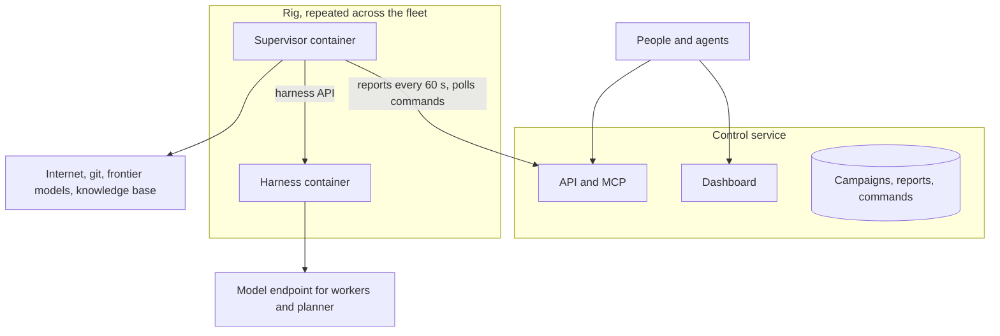

# Architecture

Thermite has three parts. A **rig** does the research, and a rig is two containers. A **control service** sees and steers every rig. **Target drivers** connect the judge to whatever is being measured.

## The rig

### Harness container

The harness does the research. It contains:

- **The ledger:** the authoritative record of campaigns, attempts, measurements, verdicts, champions, directives and budgets.
- **The judge:** gates, statistics, verdicts and promotion. Only the judge decides what counts.
- **Executors and target drivers:** they run official measurements on the rig's target, such as a GPU or a CPU set, with the clock owned by the executor.
- **The planner:** a stateless model call each epoch that assigns directions to lanes from a deterministic summary of the ledger.
- **Workers:** one fresh agent session per trial, each in its own workspace, proposing one change per trial.
  - A lane's commands have no time limit unless the contract sets one. What they start in the background runs on, as in a shell, until the trial ends.
  - Memory and disk limits cover everything a lane runs.
  - A development run on a device the judge shares is time-limited, so the judge gets the device back. Nothing a development run starts on the device outlives it.
- **A small privileged broker:** it starts, stops and isolates the other processes. Each lane's tools and shell commands, builds and candidate runs each run as separate users, and none of them can read the judge's files. A worker's agent session runs as its lane's own agent user, which can read none of the harness's state, kits, secrets or lane files. Its file and shell tools reach its workspace only through the harness API, with a token bound to its own trial that stops working when the trial ends; the harness runs them as the lane's user, in that trial's workspace only.

Network: DNS, the internet and its model endpoint. Nothing else in the network can reach the harness except its own supervisor.

### Supervisor container

The supervisor is the rig's link to everything outside:

- **Reporting.** Every 60 seconds it polls the harness and sends new results, champion changes, worker statistics and costs to control.
- **Commands.** It picks up control's signed commands and relays them to the harness.
- **Git and data.** It handles all git work: it pushes the harness's exports to the results repository, fetches the projects, kits and models an assignment names into the harness's inbox, and stages other rigs' published champions there for propagation. A kit written or uploaded on control's new-campaign page is fetched from control itself, with the rig's token. The harness verifies every commit and hash against a signed command before using anything.
- **Teaching.** Hourly, two frontier models review the rig's progress and research externally. A neutral combiner turns their reviews into structured directives for the planner.
- **Audits.** A fresh-context auditor reviews surprising results. An audit can hold a result back; it can never pass one.

## The control service

- **Dashboard.** It is written for a person deciding things, and follows Campaign ▸ Run ▸ Lane ▸ Trial ▸ Attempt:
  - **Overview:** what needs the owner, what each running run is doing now, and what happened lately, in words.
    - Each decision shows what is decided, the evidence and why it waits, then what each choice does: promotions to approve, audits, reviews, "not possible" proposals, keys to accept and resets to confirm. The evidence is the change, what the judge found and the declared flaws.
    - Each running run shows its judge's job, its planner's latest plan, each lane's direction and last action, its latest verdict and its champion.
  - **Campaigns:** each campaign with its runs on every rig. A campaign's page starts with a summary across its runs, plus a goals-by-run grid for goal campaigns. Below it, one tab per run shows that run alone, in four views:
    - an overview: its decisions, what it is doing now, its goals, the champion chart, what happened and its latest attempts;
    - all its attempts;
    - its history, in words;
    - its steering, where each control says what it does.
  - **Attempts:** each attempt has a page with the change, the judge's findings and its history.
  - **Rigs:** each rig's hardware, what its judge is doing, results export, advisors and signing key, and the runs it holds.
  - **Live:** each rig's agent sessions and judge as they work. The harness signs the lines its workers, planner and judge write, and the supervisor relays them every few seconds with its own lines, which are unsigned. The owner can message a worker's trial, a lane, the planner or the advisors from here, as a signed command. The judge is code and takes no messages.
- **API and MCP.** Every view is available to scripts and agents, with scoped tokens and an audit log.
  - An agent's token can steer: assign, pause, resume, redirect, reset workers, export, propagate.
  - An operator's token, which the owner gives an agent that runs campaigns for them, can do the same and also message the run's agents on the owner's behalf.
  - Only the owner's credential approves or declines a promotion, accepts a subjective goal or a "not possible" ending, or wipes a rig. Control signs who issued each command, and the harness checks it.
  - Control keeps only each token's SHA-256. The owner makes a token on their own machine and deploys control with its hash, so whoever runs control's machine holds nothing that signs in as the owner.
- **Commands.** Control signs every command it sends:
  - assign a campaign to a rig, with a starting point;
  - redirect it;
  - reset its workers;
  - pause or resume it;
  - propagate one rig's best result to another rig, where that rig's own judge re-measures it;
  - check a rig: its model route (one tool-calling request), its isolation selftest (which the harness also runs at every start), or a judge-only smoke campaign on its own target, each reported back as pass or fail;
  - export the rig's results to git.
- **Lifecycle.** Control can restart or fully reset a rig's containers, and the rig exports its results first.
- **Providers.** The owner adds the agents' model providers on the dashboard's Providers page (under Settings), in the same list as Git access for private repositories: a name, the type (OpenAI-compatible or Anthropic), the base URL and the API key. Control lists each provider's models from the provider itself, and the owner chooses a model for each rig.
  - Control encrypts each key with a key of its own, kept outside its store, and never shows it again.
  - A rig receives a provider's key only when the owner gives it one of the provider's models. Its supervisor fetches it over its own authenticated channel and hands it to the harness, which keeps it readable by root alone.
  - The key is never in a command, an event, an export or a log. A worker gets it in its environment, which the lane's commands, running as another user, cannot read.
  - Control calls providers over HTTPS to list their models; it needs that much outbound access.
- **Machines.** The same list holds machines control sets rigs up on, over SSH: an address, a user and a key (pasted, or made by control for the owner to add to the user's `authorized_keys`).
  - Control reads the machine's host key and the owner compares and trusts it once; every later connection must present that key, and a changed key is refused and shown.
  - Control connects with the OpenSSH client in its image, the key in a file that exists only for the call. Every command is one of Thermite's fixed scripts sent on standard input; nothing typed on the page is run as a command.
  - A read-only check reads the machine: system, GPUs, Podman, NVIDIA's container toolkit, systemd, sudo, and whether it reaches control.
  - What a rig needs and the machine lacks is installed only from a fixed list of recipes, each shown exactly as it would run, and only after the owner says yes to that install on that machine. The yes is recorded with who gave it, bound to that script, and used once.
- **Rigs on machines.** Rigs › Add a rig sets a rig up on a machine: the owner picks the machine, its GPUs (none, one shared by the judge and the agents, or two: the lower-numbered for the judge) and the rig's name.
  - Control enrolls the rig (a token of its own), then in one script over SSH writes the rig's files and Podman Quadlet units (the same two containers, capabilities, internal network and volumes as the compose rig, GPUs through NVIDIA's CDI), makes sure the images are there, and starts the services. Tokens travel inside the script on standard input, never on a command line; on the machine they sit in a directory only its user can open.
  - The rig runs as systemd services of the machine's user (rootless Podman, with lingering on), so it survives logouts and reboots, and reports to control by dialing out like any rig.
  - Every step is a setup event on the rig's page, and the page stops, starts, restarts and removes it. Removing it deletes its units, files and volumes on the machine and retires its token.
- **Edit rig.** A rig's page has an Edit page: switch the judge, the workers, the planner, the auditor, the teacher pair, the review panel and exports on or off; set how many workers run at once, a trial's length and turn limit, the workers' model and the promotion rule.
  - Control sends the changes as one signed owner command (`rig_settings`); an agent's token can't. The harness keeps the settings in its private state, applies them to its loops at once and reports them; the supervisor runs only the advisors that are both configured and on. A part switched off keeps its data. The supervisor is always on: it is the rig's link to control.
  - A paused or closed run's judge jobs wait in the queue, so the judge's time goes to running runs.
- **Rigs on clusters.** Providers also holds Kubernetes clusters: a kubeconfig (sealed), a context, and how rigs are placed: a namespace control creates for each rig, or slots the cluster's operators made for Thermite, with their own quotas and rules.
  - Control uses the kubectl in its image (a pinned release, checked by hash), with the kubeconfig in a file that exists only for the call. It runs fixed read commands, and applies only the manifests it renders itself.
  - A read-only check reads the version, the nodes and their GPUs (NVIDIA's device plugin), DRA device classes, storage classes, and whether control may create namespaces or deploy into each slot.
  - Rigs › Add a rig on a cluster chooses the GPUs (none, one, or two; through the device plugin or a DRA device class), the node, the storage and, for slots, a free slot. Control applies the rig's secret, volume, service and the harness and supervisor deployments (kept on one node to share the volume) and, in a namespace it created, network rules: the harness reaches DNS and the internet but not the cluster; only its supervisor reaches it.
  - The rig's page stops and starts it (scaling its deployments), restarts it, and removes it (its namespace, or its objects in the slot) and retires its token.
- **Rigs you join yourself.** Where control can't connect (a machine behind NAT, or a namespace whose operators give Thermite no kubeconfig), Add a rig shows a join command instead. It works once, for one hour, and control keeps only a hash of it.
  - On a machine, the command fetches a script from control (`/v1/join/<rig>/script`). The script checks for Podman, systemd, lingering and the GPUs' CDI devices before it writes anything. Then it writes the same files and Quadlet units as the SSH path and starts them.
  - In a namespace, the command pipes control's manifest into `kubectl apply`, with the operator's own rights. The manifest has the same objects and network rules as a namespace control creates, but no namespace object.
  - Control mints the rig's token when the command is used, so what the command fetches holds the only copy. A new join command gives the rig a new token when it is used.
  - Control can't reach the place afterwards. The rig's page shows the stop, start, restart and remove commands for the owner to run there. Retiring the rig ends its token.
- **GPU clouds.** Providers also holds RunPod accounts: an API key (sealed) that control uses with RunPod's REST API to read the GPU types with their list prices and stock, the data centers, the network volumes and the account's pods with what they cost per hour. Control only reads: it starts nothing there and spends nothing. A key that RunPod refuses is not kept.
- **Worker harnesses.** Each rig's agents run in Pi (built in) or OpenCode v2, chosen with the model on the settings page.
  - Under OpenCode, a trial runs `opencode run` headless in the lane's workspace, as the lane's own user, with its own tools approved and under the lane's memory, disk and time limits. It has exactly the access the lane's commands have, and none of the judge's. Thermite's tools are the `thermite-trial` command (submit, dev runs, status), which calls the harness API with the trial's token.
  - OpenCode reaches the rig's provider through a proxy in the harness API, which takes the trial's token and adds the provider's key, so the key never reaches the lane. OpenCode's own models need no key.
  - OpenCode's permission rules are not treated as a boundary; the user it runs as is.
- **Reports are signed by the harness.** The supervisor relays them but cannot forge, replay or thin them out:
  - each report carries the harness's time and its latest event;
  - control takes a report only if it continues the stream it has, is newer than the last one, and comes from the rig's current ledger;
  - a rig's signing key is pinned at first contact, or held for the owner to accept by its fingerprint when control is configured to require that.
- **The command queue.** Commands expire, the owner can cancel one that is still pending, and one command that cannot be delivered never holds up the others.

**Rigs keep researching when control is down.** Reports and commands catch up when it returns.

## Where it runs

The same images run three ways:

- on **Kubernetes**, where each rig gets its device through the cluster's device allocation;
- under **docker-compose**;
- under **podman-compose**, for a single machine.

Rigs with GPUs and CPU-only rigs, for example for research campaigns, use the same two-container contract.

## Targets

The judge measures through **target drivers**. A driver identifies the device, checks that it is idle and healthy before timing, records its state with each result, and runs the work. It also opens and closes agents' development access, sanity-checks numbers against physical limits, and recovers after faults.

v1 ships drivers for CUDA GPUs and for CPUs. Others, such as serial-attached boards, use the same interface.

**Sharing a device is configurable.**

- **Shared mode** (one device per rig). The judge takes the device whenever it has work waiting, and agents use it for their own test runs the rest of the time.
- **Dedicated mode** (two or more devices per rig). The judge measures on its devices, and agents' test runs use theirs, so neither waits for the other. On a CUDA rig, `THERMITE_GPU_INDEX` names the judge's cards and `THERMITE_DEV_GPU_INDEX` the agents' cards, each one card or a list (up to 8 of each).
  - Each card's device node belongs to its own group. A test run cannot open a judge card, and a run being timed cannot open any card but its own, whatever environment either sets.
  - Judge cards are a pool. Each has its own executor, its own timing user, its own CPU set (local to the card, disjoint from the others) and its own noise floor. Every comparison measures both arms on one card in one job, so cards are never compared with each other. A win screened on one card is confirmed on another. Builds run one at a time.
  - Agents' cards are a pool too. A test run takes any free card and waits only when all are busy; a lane has one test run at a time.
  - All judge cards of a rig are one model. A rig whose judge cards differ judges on the first only, and says so.
  - The isolation check probes every judge card's user and every agents' card: each reaches its own card and is refused the others.
  - A rig that cannot set this up neither times nor allows test runs. It never falls back to sharing while several cards are visible.
  - Where control sets a rig up, Add a rig takes any number of GPUs and asks how many are the judge's: by default half, rounded up, and on a machine the lowest-numbered.
