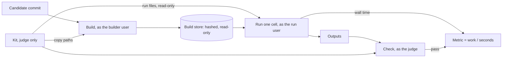

# Kits

A kit is the judge's half of a project. It says how to build a candidate, how to run it on each test case, how long the run took and whether its output is right. The project is what agents change; the kit is how Thermite decides whether a change counts. Every campaign that builds or measures code names a kit, pinned by commit. Agents never see it.

This page explains why kits exist and how the judge uses one. To write one, see [Write a kit](write-a-kit.md). For every field, see the [kit reference](kit-reference.md).

## Why the benchmark is not part of the project

The obvious design is to let a project carry its own benchmark and tests, and have agents run them. Thermite does not, because agents change the project. A benchmark the agents can edit is a benchmark they can win without improving anything:

- a timer that starts late or stops early;
- a "fast" kernel that quietly calls the reference implementation;
- a reference made trivial, so a wrong answer matches it;
- a number printed to the log that the loop believes.

The smoke kit in this repository keeps a test candidate for each of the first three, and the judge ignores printed numbers altogether. The rule that prevents them is the first design rule of Thermite: **agents propose; code judges.** The kit is that code. It lives in its own repository, the judge reads it from a directory agents cannot reach, and the only number that counts is one the judge measures itself.

Agents still build and test their own changes in their own workspaces, and the contract's notes can tell them how. Those development runs help them search, but they never count.

## What a kit holds

A kit is a directory with a manifest, `kit.json`, and whatever scripts the project needs, in any language. The manifest describes five things.

| Part | What it is |
| --- | --- |
| **Build** | A command that builds a candidate from its source tree, and the paths that make up the result |
| **Cells** | Named test cases, each a set of parameters such as a problem size, a seed or an input file |
| **Run** | A command that runs one build on one cell and writes its outputs |
| **Metrics** | Scores computed from the judge's own clock, for example operations per second |
| **Check** | A judge-side program that decides whether a run's outputs are correct |

Goal campaigns add **verifiers**: named sets of cells. A goal is met when every cell in its verifier passes the check. Verifiers can be **gated**: one runs only once the verifiers it requires have passed, so a candidate that fails a basic goal doesn't spend the judge's time on goals that depend on it.

## How the judge uses a kit

1. **Build.** The judge exports the candidate's commit into a fresh directory, copies in the kit paths that the build needs, and runs the kit's build command as the builder user. It hashes the outputs and moves them into a store that nothing else can write. The same commit and kit are built once and reused.
2. **Run.** For each cell, the run user executes the stored build with the cell's parameters. Before every run, the judge checks the build's hashes again and gives the run a fresh, read-only copy of the kit's run files, such as a driver script.
3. **Time.** The judge times the whole run process with its own clock. A metric is the cell's `work` value divided by that time. Nothing the run prints is a score.
4. **Check.** The judge runs the kit's check on the outputs, with its own copy of the parameters. If the check fails, the run is invalid, however fast it was.

A hill climb repeats this for the champion and the candidate, cell by cell, and compares them statistically. A goal campaign runs each goal's cells and records which goals are met.

## Where the trust boundaries are

The candidate controls more than its own source files. Its code runs during the run, and its build scripts run during the build. A project's CMake files, for example, can execute anything at configure time. So everything in the build directory and everything in the run's outputs is evidence to be checked, never instructions.

The kit directory, the check and the judge's copy of the parameters are outside the candidate's reach. That is where a kit's trust lives:

- **The check recomputes or compares.** It works from the parameters and from references kept in the kit, not from anything the run claims about itself.
- **Run files are the judge's, and references stay in the kit.** The run user cannot read the kit. The judge copies the files a run needs into each run, read-only, so neither the candidate's build nor its run can rewrite them. The run can read those copies, so they never include anything the check relies on.
- **The check confirms the candidate's code did the work.** The smoke kits link a probe that counts calls to the reference implementation, so a candidate that quietly calls it is caught.

## Cells, held-out cells and goals

The kit defines every cell. The contract chooses which cells count, and which of them are **held out**. Held-out cells run only when a result is confirmed, and their results go only to the code that decides promotion. Agents never see their names, their parameters or their outcomes, so a change tuned to the visible cells has to work on unseen ones too.

In a goal campaign, a goal's status comes from its visible cells, and its held-out cells gate promotion. A goal that should be held out needs at least one visible cell and one held-out cell in its verifier.

## Pinning and changing a kit

The contract names the kit's repository and commit. The kit reaches a rig as a git bundle inside a signed command, and the rig accepts it only if the commit, and the file's hash when given, match. So the kit that judged a result can always be identified, and a kit cannot change under a running campaign.

The cost is that a kit changes slowly. Any change is a new commit, so a new contract version, and every build is redone because the kit's commit is part of the build key. For a large project, that means a full rebuild for a one-line fix to a run script. This is why a kit is dry-run on the unmodified project before agents start: a mistake found then costs one rebuild, not a campaign.

## What a kit costs

A kit is real work, and it is the part of a campaign that is easiest to get wrong without noticing. Its failure modes are quiet:

- **A check that is too loose** lets wrong answers win.
- **A check that is too strict** rejects every honest improvement.
- **A run that fails for its own reasons**, such as a flag the project no longer accepts, makes every candidate look broken.
- **A run dominated by startup** buries the work being measured in noise, because the judge times the whole process.

Thermite cannot tell a bad kit from a bad candidate, so the kit has to be tested like code. Keep a set of known candidates with known verdicts, and read a dry run's report before trusting any result.

## Kits and targets

A kit measures on one kind of target: `cpu`, `cuda-gpu`, or another driver's type. A rig loads a kit only if the kit's target matches its driver. A project measured on two kinds of target has two kits.
